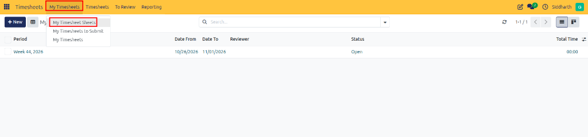
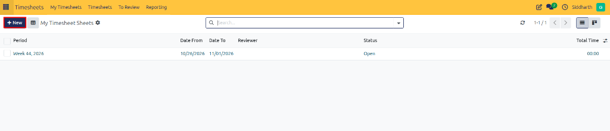
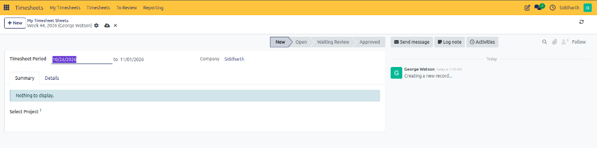
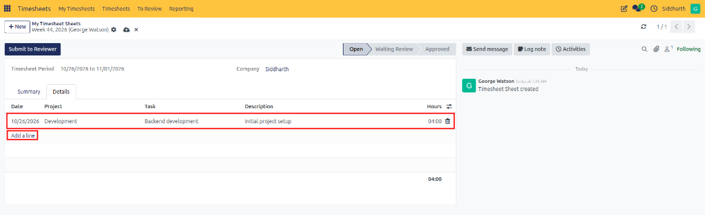
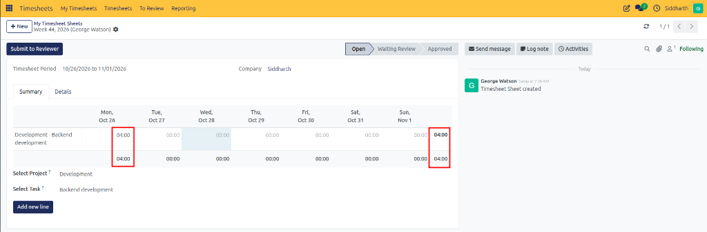
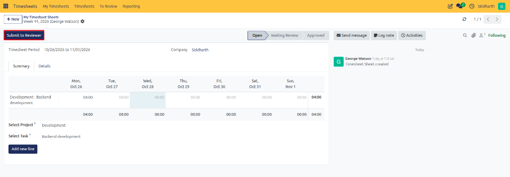

# Log Your First Timesheet and Submit for Approval

Welcome to CURQ Timesheets. The **Timesheets** application enables employees, contractors, and project managers to record working time, monitor project budget consumption, and streamline client service billing. By connecting time logs directly with tasks and customer sales orders, CURQ ensures accurate effort accounting without manual spreadsheet reconciliation.

In this tutorial, you will explore the personal timesheet workspace, create a weekly timesheet sheet, allocate hours across project deliverables, and submit your sheet for managerial review in 5 steps.

```{mermaid}
flowchart LR
    A["`**Daily Work**
    Select Project & Task`"] --> B["`**Timesheet Sheet**
    Weekly Matrix Grid`"]
    B --> C["`**Submit to Reviewer**
    Lock Entries`"]
    C --> D["`**Manager Validation**
    Approve & Bill Client`"]
```

> **Prerequisites**
> * Access to a standard CURQ instance with the **Timesheets** app installed (`hr_timesheet`).
> * An active employee profile associated with your user login.
> * At least one active project with tasks assigned to your user in **Project**.

---

## Open the My Timesheet Sheets Workspace

Access your personal periodic timesheet sheet manager:

1. Click the main application menu at the top left of CURQ and select **Timesheets**.
2. In the top navigation bar, click **My Timesheets** and select **My Timesheet Sheets**:

   

3. The **My Timesheet Sheets** list view opens, displaying all your historical and active periodic sheets along with their current review statuses *(Draft, Submitted, or Approved)*:

   

---

## Create a New Weekly Timesheet Sheet

Initialize a new timesheet container for the active reporting period:

1. In the top-left action bar, click **New**.
2. A blank timesheet sheet form opens in **New** status:

   

3. Verify the auto-populated header details:
   * **Timesheet Period**: Displays the automatically calculated date range for the active cycle *(e.g., `10/26/2026 to 11/01/2026`)*.
   * **Company**: Displays your assigned company entity *(e.g., `Siddharth`)*.
   * **Workflow Stage**: Visual indicator at the top right confirms the sheet is currently in `New` status.

---

## Add Project and Task Deliverable Lines

Record time spent on specific deliverables:

1. Click the **Details** tab on the sheet form.
2. In the bottom-left of the line table, click **Add a line**.
3. Select the target **Project** *(e.g., `Development`)*.
4. Select the specific deliverable in the **Task** dropdown *(e.g., `Backend development`)*.
5. Enter an operational summary in the **Description** field *(e.g., `Initial project setup`)*.
6. In the **Hours** column, enter the duration worked *(e.g., `04:00`)*:

   

7. The line is saved directly to your sheet and the status transitions to **Open**.

---

## Verify Hours in the Weekly Matrix Summary

Inspect your total daily hours and verify workload distribution:

1. Switch back to the **Summary** tab to view your recorded hours in the weekly matrix grid:

   

2. Review the daily columns *(Mon, Tue, Wed, Thu, Fri, Sat, Sun)* to verify recorded hours *(e.g., `04:00` on `Mon, Oct 26`)*.
3. Check the end-of-row and daily bottom totals to verify accumulated workload distribution *(e.g., `04:00` total)*.
4. If required, click any cell directly within the matrix grid to adjust or enter additional hours.

---

## Submit the Timesheet Sheet to Reviewer

Finalize your entries and lock the sheet for managerial review:

1. Confirm that all working hours for the period are accurately recorded across your tasks.
2. In the top-left control bar, click **Submit to Reviewer**:

   

3. The sheet status advances from **Draft** to **Submitted**:
   * The sheet is locked to prevent further accidental edits.
   * A notification activity is routed to your designated reviewer or HR Manager.
4. Once your manager approves the sheet, the status transitions to **Approved** and delivered quantities update on linked customer sales orders.

---

## Summary of Achievements

In this tutorial, you learned to:
* Navigate to the **My Timesheet Sheets** workspace.
* Create a periodic timesheet sheet for the active workweek.
* Allocate working hours across specific projects and tasks.
* Audit daily and weekly workload totals using the matrix summary grid.
* Submit timesheet sheets to authorized reviewers for formal validation.

---

## Related Documentation

* [Track Live Work Hours with the Timer](./02-track-live-work-hours-with-the-timer.md)
* [Create and Submit Timesheet Sheets](../task-guides/01-create-and-submit-timesheet-sheets.md)
* [Understanding Timesheet Architecture and Project Integration](../core-concepts/01-understanding-timesheet-architecture-and-project-integration.md)
