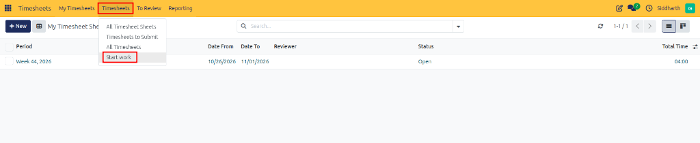
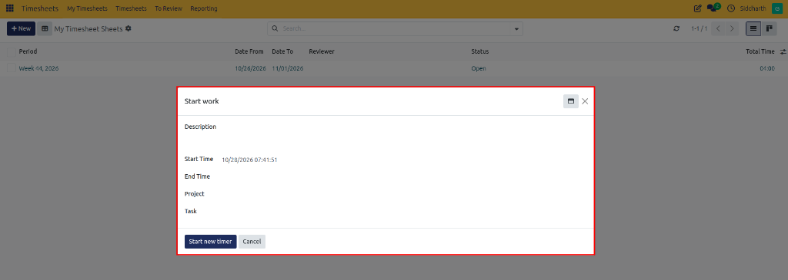
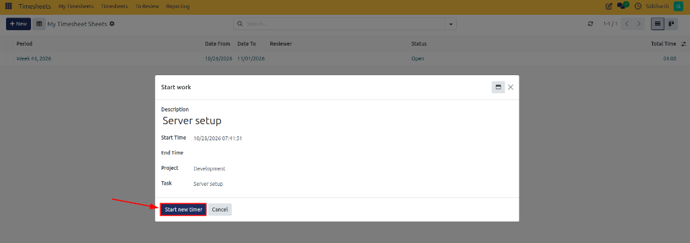
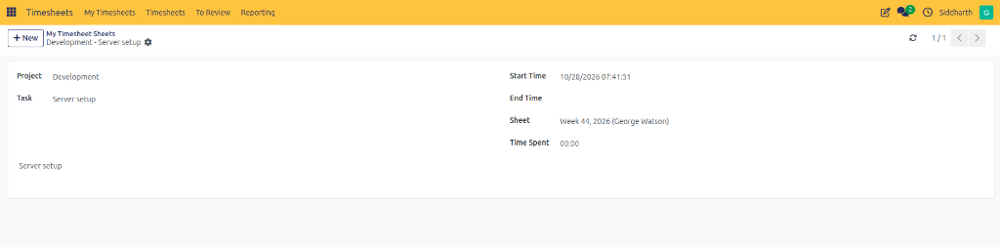
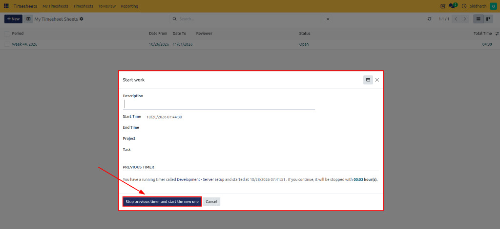

# Track Live Work Hours with the Timer

Capturing time as it happens eliminates end-of-week guesswork and ensures billable deliverables are recorded with minute-level precision. In CURQ Timesheets, the **Start Work** interactive timer allows employees to track time seamlessly while executing operational activities, seamlessly generating timesheet records upon completion.

In this tutorial, you will launch the live work timer, allocate real-time tracking to a deliverable, switch between concurrent tasks cleanly, and verify the resulting line entry.

```{mermaid}
flowchart LR
    A["`**Launch Timer**
    Open Start Work Dialog`"] --> B["`**Assign Task**
    Select Project & Activity`"]
    B --> C["`**Track Time**
    Real-Time Session`"]
    C --> D["`**Stop / Switch**
    Auto-Create Line Entry`"]
```

> **Prerequisites**
> * Access to CURQ with the **Timesheets** app installed.
> * An employee profile linked to your user account.
> * Assigned project deliverables ready for time tracking.

---

## Open the Start Work Dialog

Access the real-time tracking interface from anywhere within Timesheets:

1. Click the main application menu at the top left of CURQ and select **Timesheets**.
2. In the top navigation bar, click the **Timesheets** dropdown menu.
3. Select **Start work**:

   

4. The **Start work** modal dialog opens on your screen.

---

## Configure Activity and Task Details

Before engaging the clock, establish the task parameters for the tracking session:

1. Review the blank form presented in the **Start work** dialog:

   

2. Complete the required session fields:
   * **Project**: Select the target project *(e.g., `Development`)*.
   * **Task**: Select the specific deliverable *(e.g., `Server setup`)*.
   * **Description**: Provide an operational summary of the activity underway *(e.g., `Server setup`)*.
   * **Start Time**: CURQ automatically initializes this field with the current system timestamp.

---

## Start the Real-Time Work Timer

Initiate the active tracking session:

1. Verify your entered task parameters and locate the action button at the bottom of the modal:

   

2. Click **Start new timer**.
3. The tracking session begins:

   

   * A live timesheet entry displays the target project (`Development`), task deliverable (`Server setup`), associated weekly sheet (`Week 44, 2026`), and running duration.
   * You can freely navigate to other CURQ applications, log calls, or update deliverables while the timer runs continuously in the background.

---

## Switch Tasks and Handle Overlapping Timers

When transitioning from one deliverable to another during the workday:

1. Navigate back to **Timesheets** > **Start work**.
2. CURQ detects the active session and displays a **PREVIOUS TIMER** notification banner:

   

3. Review the running timer's details, including its accumulated duration *(e.g., `00:03 hour(s)` on `Development - Server setup`)*.
4. Enter your new deliverable's **Description**, **Project**, and **Task**.
5. Click **Stop previous timer and start the new one** (highlighted by the action arrow).
6. CURQ automatically concludes and saves the previous session before launching the new timer.

---

## Finalize the Timer and Review Generated Timesheet Line

Conclude your tracking session and verify that your hours are safely logged:

1. Stop the active timer upon completing your task deliverable.
2. The elapsed time is converted into a structured line entry.
3. Open **My Timesheets** from the top menu to view your newly generated timesheet entry.
4. Notice how the recorded hours automatically synchronize with your weekly **My Timesheet Sheets** matrix.

---

## Summary of Achievements

In this tutorial, you learned to:
* Access and launch the **Start work** live timer dialog.
* Associate running timers with specific project deliverables and work descriptions.
* Run background tracking while navigating across CURQ applications.
* Switch between tasks safely using the automatic session overlap safeguard.
* Convert live timer sessions directly into timesheet records and weekly sheet entries.

---

## Related Documentation

* [Log Your First Timesheet and Submit for Approval](./01-log-your-first-timesheet-and-submit-for-approval.md)
* [Track Active Sessions with the Work Timer](../task-guides/03-track-active-sessions-with-the-work-timer.md)
* [Manage Daily Timesheets and Line Entries](../task-guides/02-manage-daily-timesheets-and-line-entries.md)
