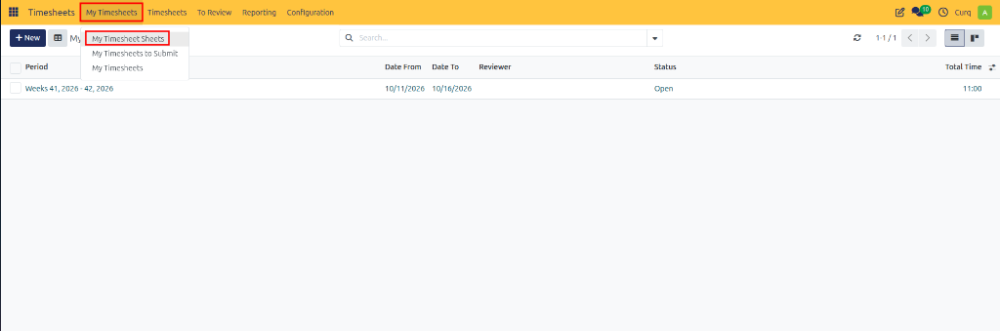
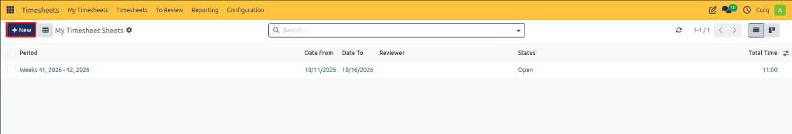
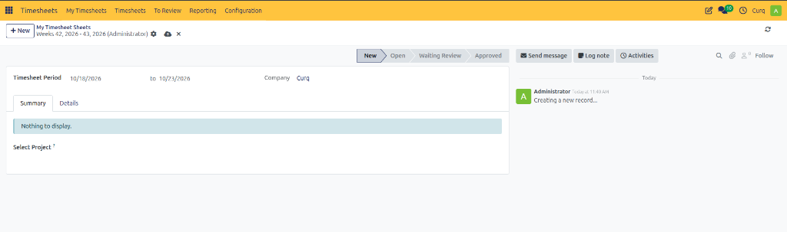
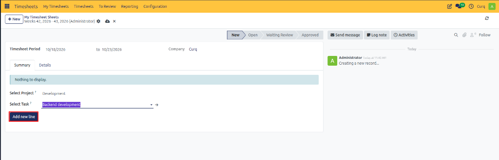
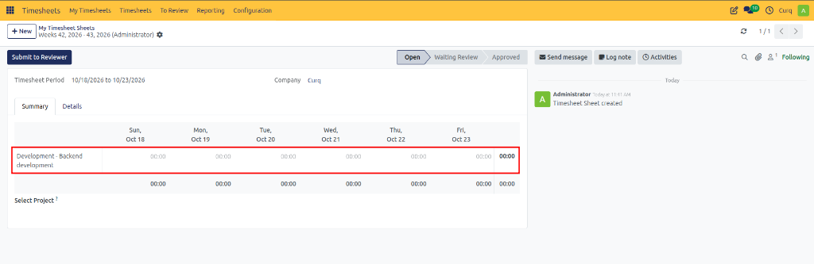
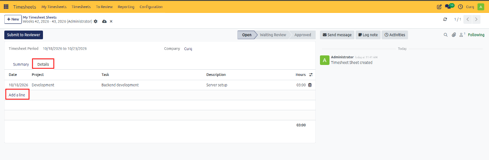
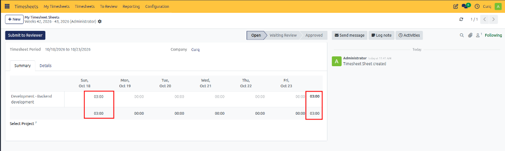

# Creating and Submitting Timesheet Sheets

Follow these steps to create a timesheet sheet, record working hours across projects and tasks, and submit the sheet for review in CURQ 18.

---

## 1. Opening My Timesheet Sheets

To access and manage your personal timesheet sheets:

1. Open the **Timesheets** application.
2. In the top navigation bar, click the **My Timesheets** menu and select **My Timesheet Sheets**.

3. Review the existing timesheet sheets listed in the view, including their reporting periods, reviewer assignments, current statuses *(such as `Open`)*, and total logged hours.
4. Click **+ New** in the top-left control panel to create a new timesheet sheet.

> [!TIP]
> To view and manage only the timesheet sheets that are awaiting submission, navigate to [My Timesheets to Submit](02-my-timesheets-to-submit.md). To view or add individual, unaggregated time entries in a flat list view, see [My Timesheets](03-my-timesheets.md).

---

## 2. Creating a New Timesheet Sheet

After clicking **+ New**, a blank timesheet sheet opens in the **New** stage:

* **Timesheet Period**: Calculated automatically based on your organization's configuration settings *(e.g., `10/18/2026 to 10/23/2026`)*.
* **Company**: Displays the active company associated with your user account.
* **Status Workflow**: The status bar in the upper-right tracks the progress through `New` → `Open` → `Waiting Review` → `Approved`.
* **Summary Tab**: Selected by default, displaying a placeholder banner until your first project line is added.

> [!NOTE]
> Review the automatically calculated period before logging your time. The range and start day *(such as Monday or Sunday)* reflect the system's global timesheet range settings.

---

## 3. Adding Project Lines to the Sheet

To allocate working hours to projects and tasks:

1. Under the **Summary** tab, click the **Select Project ?** field and choose the relevant project *(e.g., `Development`)*.
2. In the **Select Task ?** field that appears, select the specific task you worked on *(e.g., `Backend development`)*.
3. Click the **Add new line** button.

Selecting the correct project and task ensures that time entries are accurately tracked against the appropriate deliverables and billable accounts.

---

## 4. Recording Working Hours on the Summary Grid

Once you click **Add new line**, the timesheet sheet automatically transitions to the **Open** stage:

* A weekly date matrix grid is generated under the **Summary** tab with columns for each day in the timesheet period *(e.g., `Sun, Oct 18` through `Fri, Oct 23`)*.
* A row is created for the selected project and task combination *(e.g., `Development - Backend development`)*.
* Enter the duration worked *(in `HH:MM` format, such as `03:00`)* directly into the cell corresponding to the day the activity took place.
* The system dynamically calculates daily totals across the bottom row as well as overall total hours for the sheet.
* To log work for additional activities within the same period, use the **Select Project ?** field beneath the table and add more lines.

---

## 5. Logging Detailed Entries via the Details Tab

For more granular tracking or to record individual work descriptions:

1. Switch to the **Details** tab.
2. Click **Add a line** to log an individual timesheet entry.
3. Complete the details for the activity:

### Timesheet Line Field Definitions

| Field | Description |
| :--- | :--- |
| **Date** | The specific date on which the work was performed *(e.g., `10/18/2026`)*. |
| **Project** | The project associated with the recorded activity *(e.g., `Development`)*. |
| **Task** | The individual task worked on within the project *(e.g., `Backend development`)*. |
| **Description** | A brief explanation or note detailing the work completed *(e.g., `Server setup`)*. |
| **Hours** | The amount of time spent on the activity *(e.g., `03:00`)*. |

### Bidirectional Grid Synchronization

Entries recorded on the **Details** tab automatically synchronize with the **Summary** matrix:

* The recorded hours *(e.g., `03:00`)* are automatically populated under the corresponding date column *(such as `Sun, Oct 18`)* on the **Summary** tab.
* The row totals and overall sheet totals recalculate automatically.

---

## 6. Submitting the Timesheet for Review

Once you have completed and verified all logged hours for the period:

1. Review the totals on the **Summary** tab to ensure accuracy across all working days.
2. In the top action bar, click **Submit to Reviewer**.
3. The timesheet sheet transitions from **Open** to **Waiting Review**, routing the record to your designated reviewer or timesheets manager.

> [!TIP]
> Ensure all daily hours match your actual work schedule before submitting. Once submitted, editing may be restricted while the sheet is pending review.

---

## 7. Review and Approval Lifecycle

The timesheet review lifecycle follows three sequential stages:

1. **Employee Submission**: The employee records all hours for the period and submits the completed sheet.
2. **Reviewer Review**: The designated reviewer opens the submitted sheet, validates the logged hours, and checks project allocations.
3. **Approval or Rejection**:
   * **Approval**: The reviewer validates the sheet, transitioning its status to **Approved**. Hours are finalized for reporting, payroll, or customer invoicing.
   * **Rejection**: If corrections are required, the sheet is returned to the employee.