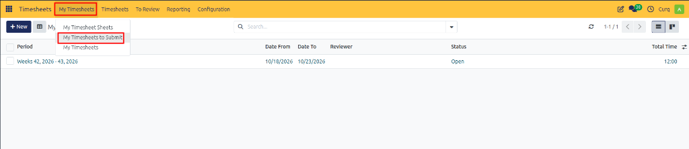
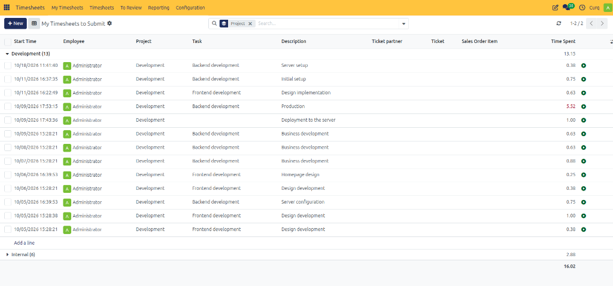

# My Timesheets to Submit

Track, inspect, and manage pending timesheet entries and sheets awaiting submission for review in CURQ 18.

---

## 1. Overview

The **My Timesheets to Submit** view serves as a dedicated operational workspace that displays only your unsubmitted timesheet records. It helps employees track all working hours that have not yet been submitted to a manager, preventing missed submission deadlines.

---

## 2. Opening My Timesheets to Submit

To access your pending timesheets:

1. Open the **Timesheets** application.
2. In the top navigation bar, click the **My Timesheets** menu.
3. Select **My Timesheets to Submit**.

---

## 3. Reviewing Unsubmitted Timesheet Records

Once opened, the view displays all recorded hours that have not yet been submitted for review:

### Key Display Features:

* **Grouped by Project**: Records are categorized by project *(such as `Development` or `Internal`)* with subtotals showing total unsubmitted hours per project.
* **Granular Entry Details**: Each row displays key activity parameters:
  * **Start Time**: The exact timestamp when the activity was logged.
  * **Employee**: The team member who recorded the time.
  * **Project & Task**: Deliverables to which the time is allocated *(e.g., `Backend development`)*.
  * **Description**: Detailed context for the work completed *(e.g., `Server setup`, `Initial setup`, `Production`)*.
  * **Ticket & Sales Order Item**: Associated support tickets or billable contract items.
  * **Time Spent**: The recorded duration for each activity *(e.g., `0.38` or `5.52` hours)*.
* **Inline Entry (`Add a line`)**: Add new timesheet entries directly within any project group.

---

## 4. Submission Lifecycle and Queue Rules

The **My Timesheets to Submit** queue operates according to strict status rules:

1. **Pending Submissions Only**:
   * Only timesheet records and sheets that have **not yet been submitted** to the reviewer are displayed here.

2. **Automatic Removal Upon Submission**:
   * Once you open your timesheet sheet and click **Submit to Reviewer**, the record transitions to `Waiting Review`.
   * It is **immediately removed from this view**, as it is now in the hands of the reviewer. You can continue monitoring its status in [My Timesheet Sheets](01-create-and-submit-timesheets.md).

3. **Reappearance Upon Rejection**:
   * If a reviewer rejects your submitted timesheet, the sheet **automatically reappears in My Timesheets to Submit**.
   * You can open the record, review the reviewer's feedback in the chatter, correct the necessary entries on the **Details** tab or **Summary** grid, and click **Submit to Reviewer** again.

> [!IMPORTANT]
> If a submitted timesheet is rejected by your manager, it returns to this queue automatically so that unapproved hours are never lost or left unaddressed.

---

## 5. Submitting a Timesheet Sheet

To submit your pending hours for managerial approval:

1. Open the relevant timesheet sheet from the list.
2. Review the recorded hours across the **Summary** grid and **Details** tab to verify that all task descriptions and durations are accurate.
3. In the top action bar, click **Submit to Reviewer**.

Once submitted, the sheet is routed to the designated reviewer and disappears from this view.

> [!TIP]
> For a full walkthrough on creating weekly matrix grids and logging working hours, see [Creating and Submitting Timesheet Sheets](01-create-and-submit-timesheets.md). To manage individual unaggregated line items, refer to [My Timesheets](03-my-timesheets.md).

---

## 6. Next Steps: Managerial Review and Approval

After submitting your sheet:

1. **Review**: The designated reviewer validates the recorded hours in [Timesheet Sheets to Review](06-timesheet-sheets-to-review.md).
2. **Approval**: Once approved, hours are locked for payroll, project reporting, and client invoicing.
3. **Rejection**: If corrections are required, the sheet returns to this view for revision.
