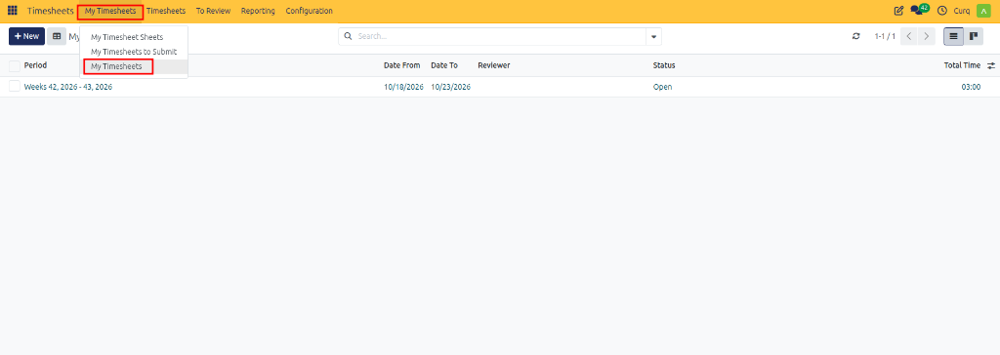
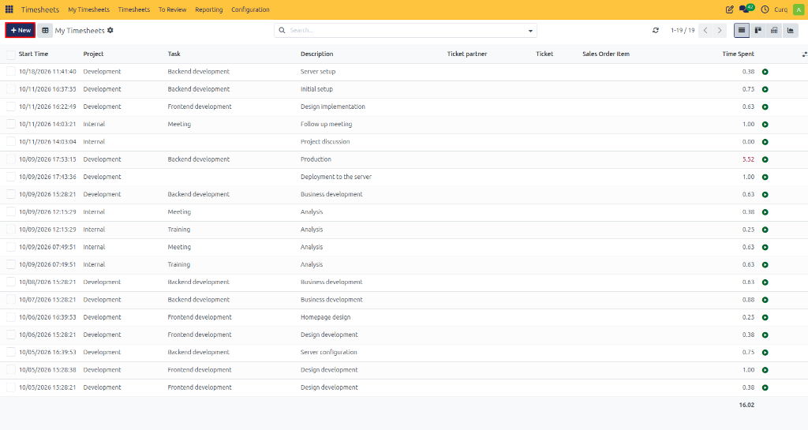
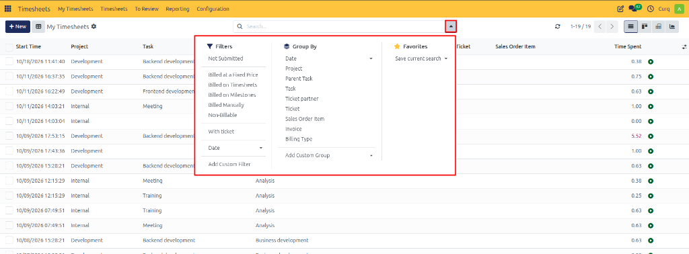

# My Timesheets

View, log, filter, and manage individual working hours and task-level timesheet entries in CURQ 18.

---

## 1. Overview

The **My Timesheets** view allows employees and contractors to record and inspect granular, entry-level working hours. Unlike higher-level timesheet sheets that aggregate entries into structured reporting periods *(such as weekly or monthly blocks)*, **My Timesheets** presents a detailed list of every individual time log created by the active user across dates, projects, and tasks.

From this view, employees can:
* Add individual timesheet entries quickly in a list format.
* Review historical work logs with associated task descriptions.
* Filter and group records to verify project hours and customer billable allocations.

---

## 2. Opening My Timesheets

To access your individual timesheet records:

1. Open the **Timesheets** application.
2. In the top navigation bar, click the **My Timesheets** menu.
3. Select **My Timesheets**.

The view opens displaying a chronological table of all your logged hours, detailing the start time, project, task, description, ticket partner, ticket, sales order item, and time spent.

---

## 3. Creating an Individual Timesheet Entry

To record a new time entry directly in the list view:

1. In the top-left control panel, click **+ New**.

2. A new editable row is created at the top of the table.
3. Enter the required details for the entry.
4. Click outside the row to save the entry inline.

### Timesheet Entry Field Definitions

| Field | Description |
| :--- | :--- |
| **Start Time** | The timestamp on which the work took place. Defaults to the current date and time. |
| **Project** | The project to which the logged time is allocated. |
| **Task** | The specific deliverable or milestone task within the chosen project. |
| **Description** | A brief explanation providing context for the completed work. |
| **Ticket partner** | The customer or partner contact associated with the support ticket *(if applicable)*. |
| **Ticket** | The linked helpdesk ticket *(where timesheet-on-ticket integration is used)*. |
| **Sales Order Item** | The customer contract line associated with billable hours, if applicable. |
| **Time Spent** | The total duration dedicated to the task *(e.g., in decimal hours)*. |

> [!TIP]
> Rather than estimating and recording completed durations manually, you can track hours live in real time as work happens using the live timer. See [Starting and Managing a Work Timer](05-start-and-manage-work-timer.md).

---

## 4. Filtering, Searching, and Grouping Entries

The control panel search bar provides comprehensive search, filter, and grouping tools to help you inspect and organize your recorded time:

1. Click the dropdown arrow on the right side of the search bar to expand the search panel.

### Search Options

* **Free-Text Search**: Type into the search bar to find records by project title, task name, description keywords, or ticket references.

### Predefined Filters

Select one or more filters from the **Filters** menu:

* **Not Submitted**: Shows entries that have not yet been submitted as part of a review sheet.
* **Billing Classification Filters**: Filter records by commercial type, including **Billed at a Fixed Price**, **Billed on Timesheets**, **Billed on Milestones**, **Billed Manually**, or **Non-Billable**.
* **With ticket**: Isolate entries tied to helpdesk customer support tickets.
* **Date**: Filter by specific year, quarter, or month periods.
* **Add Custom Filter**: Define custom filtering conditions based on any timesheet record field.

### Group By Dimensions

Group your entries dynamically to display subtotaled hours across different dimensions:

* **Date**: Group records by day, week, month, quarter, or year.
* **Project**: Consolidate entries under project headers to view total hours per project.
* **Task / Parent Task**: Group by individual milestone task or parent task deliverable.
* **Billing Type**: Summarize hours by commercial billing classification.
* **Sales Order Item / Invoice**: Group time logs by linked sales order lines or billing documents.
* **Add Custom Group**: Add multi-level grouping hierarchies.