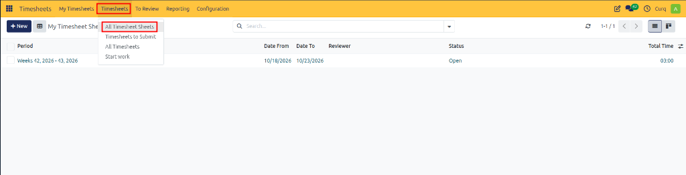
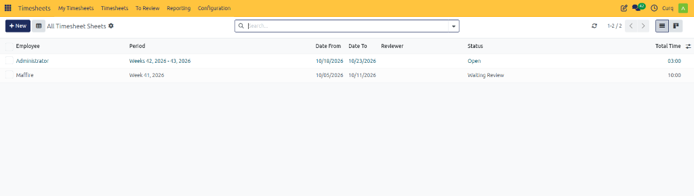
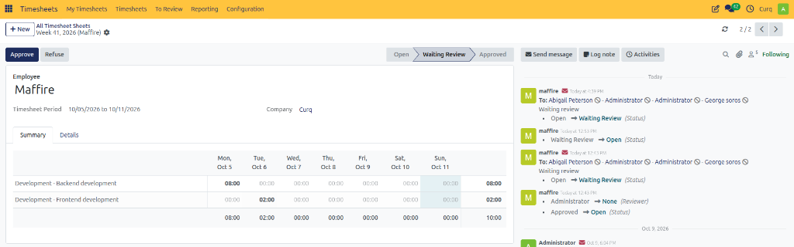
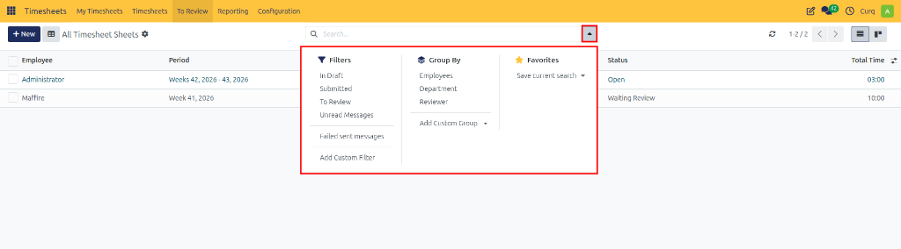

# All Timesheet Sheets

Monitor, inspect, filter, and track employee timesheet sheets across departments and project teams in CURQ 18.

---

## 1. Overview

The **All Timesheet Sheets** section provides authorized managers, project leaders, and administrators with a centralized control dashboard to monitor timesheet sheets submitted across the organization.

While individual employees manage their personal records through the **My Timesheets** menu, **All Timesheet Sheets** aggregates timesheet sheets across multiple team members. This allows management to track submission compliance, identify overdue submissions, audit logged hours across projects, and oversee the entire timesheet review pipeline.

---

## 2. Opening All Timesheet Sheets

To access organization-wide timesheet sheets:

1. Open the **Timesheets** application.
2. In the top navigation bar, click the **Timesheets** menu.
3. Select **All Timesheet Sheets**.

The page displays all timesheet sheets accessible under your user role and security permissions.

> [!NOTE]
> The second **Timesheets** menu in the top navigation bar is dedicated to managerial and administrative oversight. If you do not see this menu, verify your timesheet user group access rights with your system administrator.

---

## 3. Reviewing Employee Timesheet Sheets

The list view displays essential tracking information for each employee timesheet sheet:

### Timesheet Sheet Column Definitions

| Column | Description |
| :--- | :--- |
| **Employee** | The team member or contractor who recorded the working hours. |
| **Period** | The reporting cycle range *(e.g., `Weeks 42, 2026 - 43, 2026`)*. |
| **Date From** | The beginning date of the timesheet sheet period. |
| **Date To** | The closing date of the timesheet sheet period. |
| **Reviewer** | The designated manager or approver assigned to validate the timesheet. |
| **Status** | The current workflow stage *(such as `Open` or `Waiting Review`)*. |
| **Total Time** | Cumulative working hours recorded across all activities in the sheet *(e.g., `10:00`)*. |

Clicking on any row opens the detailed timesheet sheet form view, where you can inspect:
* **Summary Grid**: The daily distribution of hours categorized by project and task across each day of the period.
* **Details Tab**: Line-by-line activity logs, including work descriptions, task timestamps, and linked sales order items.

---

## 4. Filtering, Searching, and Grouping Timesheet Sheets

Managers can utilize the control panel search and filter bar to isolate specific sheets and assess team submission progress:

1. Click the dropdown arrow on the right side of the search bar to expand the search panel.

### Predefined Filters

Select one or more filters from the **Filters** menu:

* **In Draft**: Identifies employee sheets that are currently in progress but have not yet been submitted.
* **Submitted**: Displays sheets that have been submitted by employees.
* **To Review**: Filters timesheet sheets currently awaiting manager review and approval.
* **Unread Messages**: Displays sheets containing unread chatter messages or notifications.
* **Failed sent messages**: Highlights records where notification emails failed to send.
* **Add Custom Filter**: Configure personalized multi-field search conditions.

### Group By Dimensions

Group records dynamically to analyze workload distribution:

* **Employees**: Groups all timesheet sheets under employee headers to track submissions by team member.
* **Department**: Segments timesheet sheets by organizational department.
* **Reviewer**: Groups records by assigned validating manager.
* **Add Custom Group**: Create customized multi-level grouping criteria.

> [!TIP]
> Filter by **To Review** or group by **Employees** to quickly identify which team members have pending sheets requiring your approval.
