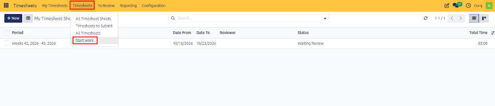
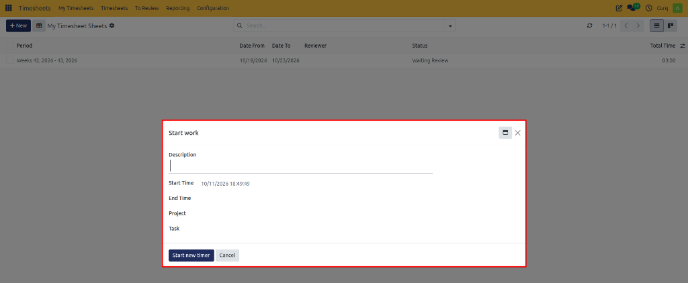
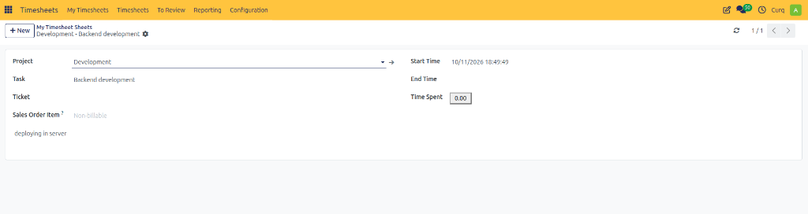
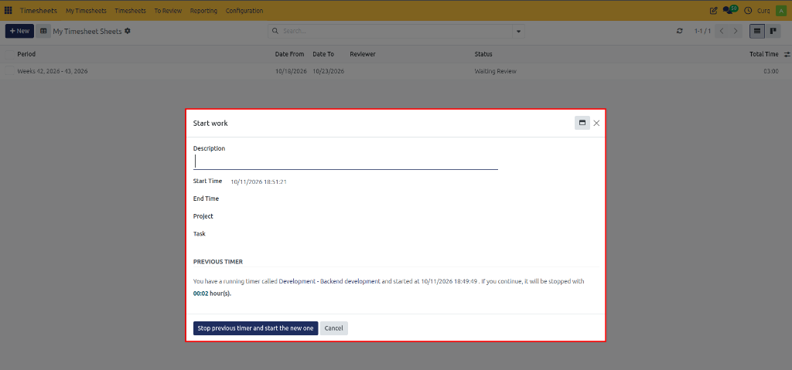

# Starting and Managing a Work Timer

Track real-time working hours on active tasks and projects using the live work timer in CURQ 18.

---

## 1. Overview

The **Start Work** feature in CURQ 18 provides employees with an interactive, real-time timer to track time spent on specific projects and deliverables. Rather than manually estimating durations at the end of the day or week, employees can start a timer when commencing an activity, capture granular work descriptions, and stop the timer when the task is complete.

Once stopped, the recorded duration is automatically converted into a timesheet entry linked to the appropriate project, task, and reporting period.

---

## 2. Opening the Start Work Dialog

To begin tracking work in real time:

1. Open the **Timesheets** application.
2. In the top navigation bar, click the **Timesheets** menu.
3. Select **Start work**.

4. The **Start work** dialog window opens.

---

## 3. Entering Work Details

Before launching the timer, configure the activity details in the dialog:

1. Complete the required work details

### Start Work Field Definitions

| Field | Description |
| :--- | :--- |
| **Description** | A concise explanation of the work being performed during the active session. |
| **Start Time** | The exact timestamp when the timer begins tracking. Set automatically. |
| **End Time** | The timestamp recorded when the timer is concluded. |
| **Project** | The project to which the logged time will be allocated. |
| **Task** | The specific milestone or deliverable within the selected project. |

> [!NOTE]
> Selecting the appropriate project first automatically filters the **Task** dropdown to show only tasks assigned to that project, ensuring that recorded time is accounted for accurately.

---

## 4. Starting and Managing the Timer

To activate and manage the live tracking session:

1. After entering your task details, click **Start new timer**.

2. The timer begins recording elapsed time for the selected activity:
   * A timesheet entry record is opened displaying the project, task, description, start time, and running time spent.
   * You can continue navigating through other CURQ applications while the timer runs in the background.

---

## 5. Switching Tasks and Stopping Previous Timers

CURQ 18 prevents overlapping timers by detecting if a tracking session is already in progress:

1. If you launch **Start work** while another timer is currently active, the dialog displays a **PREVIOUS TIMER** notification.

2. The alert indicates the name of the currently running timer, its start timestamp, and the calculated duration *(e.g., `00:02 hour(s)`)*.
3. To switch activities, enter your new task details and click **Stop previous timer and start the new one**.
4. The system automatically finalizes and saves the previous timer's elapsed hours before starting the new tracking session.

---

## 6. Automatic Timesheet Line Generation

When a timer session is stopped, CURQ 18 automatically processes the recorded duration:

* A completed timesheet entry is saved with the recorded start time, project, task, description, and total hours spent.
* The newly generated line is immediately visible in [My Timesheets](03-my-timesheets.md).
* The recorded hours automatically roll up into your periodic [My Timesheet Sheets](01-create-and-submit-timesheets.md) summary grid and [My Timesheets to Submit](02-my-timesheets-to-submit.md) queue.
