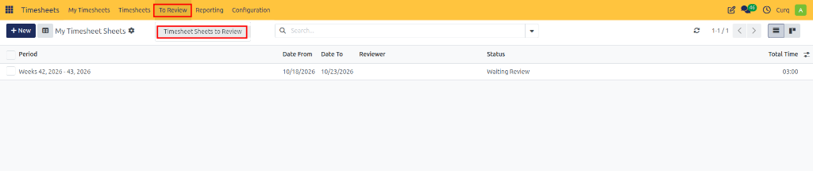
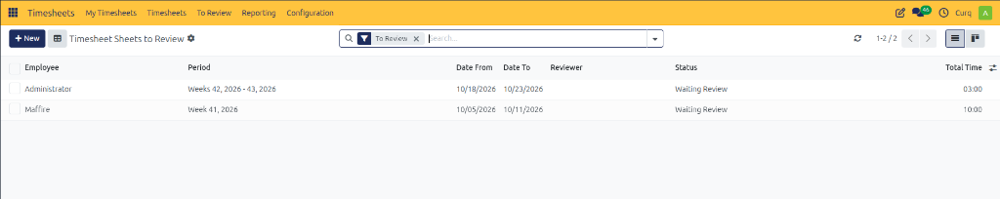
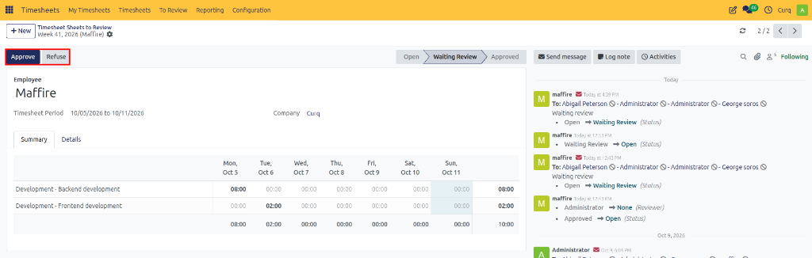

# Timesheet Sheets to Review

Review, validate, approve, or reject employee timesheet sheets submitted for review in CURQ 18.

---

## 1. Overview

The **Timesheet Sheets to Review** section provides designated reviewers, department managers, and HR officers with an operational queue to inspect and validate submitted timesheet sheets.

When employees submit their weekly or monthly timesheet sheets, the records transition to the `Waiting Review` stage and are routed directly to this queue according to your organization's configured review policy. Timely validation ensures that working hours are accurately captured for payroll processing, project cost tracking, and automated client invoicing.

---

## 2. Opening Timesheet Sheets to Review

To access timesheet sheets awaiting your review:

1. Open the **Timesheets** application.
2. In the top navigation bar, click the **To Review** menu.
3. Select **Timesheet Sheets to Review**.

The list view displays all submitted employee timesheet sheets currently in `Waiting Review` status with the pre-applied **To Review** filter.

> [!NOTE]
> Review authority is governed by the configured review policy in settings *(such as Timesheet Sheet Manager, HR Officer, or HR Manager)*. Reviewers only see sheets assigned to their jurisdiction or team direct reports.

---

## 3. Inspecting and Auditing a Timesheet Sheet

Before approving or rejecting a timesheet sheet, thoroughly examine the recorded entries:

1. Click on a timesheet sheet from the list to open its form view.

2. Review the **Summary** tab:
   * Inspect the weekly matrix grid to verify the daily distribution of logged hours across all days of the period.
   * Verify that daily totals align with expected work schedules *(e.g., standard 8-hour days)* and note any excessive overtime.
   * Ensure that total hours recorded for the entire period match organizational requirements *(such as a 40:00 hour weekly total)*.
3. Switch to the **Details** tab:
   * Inspect individual work descriptions to ensure they provide adequate context for the completed tasks.
   * Confirm that each activity is allocated to the appropriate project and task deliverable.
   * Verify that billable client work includes the correct sales order item for customer invoicing.

---

## 4. Approving a Timesheet Sheet

If all recorded hours, projects, tasks, and descriptions are complete and accurate:

1. In the top-left action bar, click **Approve**.
2. The timesheet sheet transitions from **Waiting Review** to **Approved**.

### System Outcomes Upon Approval

* **Record Locking**: Approved timesheet entries are locked against employee modifications to preserve payroll and accounting integrity.

---

## 5. Refusing / Rejecting a Timesheet Sheet

If the sheet contains errors, misallocated tasks, missing descriptions, or incorrect hour durations:

1. In the top-left action bar, click **Refuse**.

### System Outcomes Upon Rejection

* **Status Reset**: The sheet resets from `Waiting Review` back to `Open` *(or Draft)*.
* **Employee Re-submission Queue**: The sheet reappears in the employee's **My Timesheets to Submit** view so they can make the requested corrections on the **Details** tab or **Summary** grid and resubmit.
