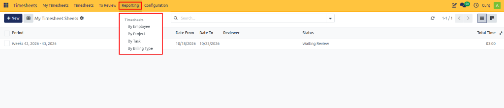
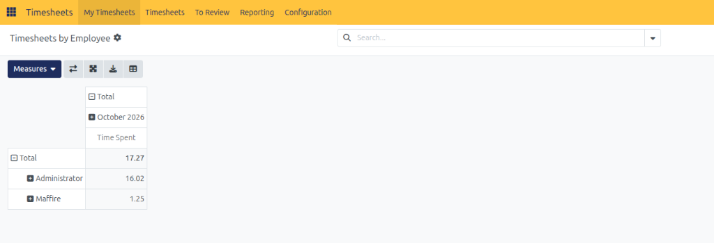
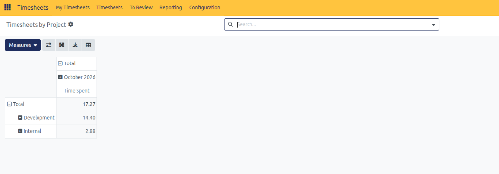
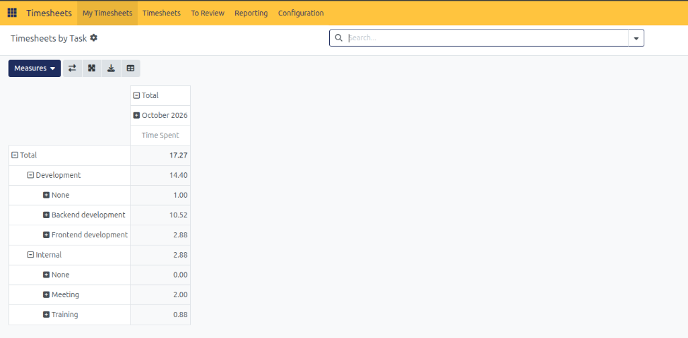
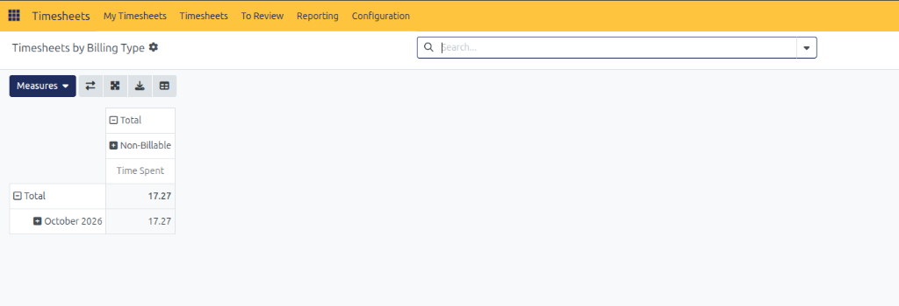
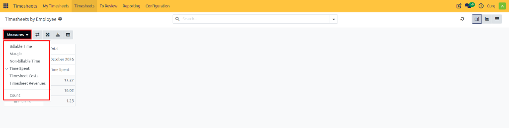
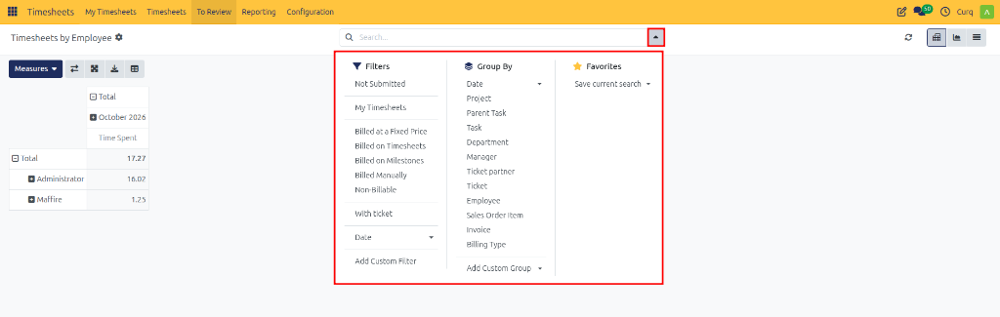

# Analyzing Timesheet Reports

Analyze employee working hours, track project effort, evaluate task distribution, and review billable allocations using CURQ 18 Timesheet Reports.

---

## 1. Overview

The **Reporting** section in CURQ 18 provides managers, operations directors, and project leads with high-level and granular analytical views of all recorded timesheet data.

By aggregating logged working hours across employees, projects, tasks, and commercial billing types, timesheet reports allow businesses to evaluate team utilization, ensure projects remain within budget, identify operational bottlenecks, and verify billable hours prior to invoicing.

---

## 2. Opening Timesheet Reports

To access timesheet reporting analytics:

1. Open the **Timesheets** application.
2. In the top navigation bar, click the **Reporting** menu.
3. Select the analysis view you wish to inspect:
   * **By Employee**
   * **By Project**
   * **By Task**
   * **By Billing Type**

---

## 3. Dedicated Reporting Views

CURQ 18 provides four targeted reports designed for distinct operational and financial auditing requirements:

### Timesheets by Employee

The **Timesheets by Employee** report aggregates recorded working hours grouped by team member:

### Timesheets by Project

The **Timesheets by Project** report summarizes cumulative time investments across client and internal projects:

### Timesheets by Task

The **Timesheets by Task** report provides an in-depth operational breakdown by individual task deliverables:

### Timesheets by Billing Type

The **Timesheets by Billing Type** report categorizes logged time by commercial billing status *(such as **Billable** and **Non-Billable**)*:

---

## 4. Selecting Measures

The **Measures** menu at the top left of each report controls the quantitative metric displayed in the analysis:

1. Click the **Measures** button in the top control panel.

2. Select your desired metric:
   * **Billable Time**: Cumulative hours billable to customers.
   * **Margin**: Profitability variance between revenue and timesheet costs.
   * **Non-billable Time**: Hours logged on internal or overhead activities.
   * **Time Spent**: Summarizes total cumulative logged hours *(selected by default)*.
   * **Timesheet Costs**: Monetary cost incurred based on employee cost rates.
   * **Timesheet Revenues**: Monetary revenue generated from billable timesheets.
   * **Count**: Total count of individual timesheet log records.

> [!NOTE]
> The displayed measure dynamically updates all chart visuals, pivot tables, and grouped rows.

---

## 5. Grouping, Expanding, and Collapsing Data

Reporting views present timesheet data in structured hierarchical trees or pivot tables:

1. Open the desired report.
2. Click the **+** (plus) icon next to any row header to expand its child dimensions *(for example, expanding a Project row to reveal its underlying Tasks)*.
3. Click the **−** (minus) icon to collapse the group and return to the aggregated subtotal.
4. Use the **Group By** menu in the search bar to apply multi-level grouping hierarchies *(such as Group by Employee, then by Project)*.

---

## 6. Searching and Filtering Report Data

Narrow down large timesheet datasets using the control panel search bar:

1. Click the dropdown arrow on the right side of the search bar to expand the search panel.

### Predefined Filters

Select one or more filters from the **Filters** menu:

* **Not Submitted**: Shows entries from sheets that have not yet been submitted.
* **My Timesheets**: Limits reporting data strictly to your personal time logs.
* **Billing Classification Filters**: Filter records by commercial type, including **Billed at a Fixed Price**, **Billed on Timesheets**, **Billed on Milestones**, **Billed Manually**, or **Non-Billable**.
* **With ticket**: Isolate entries tied to helpdesk customer support tickets.
* **Date**: Filter by specific year, quarter, or month periods.
* **Add Custom Filter**: Configure personalized multi-field search conditions.

### Group By Dimensions

Apply grouping dimensions dynamically to analyze workload and project allocations:

* **Date**: Group records chronologically across days, weeks, months, quarters, or years.
* **Project**: Consolidate entries under client and internal project headers.
* **Parent Task / Task**: Group by parent deliverable or individual milestone task.
* **Department**: Segments timesheet logs by organizational department.
* **Manager**: Group time records by employee direct supervisor.
* **Ticket partner / Ticket**: Group by customer partner or support ticket.
* **Employee**: Cluster timesheet data by individual team member.
* **Sales Order Item / Invoice**: Group by linked sales order line or billing invoice.
* **Billing Type**: Summarize effort across commercial billing classifications.
* **Add Custom Group**: Create multi-tier nested grouping hierarchies.

---

## 7. Exporting Report Data

Export summarized or itemized timesheet data for payroll processing, board presentations, or external accounting:

1. Open the desired report view.
2. Apply the necessary filters, date ranges, and grouping levels.
3. In the control panel toolbar, click the **Download** (Export) icon.
4. The system generates and downloads an `.xlsx` or `.csv` spreadsheet containing the exact report hierarchy displayed on screen.
