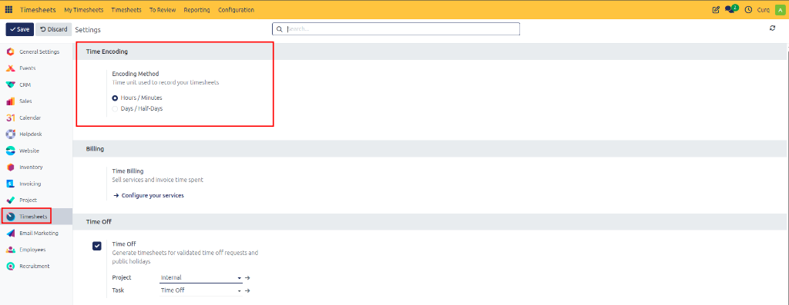
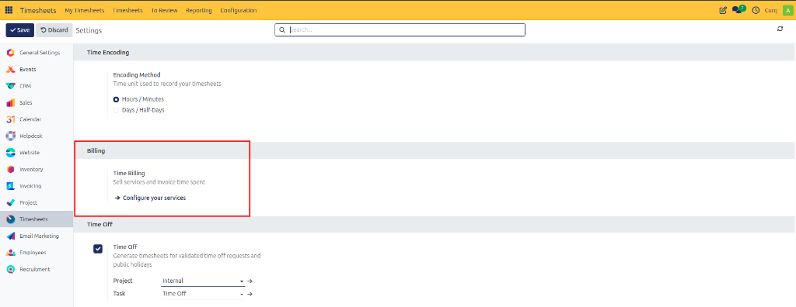
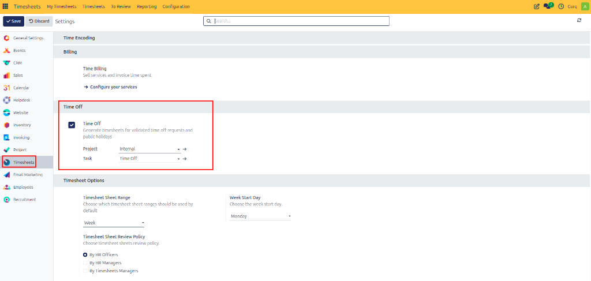
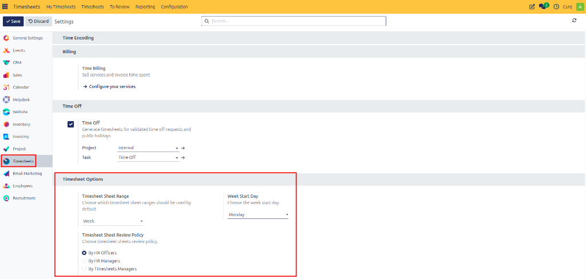

# Configuring Timesheets Settings

Configure time encoding units, service billing options, time-off integration, and timesheet review policies in CURQ 18.

---

## 1. Opening Timesheets Settings

To configure timesheet recording and review rules:

1. Open the **Timesheets** application.
2. In the top navigation bar, click **Configuration**.

3. Review the available configuration sections.
4. Update the required settings.
5. Click **Save** to apply the changes.

---

## 2. Time Encoding

The **Time Encoding** section determines the unit employees use to record their working time.

### Encoding Method

Choose the time unit used to record timesheets:

* **Hours / Minutes**: Record working time in hours and minutes. This option is suitable for businesses that track time spent on individual tasks or bill customers by the hour.
* **Days / Half-Days**: Record working time in full days or half-days. This option is useful for businesses that track work using daily or half-day units.

Choose the method that best matches your organization's time-tracking requirements.

---

## 3. Billing

The **Billing** section provides access to service configuration for selling services and invoicing the time spent on customer work.

### Time Billing

The **Time Billing** feature supports selling services and invoicing customers based on recorded time.

1. Click **Configure Your Services** to access service configuration.
2. Ensure that relevant service products and their invoicing policies are configured appropriately to use time-based billing.

*Example*: A consulting company records hours spent on a customer project and uses the corresponding timesheet entries to calculate the billable service quantity.

---

## 4. Time Off Integration

The **Time Off** setting allows CURQ to generate timesheet entries for validated time-off requests and public holidays automatically.

### Enabling Time Off

1. Navigate to **Configuration → Settings**.
2. Locate the **Time Off** section.
3. Enable the **Time Off** checkbox.
4. Once enabled, configure the following fields:
   * **Project**: Select the project where time-off entries will be recorded *(default: `Internal`)*.
   * **Task**: Select the task associated with time-off entries *(default: `Time Off`)*.

When an applicable time-off request is approved, CURQ records the corresponding time against the configured project and task. The available behavior depends on the time-off type and its approval requirements.

This feature helps maintain accurate time records without requiring employees to enter approved leave manually.

---

## 5. Timesheet Options and Review Policy

The **Timesheet Options** section controls the default timesheet sheet period, the beginning of the workweek, and the review approval policy.

### Timesheet Sheet Range

Choose the default period covered by a timesheet sheet:

* **Week**: Groups recorded time into weekly sheets for review. Select the range that matches your organization's review and reporting practices.

### Week Start Day

Choose the day on which the weekly timesheet period begins *(for example, selecting `Monday` makes Monday the first day of the weekly period)*. Choose the day that matches your organization's working calendar.

### Timesheet Sheet Review Policy

Choose who is responsible for reviewing timesheet sheets:

* **By HR Officers**: Assigns timesheet sheet reviews to HR officers.
* **By HR Managers**: Assigns reviews to HR managers.
* **By Timesheets Managers**: Assigns reviews to users responsible for timesheet management.

Select the policy that matches your organization's approval structure and responsibilities.

---

## 6. Saving Settings

Once all configuration options are reviewed:

1. Verify the selected encoding methods, time-off projects, and review policies.
2. Click **Save** at the top of the page.

CURQ applies the updated settings across all relevant time-tracking features and employee workflows.
