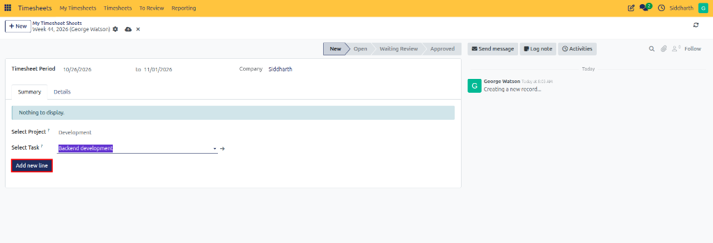

# Create and Submit Timesheet Sheets

This guide covers how to create a periodic timesheet sheet, record working hours across projects and tasks using the matrix summary grid and details log, and submit the sheet for managerial review.

---

### Task 1: Open My Timesheet Sheets

Access your personal periodic timesheet sheet workspace:

1. Open the **Timesheets** application from the main CURQ menu.
2. In the top navigation bar, click the **My Timesheets** menu and select **My Timesheet Sheets**:

   

3. Review the existing timesheet sheets listed in the view, including their reporting periods, assigned reviewers, current statuses *(such as `Open` or `Waiting Review`)*, and total logged hours:

   

4. In the top-left control panel, click **New** to create a new timesheet sheet.

---

### Task 2: Create a New Timesheet Sheet

After clicking **New**, a blank timesheet sheet opens in the initial stage:

* **Timesheet Period**: Calculated automatically based on your organization's configuration settings *(e.g., current weekly cycle)*.
* **Company**: Displays the active company associated with your user account.
* **Status Workflow**: The status bar in the upper-right tracks progress through `New` → `Open` → `Waiting Review` → `Approved`.
* **Summary Tab**: Selected by default, displaying a placeholder banner until your first project line is added.

---

### Task 3: Add Project Lines to the Sheet

Allocate working hours to your designated projects and tasks:

1. Under the **Summary** tab, click the **Select Project ?** field and choose the relevant project *(e.g., `Development`)*.
2. In the **Select Task ?** field, select the specific task worked on *(e.g., `Backend development`)*.
3. Click the **Add new line** button:

   

Selecting the correct project and task ensures that time entries are accurately tracked against the appropriate deliverables and billable accounts.

---

### Task 4: Record Working Hours on the Summary Grid

Once you add a project line, the sheet transitions to the **Open** stage:

1. A weekly date matrix grid displays columns for each day in the timesheet period *(e.g., `Mon, Oct 26` through `Sun, Nov 1`)*.
2. Locate the row for the selected project and task deliverable.
3. Enter the duration worked *(in `HH:MM` format, such as `04:00`)* directly into the cell corresponding to the work date.
4. The system dynamically calculates daily totals across the bottom row as well as overall total hours for the sheet.
5. To log work for additional activities within the same period, use the **Select Project ?** field beneath the table and add more lines.

---

### Task 5: Log Detailed Entries via the Details Tab

For granular time tracking or to record individual work descriptions:

1. Switch to the **Details** tab on the sheet form.
2. Click **Add a line** to log an individual timesheet entry:

   

3. Complete the details for the activity:
   * **Date**: The specific date on which the work was performed *(e.g., `10/26/2026`)*.
   * **Project**: The target project *(e.g., `Development`)*.
   * **Task**: The individual deliverable within the project *(e.g., `Backend development`)*.
   * **Description**: A brief explanation detailing the work completed *(e.g., `Initial project setup`)*.
   * **Hours**: The amount of time spent on the activity *(e.g., `04:00`)*.

---

### Task 6: Verify Synchronization and Submit for Review

Entries recorded on the **Details** tab automatically synchronize with the **Summary** matrix:

1. Review the daily and weekly totals on the **Summary** tab to verify hours across all working days.
2. Confirm that all working hours for the period are accurately recorded.
3. In the top action bar, click **Submit to Reviewer**.
4. The timesheet sheet transitions from **Open** to **Waiting Review**, locking entries and routing the record to your designated reviewer or timesheet manager.

---

### Related Documentation

* [Log Your First Timesheet and Submit for Approval](../getting-started/01-log-your-first-timesheet-and-submit-for-approval.md)
* [Review, Approve, and Refuse Timesheet Sheets](./04-review-approve-and-refuse-timesheet-sheets.md)
* [Understanding Timesheet Sheet Approval and Billing Workflows](../core-concepts/02-understanding-timesheet-sheet-approval-and-billing-workflows.md)
