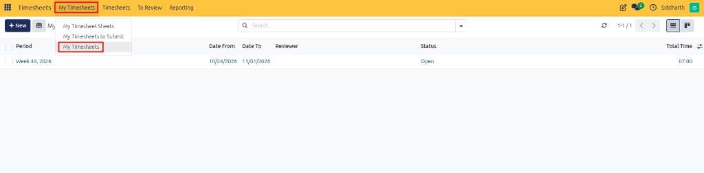
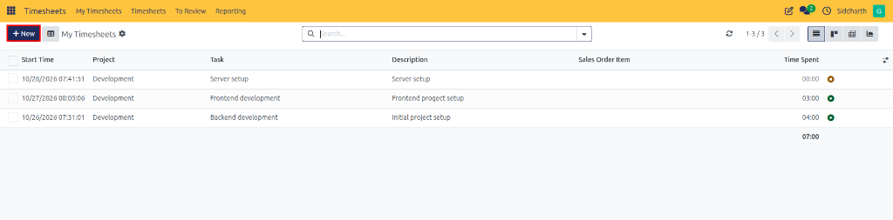
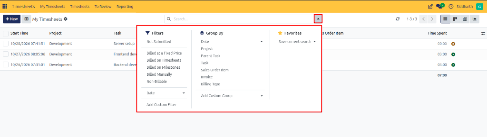
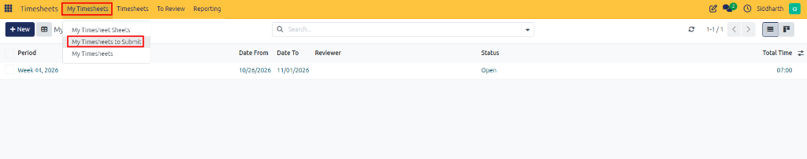
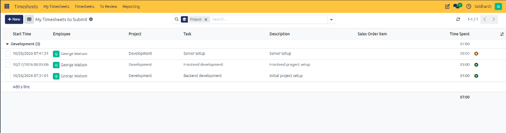

# Manage Daily Timesheets and Line Entries

This guide explains how to view, log, filter, and audit individual working hours and unsubmitted timesheet entries in CURQ Timesheets.

---

### Task 1: Access the My Timesheets Log

The **My Timesheets** view presents a detailed list of every atomic time entry logged by your user account:

1. Open the **Timesheets** application.
2. In the top navigation bar, click the **My Timesheets** menu and select **My Timesheets**:

   

3. The list view opens, displaying a chronological record of your logged activities, including timestamps, project assignments, task deliverables, descriptions, and durations.

---

### Task 2: Record an Individual Line Entry Inline

Log individual time entries quickly without opening a periodic sheet:

1. In the top-left action panel, click **New**:

   

2. A new editable row appears at the top of the table.
3. Configure the line entry fields:
   * **Start Time**: Set automatically to current date/time *(e.g., `10/26/2026 07:31:01`)*; adjust if entering past work.
   * **Project**: Select the target project *(e.g., `Development`)*.
   * **Task**: Select the specific task deliverable *(e.g., `Backend development`)*.
   * **Description**: Enter an operational note summarizing what was accomplished *(e.g., `Initial project setup`)*.
   * **Time Spent**: Enter the duration *(e.g., `04:00`)*.
4. Click anywhere outside the row to save the entry inline.

---

### Task 3: Filter and Group Daily Logs

Use search, filter, and grouping mechanisms to audit your logged hours:

1. Click the search bar dropdown arrow to expand search controls:

   

2. Apply filters to narrow your logs:
   * **Not Submitted**: Isolate entries that have not yet been submitted in a sheet.
   * **Billing Classification**: Filter by **Billed on Timesheets**, **Billed at Fixed Price**, or **Non-Billable**.
   * **With ticket**: Isolate entries linked to helpdesk support tickets.
3. Apply grouping rules to inspect subtotals:
   * Group by **Project** or **Task** to review accumulated effort per deliverable.
   * Group by **Date** *(by Month, Week, or Day)* to analyze time distribution.

---

### Task 4: Access the Unsubmitted Timesheet Queue

To audit and organize hours awaiting managerial submission:

1. Click **My Timesheets** in the top navigation bar.
2. Select **My Timesheets to Submit**:

   

3. This view acts as an operational staging queue displaying only records that have not yet been submitted to reviewers:

   

---

### Task 5: Review and Manage Unsubmitted Hours

1. **Project Subtotals**: Inspect unsubmitted records grouped by project *(such as `Development (3)` totaling `07:00` hours)* to identify unallocated effort.
2. **Inline Adjustments**: Click **Add a line** directly within any project grouping to add missing work entries.
3. **Queue Behavior**:
   * Once you submit your parent timesheet sheet, the corresponding entries automatically vanish from this queue.
   * If a reviewer rejects your sheet, the records immediately reappear in this queue so you can review manager feedback, amend lines, and resubmit.

---

### Related Documentation

* [Create and Submit Timesheet Sheets](./01-create-and-submit-timesheet-sheets.md)
* [Track Active Sessions with the Work Timer](./03-track-active-sessions-with-the-work-timer.md)
* [Understanding Timesheet Architecture and Project Integration](../core-concepts/01-understanding-timesheet-architecture-and-project-integration.md)
