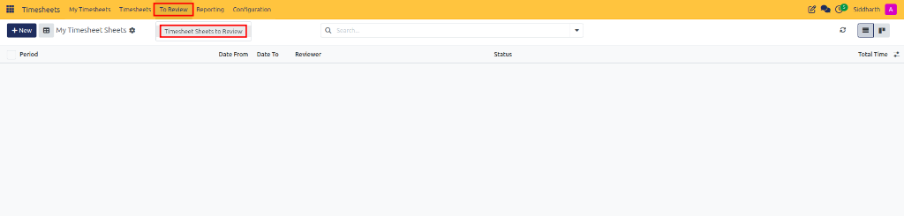
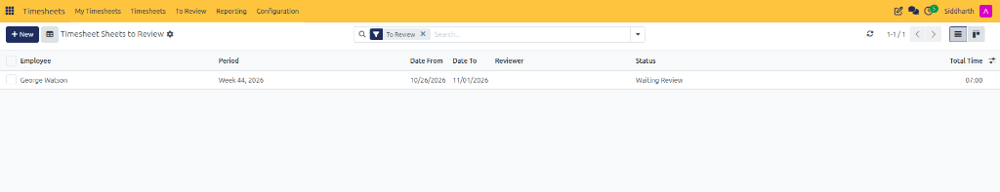
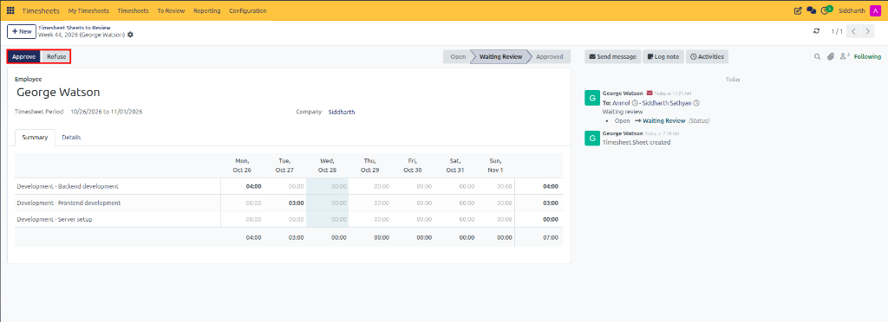

# Review, Approve, and Refuse Timesheet Sheets

This guide covers how supervisors, department leads, and HR managers inspect, audit, approve, or refuse submitted employee timesheet sheets in CURQ Timesheets.

---

### Task 1: Access the Timesheet Sheets to Review Queue

Submitted timesheet sheets are routed directly to the designated review workspace:

1. Open the **Timesheets** application.
2. In the top navigation bar, click the **To Review** menu.
3. Select **Timesheet Sheets to Review**:

   

4. The queue opens, displaying all employee timesheet sheets currently in `Waiting Review` status:

   

---

### Task 2: Audit Recorded Hours and Activity Details

Before taking an approval action, audit the sheet's entries for accuracy:

1. Click an employee's timesheet sheet in the list to open its form view:

   

2. Inspect the **Summary** tab:
   * Verify daily hours distribution across the reporting cycle *(e.g., `04:00` on Monday for Backend development, `03:00` on Tuesday for Frontend development)*.
   * Check for unexpected overtime or unexplained absences against the period's total hours *(e.g., `07:00`)*.
   * Confirm the total period hours match the employee's work schedule.
3. Switch to the **Details** tab:
   * Confirm task descriptions provide clear context for deliverables accomplished.
   * Verify that time is assigned to the correct projects and deliverable tasks.
   * Ensure billable client deliverables contain the correct sales order item.

---

### Task 3: Approve the Timesheet Sheet

When all hours and deliverables are accurate and verified:

1. In the top-left action bar, click **Approve**.
2. The sheet status advances to **Approved**.
3. The records become locked, preventing further employee modifications.
4. Delivered quantities update on linked customer sales orders for billable projects, releasing hours for invoicing.

---

### Task 4: Refuse a Sheet for Correction

If a sheet contains inaccurate hours, missing descriptions, or misallocated tasks:

1. In the top-left action bar, click **Refuse**.
2. Provide a clear explanation in the chatter specifying why the sheet is being returned and what corrections are required.
3. The sheet status reverts from `Waiting Review` back to `Open`.
4. The record immediately reappears in the employee's **My Timesheets to Submit** queue so they can update lines and resubmit.

---

### Post-Validation Outcomes

* **Locked Records**: Approved entries cannot be altered, ensuring compliance for payroll calculation.
* **Analytic Ledger Updates**: Confirms labor costs against the project's analytic budget.
* **Automated Invoicing**: Hours tagged to time-and-materials contracts become available on draft customer invoices.

---

### Related Documentation

* [Understanding Timesheet Sheet Approval and Billing Workflows](../core-concepts/02-understanding-timesheet-sheet-approval-and-billing-workflows.md)
* [Audit All Timesheets and Periodic Sheets](./05-audit-all-timesheets-and-periodic-sheets.md)
* [Create and Submit Timesheet Sheets](./01-create-and-submit-timesheet-sheets.md)
