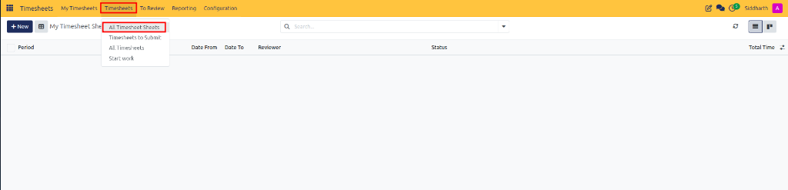
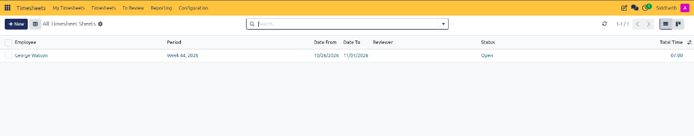
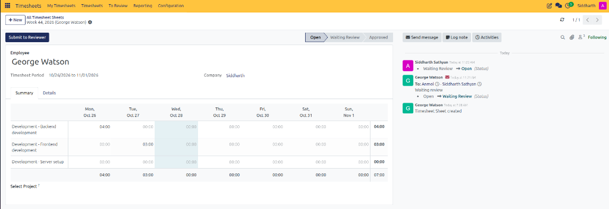
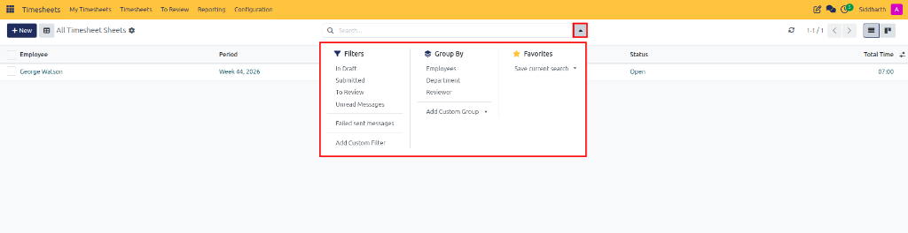

# Audit All Timesheets and Periodic Sheets

This guide explains how administrators, department leads, and operations managers monitor organization-wide timesheet sheets, track submission compliance, and audit logged hours across projects in CURQ Timesheets.

---

### Task 1: Access the All Timesheet Sheets Overview

The **All Timesheet Sheets** workspace provides centralized administrative oversight across all company staff:

1. Open the **Timesheets** application.
2. In the top navigation bar, click the **Timesheets** management menu.
3. Select **All Timesheet Sheets**:

   

4. The dashboard displays all employee timesheet sheets across departments.

---

### Task 2: Inspect Employee Timesheet Sheets

The list view consolidates key operational metadata for each timesheet cycle:

* **Employee**: The team member or contractor who recorded the working hours.
* **Period**: The reporting cycle range *(e.g., `Week 44, 2026`)*.
* **Date From & Date To**: Exact calendar boundaries of the reporting period.
* **Reviewer**: Assigned manager or HR officer responsible for approval.
* **Status**: Workflow state *(e.g., `Open`, `Waiting Review`, or `Approved`)*.
* **Total Time**: Cumulative working hours recorded across all activities in the sheet.

---

### Task 3: Examine Summary and Line Item Breakdowns

Click any timesheet sheet row to open the complete inspection view:

1. **Summary Grid**: Review the matrix distribution of hours by project, task, and daily date column. Verify that hours align with standard weekly expectations.
2. **Details Tab**: Review individual task descriptions, start times, and linked sales order items to ensure client billable work is accurately tagged.
3. **Chatter Activity**: Check employee notes, submission timestamps, and previous review feedback.

---

### Task 4: Apply Administrative Filters and Groupings

Use advanced filtering and grouping to identify missing submissions and track reviewer backlogs:

1. Click the search bar dropdown arrow to expand the search panel:

   

2. **Predefined Filters**:
   * **In Draft**: Identifies employee sheets that are currently in progress but have not yet been submitted.
   * **Submitted**: Displays sheets waiting for manager validation.
   * **To Review**: Isolates sheets requiring immediate review.
3. **Dynamic Grouping**:
   * **Employees**: Groups records by employee to track compliance over consecutive periods.
   * **Department**: Segments timesheets across engineering, operations, or consulting teams.
   * **Reviewer**: Groups records by assigned manager to identify review bottlenecks.

---

### Related Documentation

* [Review, Approve, and Refuse Timesheet Sheets](./04-review-approve-and-refuse-timesheet-sheets.md)
* [Generate and Analyze Timesheet Reports](./07-generate-and-analyze-timesheet-reports.md)
* [Understanding Timesheet Architecture and Project Integration](../core-concepts/01-understanding-timesheet-architecture-and-project-integration.md)
