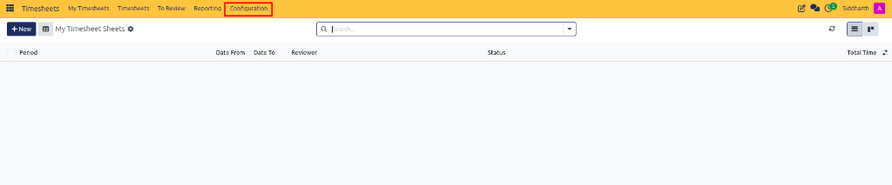
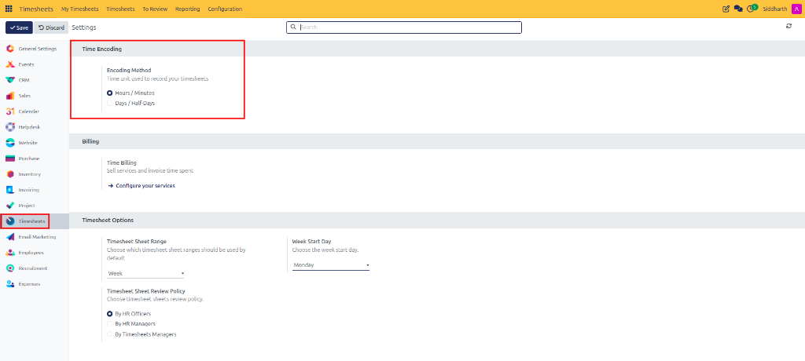
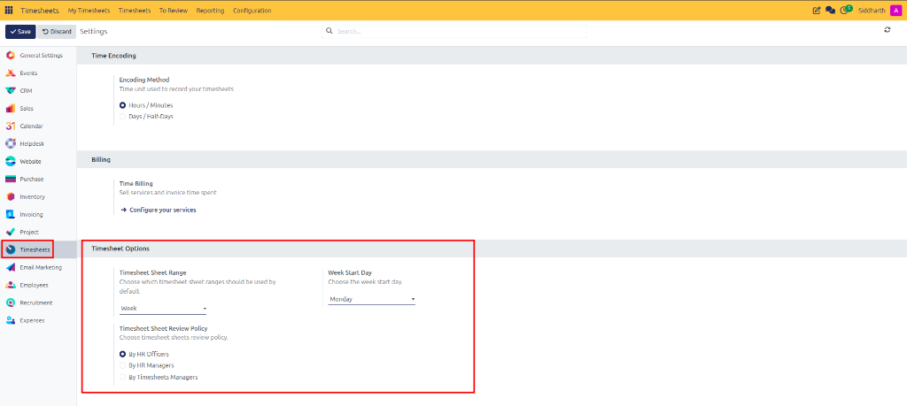

# Configure Timesheet Policies and Encoding Rules

This guide outlines how system administrators and operations leads configure time encoding units, reporting period ranges, workweek calendar start days, and managerial review policies in CURQ Timesheets.

---

### Task 1: Access Timesheets Configuration

Open the global configuration interface:

1. Open the **Timesheets** application.
2. In the top navigation bar, click **Configuration**:

   

3. The settings panel opens, displaying operational parameters for time recording, billing, and review governance.

---

### Task 2: Configure Time Encoding Units

Determine how employees enter their working durations across all timesheet views:

1. Locate the **Time Encoding** section.
2. Select your organization's encoding method:
   * **Hours / Minutes**: Allows employees to record time with granular precision *(e.g., `01:45` or decimal `1.75`)*. Ideal for hourly billing and task-level tracking.
   * **Days / Half-Days**: Restricts time entry to full or half-day blocks. Best suited for project-based professional services where consultants work in day-rate increments.

---

### Task 3: Define Timesheet Sheet Period and Calendar Boundaries

Establish the periodic cycle and starting boundary for timesheet sheets:

1. Navigate to the **Timesheet Options** section.
2. Set the **Timesheet Sheet Range**:
   * **Week**: Automatically generates weekly timesheet containers covering 7 consecutive days.
3. Configure the **Week Start Day**:
   * Select the day on which your organization's workweek begins *(e.g., `Monday` or `Sunday`)*.
   * The matrix grid columns in **My Timesheet Sheets** automatically adjust to reflect this chosen day as column one.

---

### Task 4: Establish Review Policies and Approval Governance

Designate who is authorized to review and validate submitted employee timesheets:

1. In the **Timesheet Options** section, locate **Timesheet Sheet Review Policy**.
2. Select the appropriate approval authority:
   * **By HR Officers**: Routes submitted sheets to designated human resource officers.
   * **By HR Managers**: Restricts validation authority exclusively to senior HR managers.
   * **By Timesheets Managers**: Directs review notifications to departmental timesheet supervisors.

---

### Task 5: Save and Apply System Changes

1. Review all updated selections to ensure alignment with HR guidelines.
2. Click **Save** in the top action bar.
3. The new settings apply immediately to newly generated timesheet sheets and tracking sessions.

---

### Related Documentation

* [Generate and Analyze Timesheet Reports](./07-generate-and-analyze-timesheet-reports.md)
* [Review, Approve, and Refuse Timesheet Sheets](./04-review-approve-and-refuse-timesheet-sheets.md)
* [Understanding Timesheet Architecture and Project Integration](../core-concepts/01-understanding-timesheet-architecture-and-project-integration.md)
