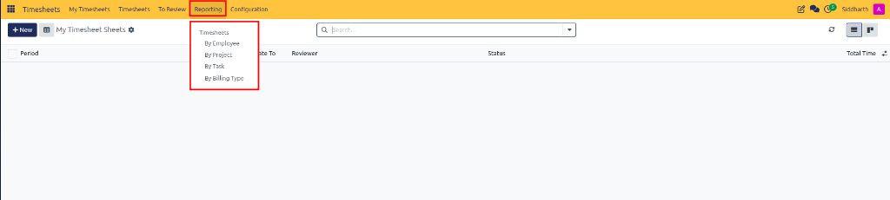
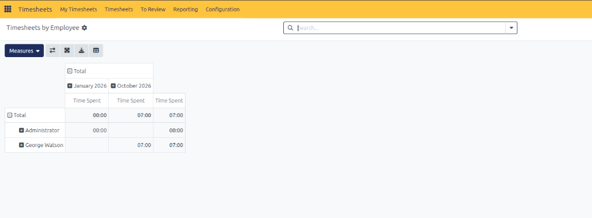
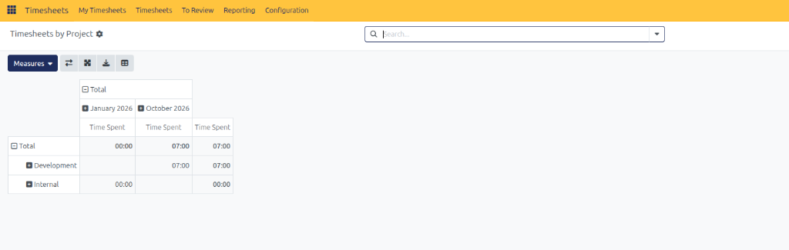
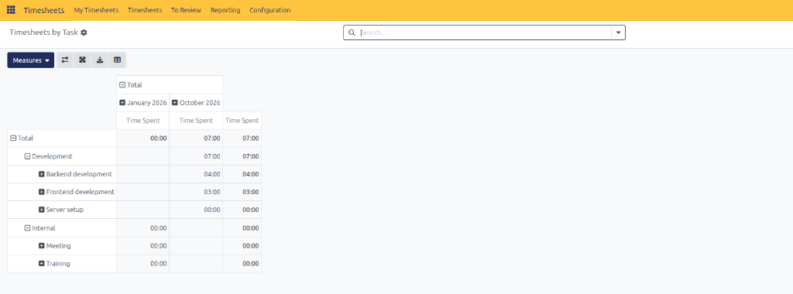
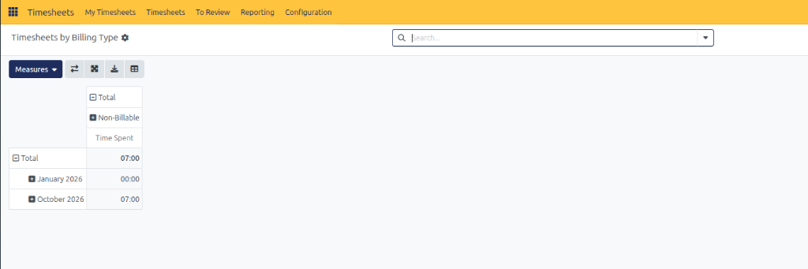
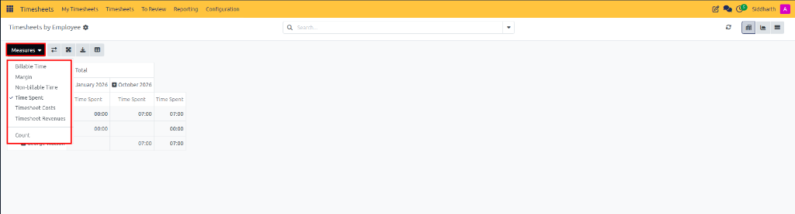

# Generate and Analyze Timesheet Reports

This guide demonstrates how project leaders, finance managers, and department heads generate, analyze, and export multidimensional timesheet reports in CURQ Timesheets.

---

### Task 1: Access Timesheet Reports

Open the reporting suite from the Timesheets navigation interface:

1. Open the **Timesheets** application.
2. In the top navigation bar, click the **Reporting** menu.
3. Select an analytical perspective:
   * **By Employee**
   * **By Project**
   * **By Task**
   * **By Billing Type**

---

### Task 2: Analyze Dedicated Reporting Views

CURQ provides four targeted reporting perspectives tailored for resource allocation and financial auditing:

#### Timesheets by Employee

Aggregates recorded working hours grouped by employee to assess workload balance and team utilization:

#### Timesheets by Project

Summarizes cumulative time investments across client accounts and internal initiatives to audit budget burn rates:

#### Timesheets by Task

Provides an in-depth operational breakdown by individual task deliverables, highlighting deliverables with high effort consumption:

#### Timesheets by Billing Type

Categorizes logged hours by commercial billing classification *(e.g., Billable on Timesheets, Fixed Price, Non-Billable)*:

---

### Task 3: Select Quantitative Measures

Customize the numerical metrics calculated within your pivot tables and visual charts:

1. In the top-left action bar, click **Measures**:

   

2. Select your desired analytical metric:
   * **Time Spent**: Cumulative hours logged *(default)*.
   * **Billable Time**: Cumulative hours billable to customers.
   * **Non-billable Time**: Hours logged on overhead or administrative activities.
   * **Margin**: Profitability variance between client billing revenues and internal employee labor costs.
   * **Timesheet Costs**: Monetary labor costs incurred based on employee cost rates.
   * **Timesheet Revenues**: Monetary sales revenue generated from billable timesheets.
   * **Count**: Total volume of individual timesheet records.

---

### Task 4: Search, Filter, and Group Reporting Data

Refine your analytical dataset using multi-level search and grouping controls:

1. Click the search bar dropdown arrow to expand search and filter options:

   

2. Apply **Filters**:
   * **Not Submitted**: Focus on unfinalized hours still in open drafting.
   * **Billing Classification**: Filter by specific billing contract models.
   * **Date**: Narrow results to specific calendar quarters, months, or fiscal years.
3. Apply **Group By**:
   * Group by **Department**, **Manager**, **Project**, or **Sales Order Item** to reveal multi-tier hierarchies.
   * Click **+** (plus) icons on pivot rows to expand parent groupings into child deliverables.

---

### Task 5: Export Analytical Data

Export structured timesheet analyses for executive presentations, payroll reconciliation, or client auditing:

1. Configure your desired report view with filters, date bounds, and grouping hierarchies applied.
2. In the top-left control panel, click the **Export** (Download) icon.
3. CURQ generates an `.xlsx` spreadsheet matching the exact grouping and pivot structure shown on screen.

---

### Related Documentation

* [Audit All Timesheets and Periodic Sheets](./05-audit-all-timesheets-and-periodic-sheets.md)
* [Configure Timesheet Policies and Encoding Rules](./06-configure-timesheet-policies-and-encoding-rules.md)
* [Understanding Timesheet Architecture and Project Integration](../core-concepts/01-understanding-timesheet-architecture-and-project-integration.md)
