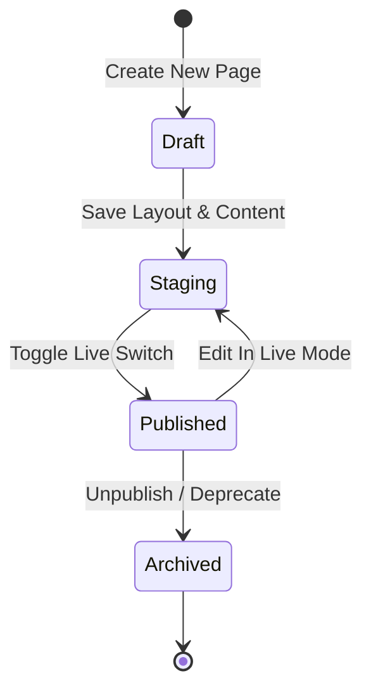

# Understanding Website Architecture and Content Delivery

CURQ 18 Website provides a modern, high-performance web publishing framework designed for enterprise businesses. It unifies visual drag-and-drop page editing, responsive layout modularity, multi-website management, and search engine optimization within a single cohesive environment.

---

## Architectural Foundation

CURQ Website is built on a decoupled, responsive rendering pipeline that bridges the backend relational database with a lightweight frontend execution environment:

```{mermaid}
flowchart LR
    A["`**Client Request**
    Browser / Mobile / CDN`"] --> B["`**HTTP Routing Engine**
    Domain & URL Matching`"]
    B --> C["`**QWeb Rendering Engine**
    XML Templates & Snippets`"]
    C --> D["`**Asset Bundler**
    SCSS / JS Compilation`"]
    D --> E["`**Rendered HTML View**
    Responsive Output`"]
```

### Key Architectural Pillars

* **Multi-Website Architecture**: CURQ supports multiple independent websites on a single database instance. Each website maintains its own domain routing, custom branding, localized languages, customer menus, product catalogs, and payment gateways while sharing shared company resources.
* **QWeb Templating Engine**: Pages are rendered using QWeb, an XML-based dynamic templating language that supports conditional display, record looping, template inheritance, and translation string extraction.
* **Building Block Snippet System**: Content is constructed using atomic building blocks (snippets) categorized into Structure, Features, Dynamic Content, and Inner Content. Snippets can be dragged and rearranged without modifying raw template source code.
* **Asset Pipeline & SCSS Compilation**: Stylesheets are authored in SCSS and automatically compiled and minified into optimized CSS asset bundles. Static assets (images, icons, fonts) are cached and served with HTTP cache-control headers.

---

## The Page Lifecycle: From Editing to Publication

Every webpage in CURQ transitions through distinct lifecycle states, ensuring changes can be drafted and reviewed before going live:



### 1. Creation and URL Slug Definition
When a user initializes a page, CURQ prompts for a title and derives an SEO-friendly URL slug (e.g., `/about-us` or `/services/consulting`). Slugs are validated against existing routes to prevent collision.

### 2. Layout Assembly and Customization
In edit mode, authors drag modular blocks onto the canvas. The visual editor enables inline text editing, media insertion, responsive column resizing, and background styling.

### 3. Viewport Adaptation and Mobile Responsiveness
The editor includes an instant mobile viewport simulator. Blocks automatically adapt across desktop, tablet, and mobile breakpoints using responsive flexbox and grid layouts.

### 4. Publication and Redirection Management
Pages remain invisible to unauthenticated visitors until toggled to **Published**. If a page URL is updated, CURQ automatically creates a 301 Permanent Redirect from the legacy path to preserve search engine rankings and incoming referral traffic.

---

## Technical Specifications

| Parameter | Specification | Purpose |
| :--- | :--- | :--- |
| **Rendering Engine** | QWeb XML / Python Server | High-throughput server-side rendering with dynamic database queries. |
| **CSS Framework** | Custom SCSS / Bootstrap-compatible | Responsive grid layout with variable-driven themes and dark mode capabilities. |
| **Asset Compression** | Minified Gzip/Brotli Bundles | Combined CSS/JS assets to reduce HTTP requests and optimize Core Web Vitals. |
| **Caching Layer** | In-memory Page Cache & HTTP CDN | Caches static blocks and anonymous visitor responses for sub-second load times. |
| **URL Structure** | Hierarchical Slug-based Routing | Human-readable, keyword-rich paths with automated multi-language prefixing. |

---

## Multi-Website Routing and Domain Isolation

In enterprise environments with subsidiary brands or regional business units, CURQ routes requests dynamically based on the incoming HTTP `Host` header:

* **Domain Mapping**: Each website record is assigned a unique primary domain (e.g., `store.brand-a.com` vs. `wholesale.brand-b.com`).
* **Shared vs. Isolated Catalogs**: Products and content pages can be shared across all websites or restricted to a specific website instance.
* **Fiscal and Currency Segregation**: Independent price lists, default currencies, and tax identification numbers can be assigned per website.

---

## Related Documentation

* [Build and Publish Your First Web Page](../getting-started/01-build-and-publish-your-first-web-page.md)
* [Design Pages with Building Blocks](../task-guides/01-design-pages-with-building-blocks.md)
* [Website Configuration and Domain Settings](../settings-and-fields/01-website-configuration-and-domain-settings.md)
