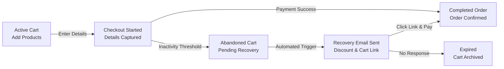

# Understanding eCommerce Checkout and Customer Portals

CURQ 18 integrates an end-to-end electronic commerce engine directly with inventory, sales orders, automated invoicing, customer relationship management, and self-service customer portals. This eliminates the latency and data synchronization errors common with external e-commerce integrations.

---

## 1. The eCommerce Transaction Lifecycle

When a shopper visits your CURQ storefront, their session progresses through an automated transaction lifecycle:

```{mermaid}
flowchart LR
    A["`**Catalog Browse**
    Products & Variants`"] --> B["`**Shopping Cart**
    Draft Quotation SO`"]
    B --> C["`**Checkout Flow**
    Address & Fiscal Position`"]
    C --> D["`**Payment / Delivery**
    Acquirer & Shipping`"]
    D --> E["`**Confirmed Order**
    Inventory & Invoice`"]
```

### 1.1 Catalog Browsing & Variant Resolution
Products displayed on `/shop` dynamically inherit customer-specific pricelists, attribute matrix selections (such as size, color, or material), and promotional badges (ribbons). Inventory levels determine whether items show live stock indicators or backorder warnings.

### 1.2 Shopping Cart Management
Adding an item creates a temporary quotation in the backend. As the customer adds items or applies promotional discount codes, CURQ calculates line totals, taxes, and discounts in real time.

### 1.3 Checkout Address and Fiscal Position
During checkout, the customer specifies shipping and billing coordinates. CURQ automatically resolves the customer's **Fiscal Position** to apply correct regional VAT, domestic tax rates, or zero-rated export exemptions.

### 1.4 Shipping Carrier and Delivery Method
Shoppers select from active shipping methods:
* **Fixed Price**: Flat-rate or free shipping over a spending threshold.
* **Rule-based Carrier**: Dynamic rate calculation based on weight, volume, or delivery zone.
* **In-Store Collection**: Customer pickup at local warehouse outlets with zero delivery surcharge.

### 1.5 Payment Acquirer and Order Confirmation
Customers execute payment via integrated payment providers (such as Stripe, PayPal, Authorize.net) or choose manual terms (Wire Transfer). Upon payment validation, CURQ:
* Converts the quotation into a confirmed **Sales Order**.
* Generates inventory reservation pickings in the warehouse.
* Triggers an automated email receipt with an order tracking link.

---

## 2. Abandoned Cart Detection and Recovery

Not every cart completes checkout. CURQ tracks incomplete orders and powers automated recovery workflows:



* **Inactivity Detection**: If a customer inputs their email address during checkout but abandons the transaction, CURQ tags the record as an **Abandoned Cart** once the inactivity threshold expires.
* **Automated Recovery Emails**: Marketing automation dispatches follow-up emails featuring the cart contents and a direct one-click link to resume checkout.
* **Analytics**: E-commerce reporting tracks recovery rates, lost revenue, and drop-off steps across the checkout funnel.

---

## 3. Customer Portal and B2B Access

CURQ provides a dedicated, authenticated **Customer Portal** accessible at `/my`:

| Portal Feature | B2C Consumer Capabilities | B2B Commercial Customer Capabilities |
| :--- | :--- | :--- |
| **Order History** | View confirmed orders, delivery tracking numbers, and order receipts. | Download official purchase order confirmations and shipping packing slips. |
| **Invoices & Receipts** | Download PDF sales invoices and review payment status. | Access outstanding account statements, credit notes, and pay past invoices online. |
| **Pricelists & Terms** | Standard retail pricing and public promotions. | Contract-specific volume pricelists and commercial credit payment terms. |
| **Account Management** | Update billing/delivery addresses and password credentials. | Manage corporate branch addresses and assign subsidiary billing contacts. |
| **Helpdesk & Communication**| Submit support tickets and view ticket resolution status. | Open priority service tickets and communicate directly on project records. |

---

## Related Documentation

* [Set Up an eCommerce Storefront and Checkout](../getting-started/02-set-up-an-ecommerce-storefront-and-checkout.md)
* [Manage Online Orders and Abandoned Carts](../task-guides/07-manage-online-orders-and-abandoned-carts.md)
* [eCommerce Shop and Checkout Specifications](../settings-and-fields/02-ecommerce-shop-and-checkout-settings.md)
* [Privacy, Cookie Compliance, and Account Settings](../settings-and-fields/04-privacy-cookie-compliance-and-account-settings.md)
