# Build and Publish Your First Web Page

Welcome to CURQ Website. The **Website** application provides an intuitive visual drag-and-drop page builder that enables marketing, sales, and design teams to create responsive, high-converting web pages without coding.

In this tutorial, you will launch the website editor, initialize a new webpage, assemble content using modular building blocks, customize layout styles, and publish your live page in 5 steps.

```{mermaid}
flowchart LR
    A["`**Access Editor**
    Frontend Canvas`"] --> B["`**Create Page**
    Title & URL Slug`"]
    B --> C["`**Add Blocks**
    Drag & Drop Snippets`"]
    C --> D["`**Mobile Check**
    Responsive Viewport`"]
    D --> E["`**Save & Publish**
    Live Deployment`"]
```

> **Prerequisites**
> * Access to a standard CURQ instance with the **Website** application installed.
> * Editor or administrative permissions to create and publish website pages.

---

## Step 1: Open the Frontend Website Canvas

Access the live website environment from the CURQ backend:

1. Click the main application menu at the top left of CURQ and select **Website**.
2. CURQ loads your live website frontend with the administrative control bar at the top:

   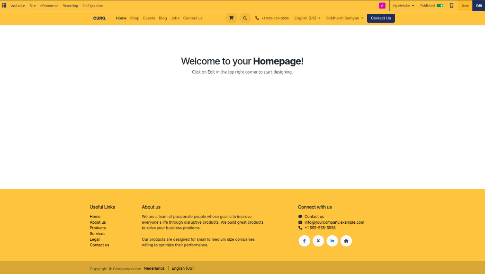

3. Note the key tools in the top bar:
   * **Edit**: Toggles the visual block editor for the currently active page.
   * **+ New**: Opens the quick-creation modal to add pages, products, or posts.
   * **Mobile View Icon**: Switches the viewport between desktop and mobile simulator modes.
   * **Site Menu**: Provides access to Page Management, HTML/CSS Editor, and SEO tools.

---

## Step 2: Initialize a New Webpage

Create a dedicated landing page for your organization:

> For field explanations, allowed values, and page property definitions, see [Website Page, Product, and Reporting Field Definitions](../settings-and-fields/05-website-page-product-and-reporting-field-definitions.md).

1. In the top administrative bar, click the **+ New** button:

   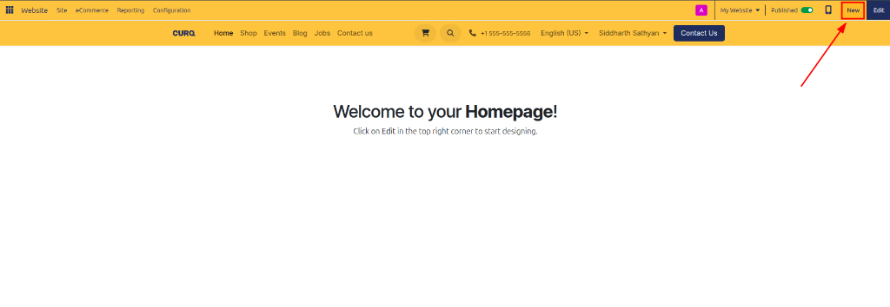

2. The quick-creation modal opens, offering various web content types:

   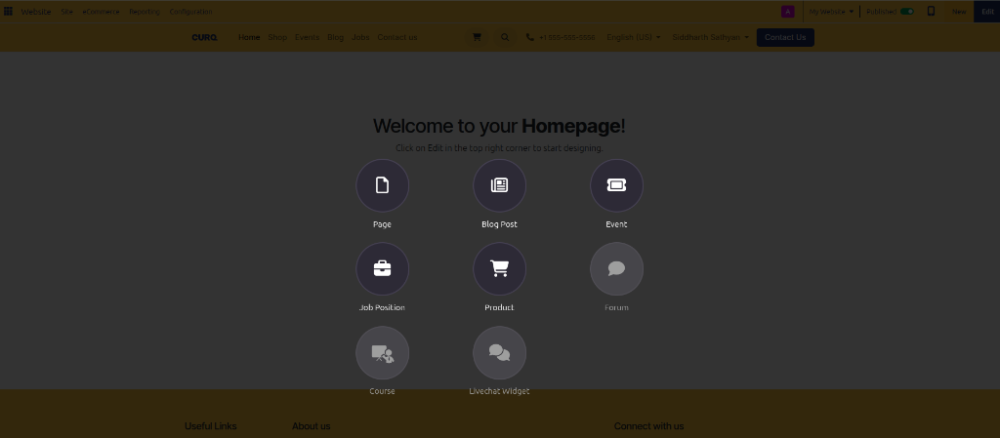

3. Select **Page** to open the template selection dialog:

   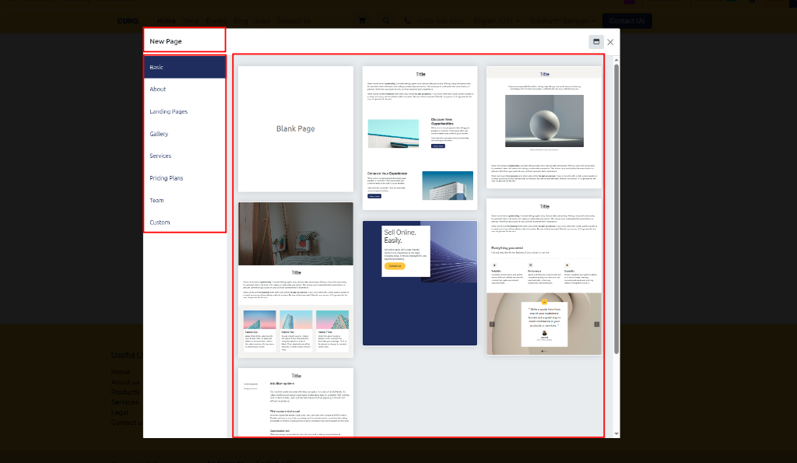

4. Choose a layout template or select a blank page, then click **Select**.
5. In the **New Page** dialog, enter a title *(e.g., `Company Services`)* and verify the **Add to menu** checkbox:

   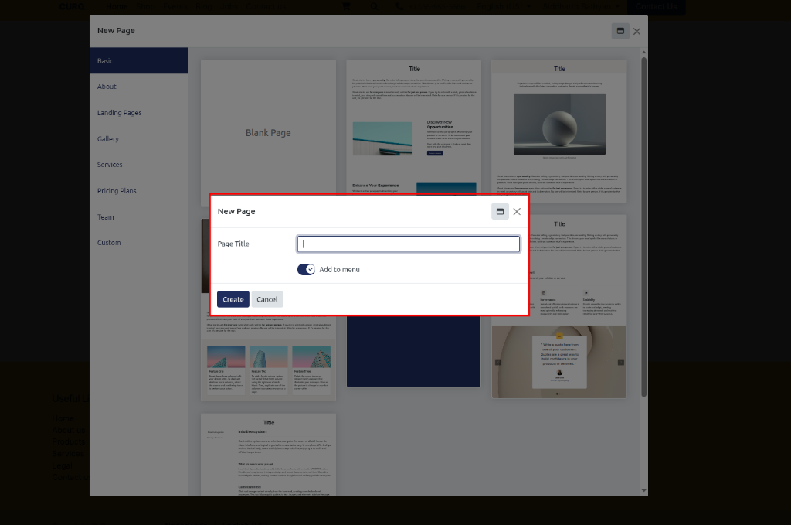

6. Click **Create**. CURQ automatically generates the page slug *(e.g., `/company-services`)* and opens the page directly in the visual builder:

   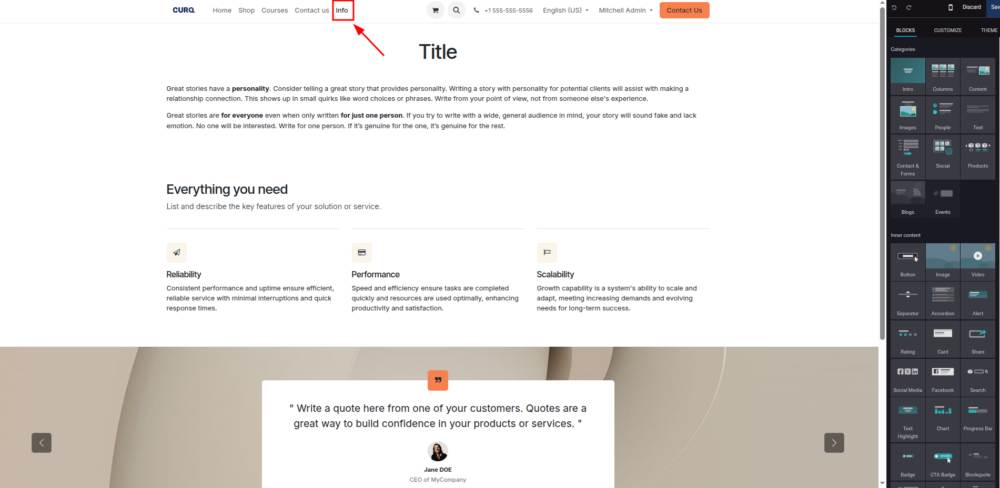

---

## Step 3: Assemble Layout Using Building Blocks

Populate your empty canvas with pre-built modular snippets:

1. On the right side of the screen, browse the **Blocks** sidebar panel:

   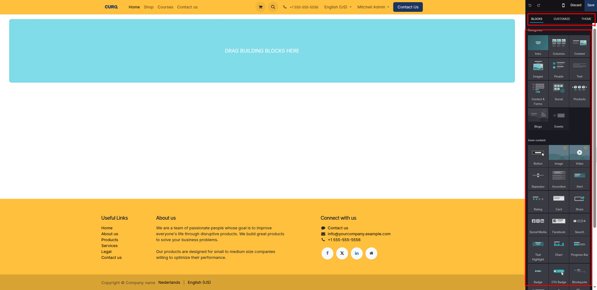

2. Drag an **Intro** or **Banner** block from the sidebar and drop it onto the canvas:

   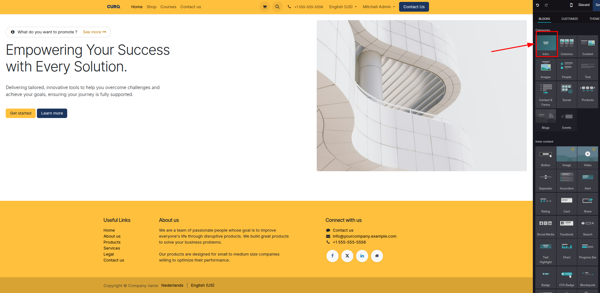

3. Click directly into any headline or body paragraph to edit text inline:

   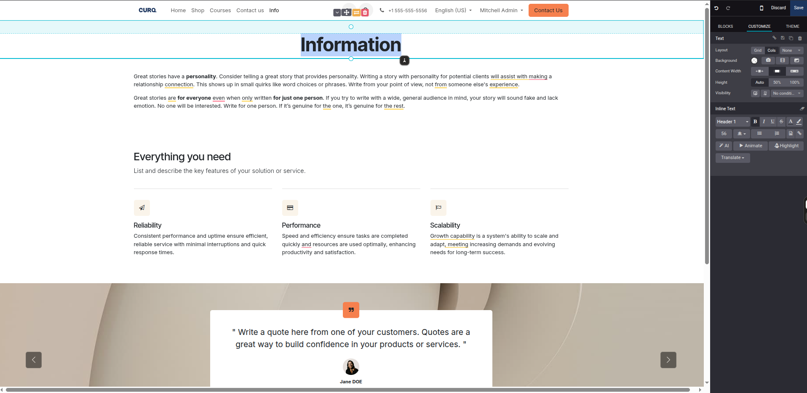

4. Drag additional functional blocks onto the page *(such as **Features**, **Team**, or **Call to Action**)* to complete the structure.

---

## Step 4: Preview Across Viewports

Ensure your content renders cleanly across desktop and mobile devices:

1. With your layout customized, click the **Mobile Preview** smartphone icon in the top toolbar:

   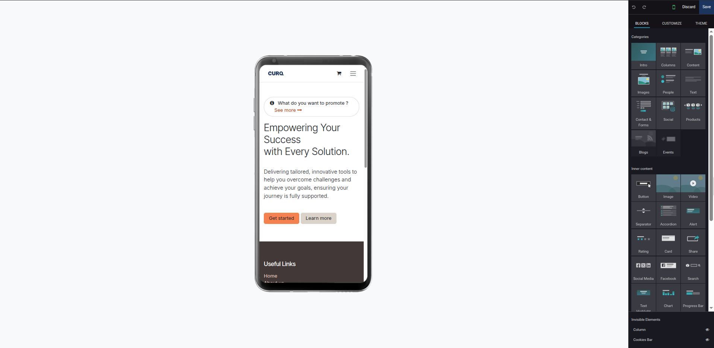

2. Verify that typography scales down legibly, buttons remain easily tappable, and multi-column rows stack vertically for mobile screens.
3. Switch back to desktop view to finalize any minor spacing adjustments.

---

## Step 5: Save and Publish Live

Commit your design changes and deploy the page to public visitors:

1. In the top-right corner of the editor toolbar, click **Save**:

   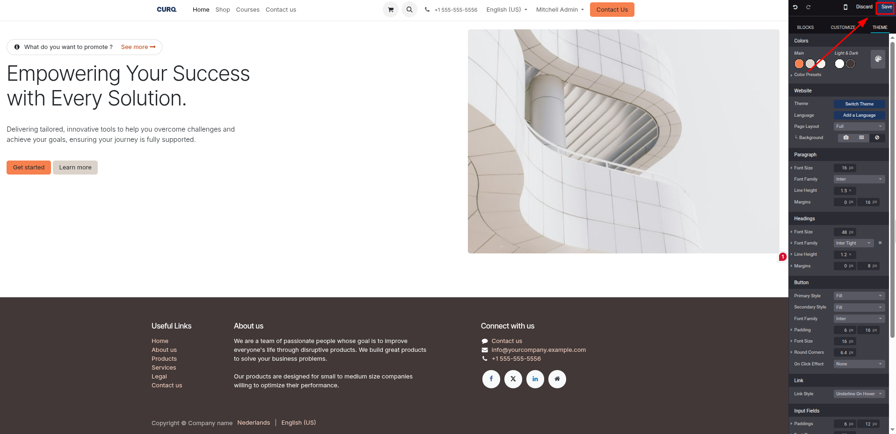

2. The editor closes, returning you to the live frontend view.
3. In the top bar, toggle the page status switch from **Unpublished** to **Published**.
4. Your new webpage is now live, fully responsive, and accessible to website visitors at its assigned URL.

---

## Related Documentation

* [Design Pages with Building Blocks](../task-guides/01-design-pages-with-building-blocks.md)
* [Configure Menus, Headers, and Footers](../task-guides/02-configure-menus-headers-and-footers.md)
* [Optimize SEO and Search Metadata](../task-guides/04-optimize-seo-and-search-metadata.md)
* [Understanding Website Architecture and Content Delivery](../core-concepts/01-understanding-website-architecture-and-content-delivery.md)
