# Set Up an eCommerce Storefront and Checkout

CURQ 18 integrates a complete online retail and B2B wholesale store directly into your website. With zero third-party connectors, your online storefront shares live inventory, real-time customer pricelists, automated tax rules, payment processing, and fulfillment workflows directly with backend Sales and Accounting.

In this tutorial, you will publish products to the web catalog, organize store categories, configure payment acquirers and delivery options, and test a customer purchase in 5 steps.

```{mermaid}
flowchart LR
    A["`**Publish Items**
    Name, Price & Photo`"] --> B["`**Organize Catalog**
    Categories & Ribbons`"]
    B --> C["`**Payment Gateways**
    Activate Providers`"]
    C --> D["`**Shipping Methods**
    Fixed / Carrier Rates`"]
    D --> E["`**Test Checkout**
    Confirm Sales Order`"]
```

> **Prerequisites**
> * Access to CURQ with the **Website** and **eCommerce** applications installed.
> * Inventory items configured in the catalog with sales prices and stock tracking.
> * Administrative permissions to configure payment providers and shipping methods.

---

## 1. eCommerce Storefront and Checkout Setup

### 1.1 Publish Products to the Online Store

Make your catalog items visible on the public `/shop` page:

> For product catalog field explanations and publication indicators, see [**Website Page, Product, and Reporting Field Definitions**](../settings-and-fields/05-website-page-product-and-reporting-field-definitions.md).

1. In the top administrative bar of the website, click **Site** and select **Products**:

   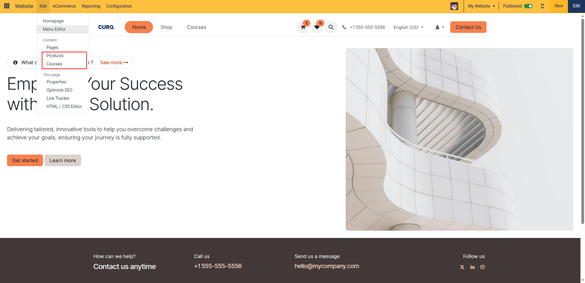

2. The **Product Pages** manager opens, displaying catalog items and publication indicators:

   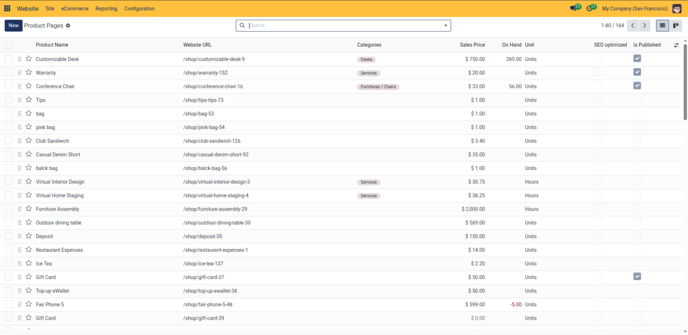

3. Click **+ New** in the top action bar to open the creation dialog:

   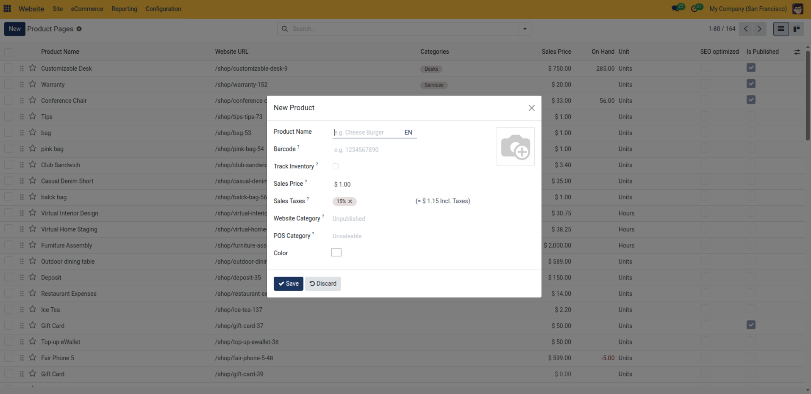

4. Enter the **Product Name**, set the **Sales Price**, assign an **eCommerce Category**, and upload high-resolution product imagery.
5. Click **Save & Publish** (or open the product page on the frontend and toggle the **Unpublished** switch to **Published**).

---

### 1.2 Categorize Products and Apply Promotional Badges

Help shoppers browse your catalog efficiently with structured categories and badges:

1. On the product configuration form, navigate to the **Sales** tab.
2. Under **eCommerce Shop**, assign relevant categories and apply a **Ribbon** badge *(e.g., `Sale`, `New Arrival`, or `Featured`)*:

   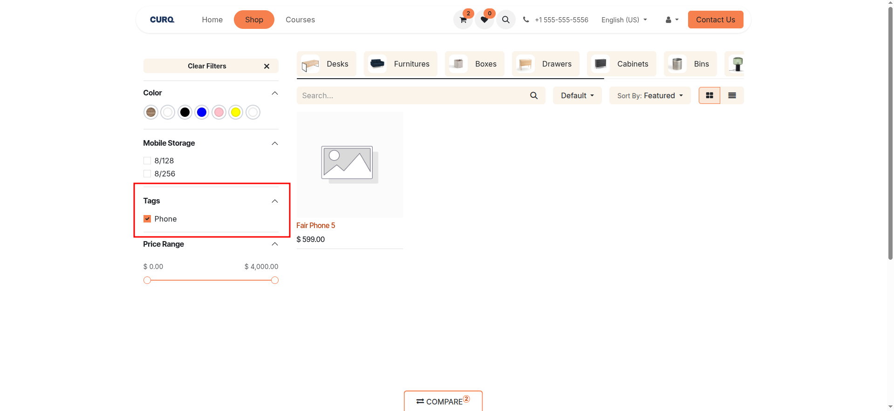

3. Review the `/shop` storefront to verify that category filters appear in the sidebar and ribbons highlight promotional items on product cards:

   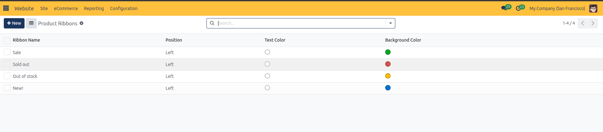

---

### 1.3 Configure Online Payment Providers

Enable shoppers to settle purchases digitally or via offline commercial terms:

> For payment provider field explanations, states, and currency constraints, see [**eCommerce Shop and Checkout Settings**](../settings-and-fields/02-ecommerce-shop-and-checkout-settings.md).

1. Open **Website > Configuration > Settings**.
2. Scroll to the **Shop - Payment** section and click **Payment Providers**:

   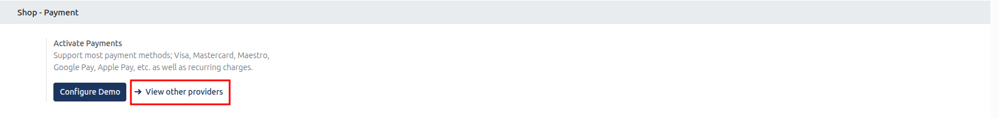

3. Review the available payment gateways *(e.g., Stripe, PayPal, Authorize.net, Wire Transfer, Demo)*:

   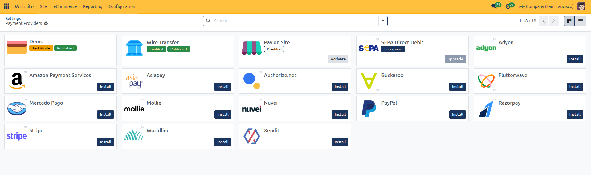

4. Open the desired provider *(such as **Wire Transfer**)*, set the state to **Enabled**, and enter the required operational instructions:

   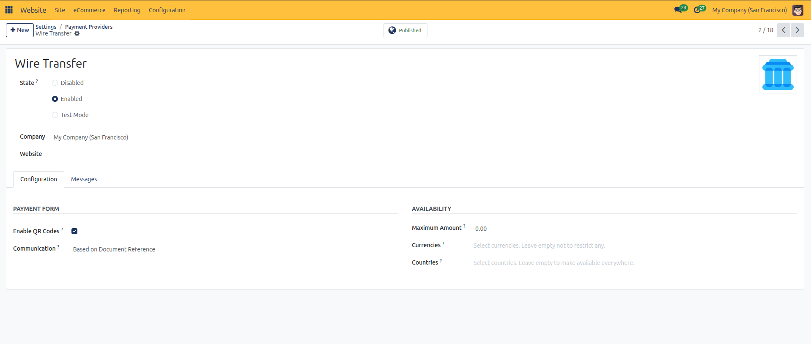

5. Click the cloud icon to save the provider configuration.

---

### 1.4 Configure Shipping and Delivery Methods

Define how physical goods are dispatched to online shoppers:

> For delivery method field explanations, carrier options, and store pickup parameters, see [**Delivery, Shipping, and Store Pickup Settings**](../settings-and-fields/03-delivery-shipping-and-store-pickup-settings.md).

1. In **Website > Configuration > Settings**, scroll to **Shipping** and click **Shipping Methods**:

   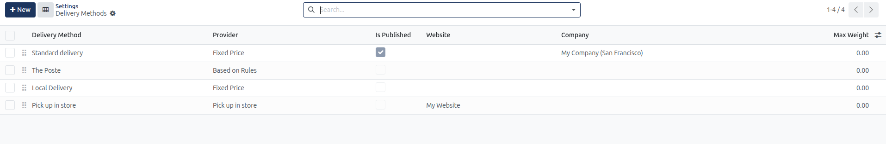

2. Review active shipping carriers *(e.g., `Standard Delivery`, `In-Store Pickup`, `Express Carrier`)*:

   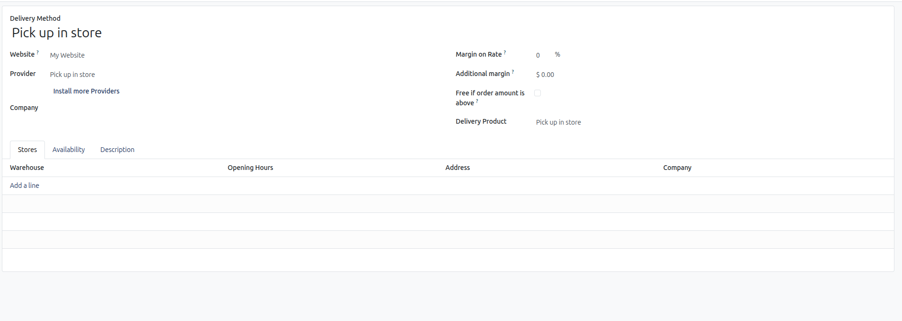

3. Ensure at least one delivery option is set to **Published** and available for the customer's geographic zone.

---

### 1.5 Test Customer Checkout and Validate Orders

Verify the checkout experience from a visitor's perspective:

1. Open an incognito browser window and navigate to your website's `/shop` page.
2. Select an item, choose variant attributes, and click **Add to Cart**.
3. Proceed to the checkout flow:
   * **Address**: Enter test billing and shipping coordinates.
   * **Delivery**: Select your configured shipping method.
   * **Payment**: Choose **Wire Transfer** or the test payment gateway and click **Pay Now**.
4. Return to your administrator backend and navigate to **eCommerce > Orders**:

   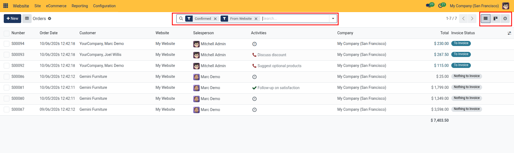

5. The newly placed transaction appears with confirmed sales status, ready for inventory picking, packing, and automated customer invoicing.

---

## Related Documentation

* [Manage Online Orders and Abandoned Carts](../task-guides/07-manage-online-orders-and-abandoned-carts.md)
* [Configure Delivery Methods and Shipping Zones](../task-guides/11-configure-delivery-methods-and-shipping-zones.md)
* [eCommerce Shop and Checkout Specifications](../settings-and-fields/02-ecommerce-shop-and-checkout-settings.md)
* [Understanding eCommerce Checkout and Customer Portals](../core-concepts/02-understanding-ecommerce-checkout-and-customer-portals.md)
