# eCommerce Management

Manage online sales orders, recover abandoned shopping carts, and configure website catalog rules in CURQ 18.

---

> [!NOTE]
> Installing the **eCommerce** app automatically creates the **Shop** navigation menu (`/shop`) in your website header, along with the shopping cart, wishlist shortcuts, and product catalog pages. The top administrative **eCommerce** menu also becomes available for managing orders and catalog settings. If your database only uses the base website builder without eCommerce, configure standard pages via [Page Management](./03-page-management.md).

---

### 1. Accessing eCommerce

In the top administrative bar, click **eCommerce** to open the menu dropdown:

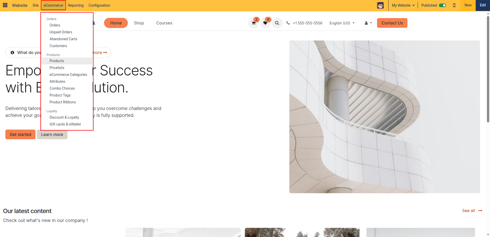

The menu organizes your online store into three functional areas:

* **Orders**: Track online checkouts, review unpaid orders, manage customer recovery for abandoned shopping carts, and browse registered online customers.
* **Products**: Configure master products, pricelists, eCommerce categories, variant attributes, combo choices, product tags, and promotional ribbons.
* **Loyalty**: Set up discount promotions, customer loyalty programs, gift cards, and eWallets.

---

### 2. Managing Online Orders & Recovery

#### Orders (`eCommerce > Orders > Orders`)

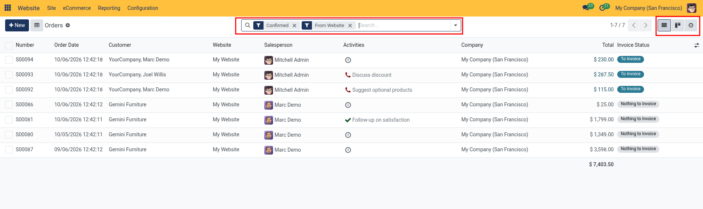

* **Automatic Default Filters**:
  * **Confirmed**: Displays only sales orders in confirmed status (**Sales Order**).
  * **From Website**: Filters out backend manual quotations, displaying only sales originating from your website (`/shop`).

* **Key Columns Displayed**:

| Column | Description |
| --- | --- |
| **Number** | Unique sales order reference number *(e.g., `S00094`)*. |
| **Order Date** | Date and time the customer completed the website checkout. |
| **Customer** | The billing contact or company account name. |
| **Website** | Website domain where the checkout took place *(in multi-website databases)*. |
| **Salesperson** | Assigned sales representative or website team member. |
| **Activities** | Scheduled follow-up tasks, calls, or reminders. |
| **Company** | Multi-company legal entity managing the transaction. |
| **Total** | Final transaction total including items, shipping, and taxes. |
| **Invoice Status** | Customer billing status: **To Invoice** or **Nothing to Invoice**. |

* **View Switcher**: Use the view icons in the upper-right corner to toggle between **List**, **Kanban cards**, and **Activities calendar**.

* **All Sales Orders Filter**: To see orders across both physical and digital channels, remove the **From Website** filter chip in the search bar.
* **Order Processing Guides**: For step-by-step instructions on confirming orders, delivery validation, and invoice generation, see [Confirm Sales Order](../../Sales/manual/03-confirm-sales-order.md), [Invoicing Sales Order](../../Sales/manual/04-invoicing-sales-order.md), and [Analyze Sales Orders](../../Sales/manual/07-analyze-sales-orders.md).

#### Unpaid Orders (`eCommerce > Orders > Unpaid Orders`)

Clicking **Unpaid Orders** displays website checkout orders that reached the payment step with a quotation sent to the customer, but where the final payment was not confirmed:

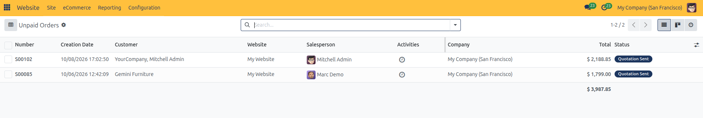

* **Automatic Default Filter**: Automatically filters for website orders where the order status is **Quotation Sent**.
* **How an Order Enters Unpaid Orders**:
  * **Pending / Wire Transfer Payments**: When a customer checks out using offline payment providers *(such as Wire Transfer / SEPA / Custom payment methods)*, the payment transaction enters a pending state. CURQ automatically moves the quotation into **Quotation Sent** and emails the payment instructions to the customer.

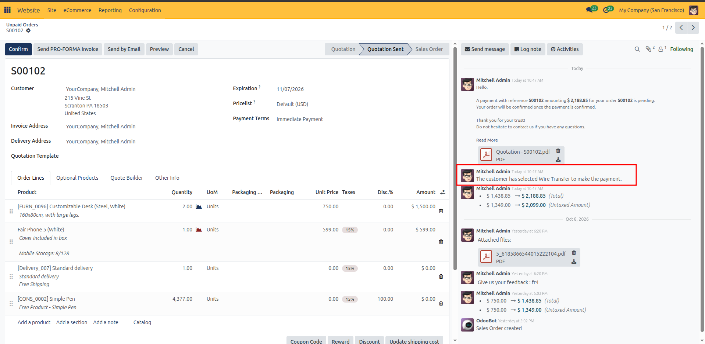

  * **Failed / Interrupted Online Transactions**: If a shopper completes checkout and receives a quotation link or their payment gateway transaction is awaiting asynchronous authorization, the record remains in this view until settled.
* **Processing Unpaid Orders**:
  1. Once the customer completes the bank transfer or offline payment, open the order from this list.
  2. Click **Confirm** to convert the quotation into a confirmed sales order. The order automatically moves from **Unpaid Orders** to the confirmed **Orders** list.

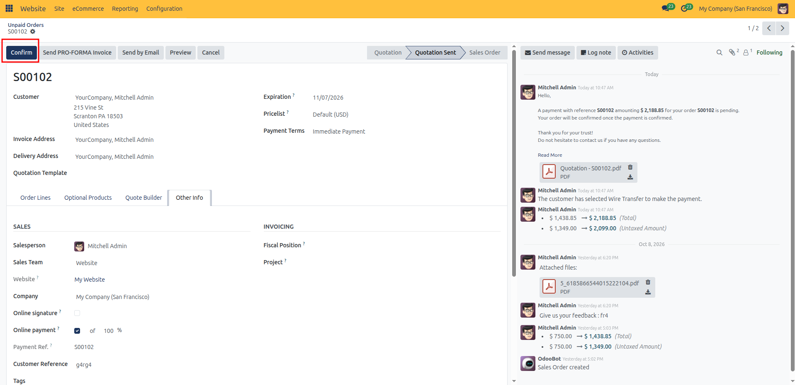

#### Abandoned Carts (`eCommerce > Orders > Abandoned Carts`)

Clicking **Abandoned Carts** displays shopping sessions where visitors added items to their shopping cart and provided their contact details, but left before completing checkout.

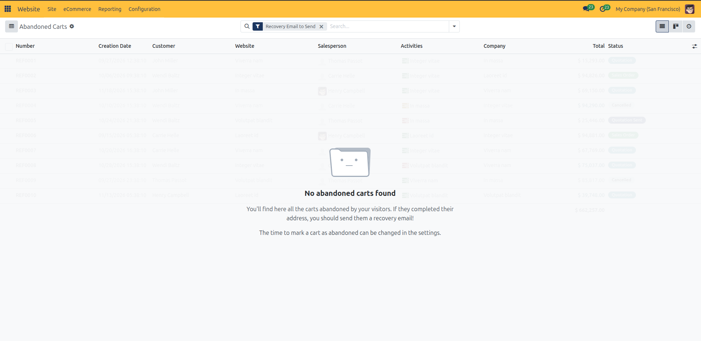

* **How CURQ Qualifies an Abandoned Cart**:
  An online shopping session is automatically classified as an abandoned cart when all of the following conditions are met:
  * **Originated on Website**: The order was created through your online store (`/shop`), not manually entered by backend sales staff.
  * **Quotation State**: The order remains in unconfirmed quotation status (**Quotation**).
  * **Contains Products**: The shopping cart contains at least one product line.
  * **Identified Customer**: The shopper logged into their customer portal account or entered their contact email on the checkout address step. Completely anonymous visitors who never entered an email cannot be targeted with recovery emails.
  * **Inactivity Time Window**: The shopper has been inactive for longer than the configured abandoned cart delay *(set to 1 hour by default)*. Active browsing sessions within this window are not considered abandoned.

* **Automatic Default Filter**:
  * **Recovery Email to Send**: Automatically filters the list to show only abandoned carts where a recovery email has not yet been dispatched.

* **Recovering the Cart**:
  1. In the top bar, click **eCommerce** > **Orders** > **Abandoned Carts**.
  2. Review the list showing customer names, creation dates, and cart totals.
  3. Click an abandoned order row to inspect the cart items.
  4. On the order form, click the primary **Send a Recovery Email** button.
  5. CURQ sends a personalized recovery email containing a direct link that restores the visitor's shopping cart so they can complete checkout with a single click. Once sent, the order receives the **Recovery Email Sent** badge and clears from the default view to prevent duplicate messages.

#### Order Status Comparison

The following table clarifies how CURQ distinguishes between abandoned carts, unpaid orders, and confirmed sales orders:

| Order Type | Order Status | Customer Activity | Next Required Action |
| --- | --- | --- | --- |
| **Abandoned Carts** | Quotation | Visitor added items to the cart and entered details, but left before submitting checkout. | Click **Send a Recovery Email** to invite them back to their cart. |
| **Unpaid Orders** | Quotation Sent | Customer submitted checkout, but payment is pending *(e.g., awaiting wire transfer)*. | Verify bank receipt and click **Confirm** to authorize the sale. |
| **Confirmed Orders** | Sales Order | Customer paid via payment gateway, or staff manually confirmed the quotation. | Fulfill delivery lines and generate customer invoice. |

#### Customers (`eCommerce > Orders > Customers`)

Clicking **Customers** opens your address book of customer contacts and buyer accounts:

* **Default View**: Opens directly in **Kanban card view** by default, with an option to toggle to **List view** using the switcher in the upper-right corner.
* **Card Details**: Each card displays the contact avatar, display name, job title, company link, city, and country.
* **Creating a Customer**: Clicking the **New** button opens a blank contact form with **Company** selected by default. Follow the step-by-step creation guide in [Create and Manage Contacts](../../Contacts/manual/01-create-contact.md).
* **Customer Profile & Metrics**: Clicking any card opens the customer profile form:
  * **Sales Smart Button**: Displays the total count of quotations and sales orders, opening their full order history.
  * **Invoiced Smart Button**: Displays the cumulative billing amount for the customer.
  * **Contacts & Addresses Tab**: Displays and manages secondary shipping locations, invoice addresses, and company contact persons.

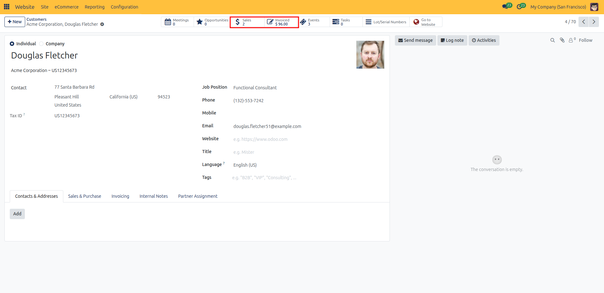

* **Search & Filters**: Search by name, email, or company, or use custom filters and grouping as described in [Search, Filter, and Group Contacts](../../Contacts/manual/02-search-filter-and-group-contacts.md).

---

### 3. Website Catalog Configuration

While general product settings (such as cost, invoicing policies, and warehouse routes) are managed in standard sales catalogs, website merchandising rules are configured under **eCommerce** > **Products**.

* **Master Catalog & Inventory**: For setting up product templates, variants, and stock tracking, see [View All Products](../../Sales/manual/06-view-all-products.md).
* **Frontend Pages & SEO**: For product page URLs, SEO metadata, and frontend layout editing, see [Products & Courses Management](./06-products-and-courses.md).

#### Products & Website Visibility

In product list views, the **Is Published** column is read-only and displays whether an item is active online without permitting inline edits.

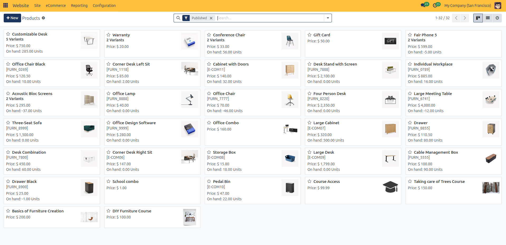

You can publish or unpublish a product using either of two methods:

* **From the Product Form**:
  1. In the top administrative bar, click **eCommerce** > **Products** > **Products**.
     * *Catalog Search Tip*: This view filters for **Published** products by default. If your product is currently unpublished, remove the **Published** filter chip from the search bar to locate it.
  2. Click on the product row to open its form view.
  3. Switch to the **Sales** tab.
  4. Under the **Ecommerce Shop** section:
     * **Is Published**: Check this box to make the product visible to shoppers in `/shop`. Uncheck it to hide the product from the public catalog.
     * **Website**: Leave blank to publish across all websites, or select a specific website domain in multi-website databases.

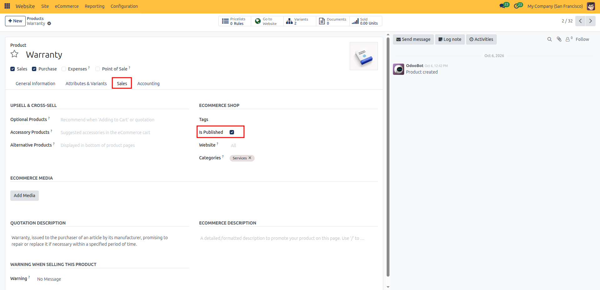

* **From Product Pages Kanban View**:
  1. In the top administrative bar, click **Site** > **Products**.
  2. Click the **Kanban view** switcher icon in the upper-right corner.
  3. On the target product card, click the interactive **Published / Not Published** toggle switch in the footer to change its status instantly without opening the product form.

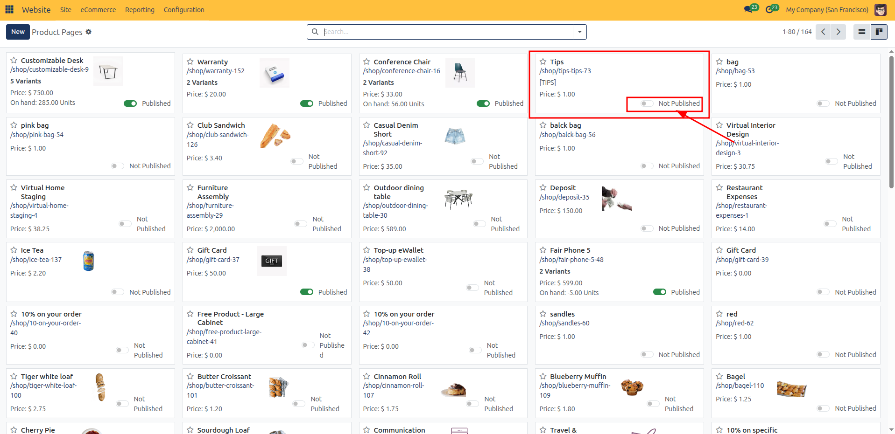

#### Product Merchandising & Media

When editing a product (**eCommerce** > **Products** > **Products**), configure promotional presentation and upselling rules across the **General Information** and **Sales** tabs:

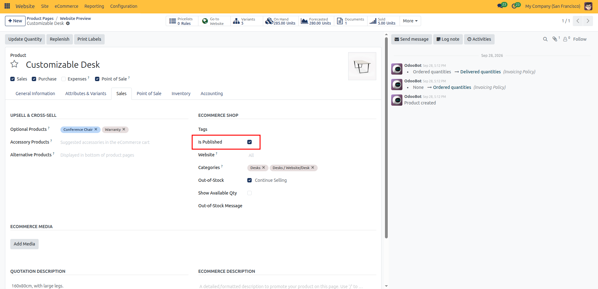

* **Compare to Price** (`General Information` tab): Set an original baseline price to display a strikethrough comparison *(e.g., ~~$120~~ $99)*, visually highlighting promotional discounts to shoppers.
* **Alternative Products** (`Sales` tab > **Upsell & Cross-sell**): Select related products to display as recommendations at the bottom of the product detail page under *"Alternative Products"*.
* **Accessory Products** (`Sales` tab > **Upsell & Cross-sell**): Select add-on items suggested in the shopping cart pop-up drawer when customers add this item to their cart.

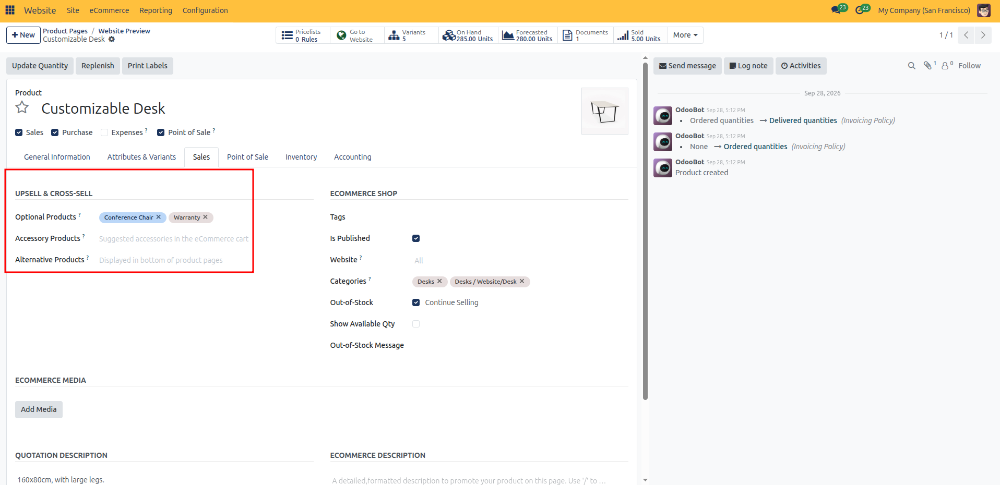

When shoppers add items with configured optional or accessory products to their cart, CURQ displays a configuration modal showcasing available add-ons directly before checkout:

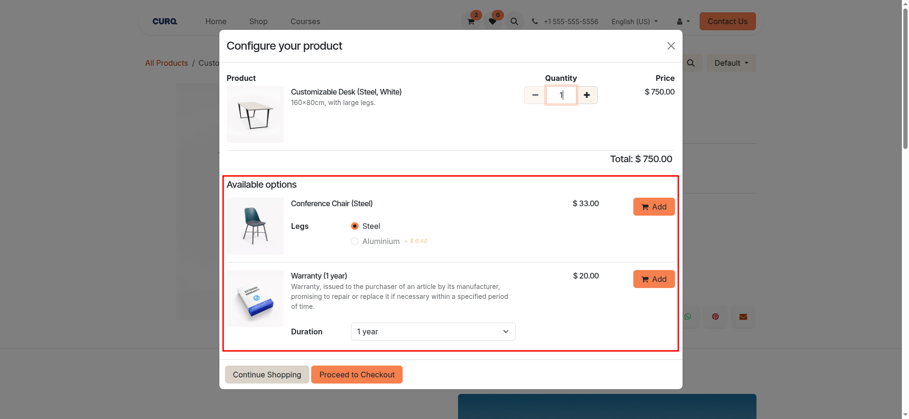

* **eCommerce Media** (`Sales` tab > **eCommerce Media**): Click **Add Media** to upload additional high-resolution images or embed video links for the product page image gallery.

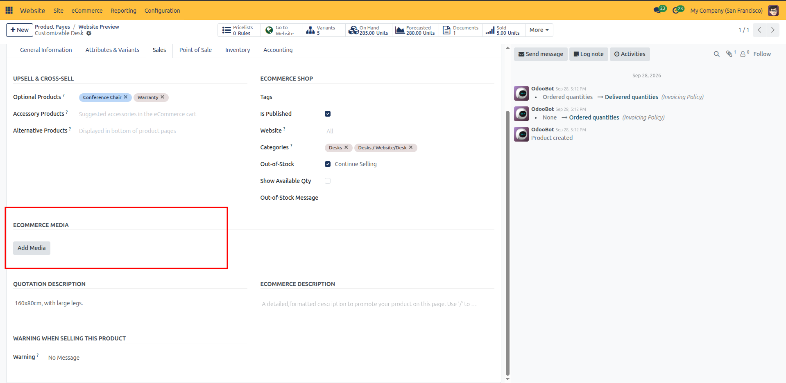

* **eCommerce Description** (`Sales` tab > **Ecommerce Description**): Enter formatted rich-text marketing copy to showcase product specifications and features directly on the `/shop` product page.

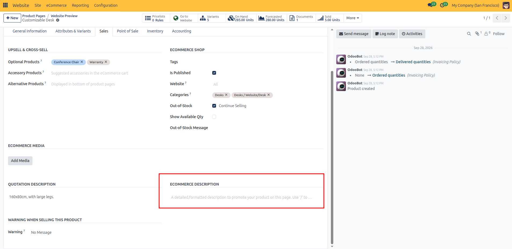

#### Pricelists & Web Pricing Rules

General pricelist creation, pricing formulas, and wholesale tiers are managed in Sales; for complete setup instructions, see [Configuring Pricelists and Pricing Rules](../../Sales/procedures/04-pricelists-and-pricing-rules.md).

Under **eCommerce** > **Products** > **Pricelists**, view and configure website-specific pricing rules:

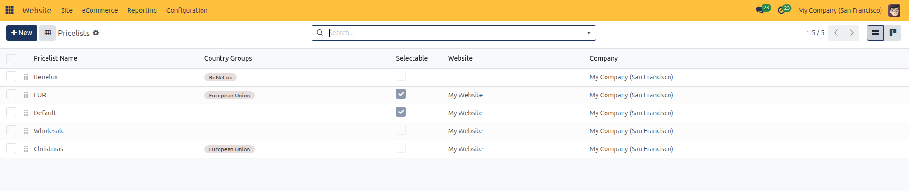

Open any pricelist to configure options under the **Price Rules** and **Ecommerce** tabs:

* **Price Rules Tab**: Define percentage discounts, formula margins, or fixed prices for specific products or entire catalogs:

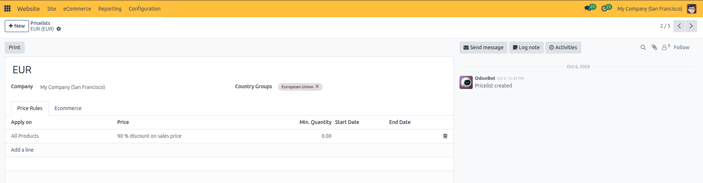

* **Ecommerce Tab**:
  * **Website**: Restrict the pricelist to a specific website domain, or leave blank to make it available across all websites.
  * **Selectable**: Enable this option to let online shoppers manually choose this pricelist from the website currency and pricing dropdown menu.
  * **Code / E-commerce Promotional Code**: Enter a promotional code *(e.g., `EU`)* that automatically activates this pricelist when entered during online checkout or visited via promotional link.

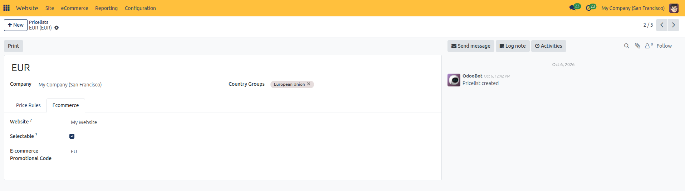

##### Shopper Experience with Selectable Pricelists and Promo Codes

* **Selectable Pricelist Dropdown**: When **Selectable** is enabled, shoppers can switch pricing and currencies from the dropdown located on the catalog page or individual product pages:

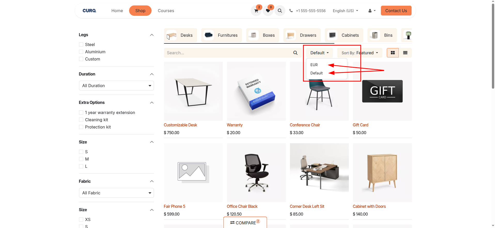

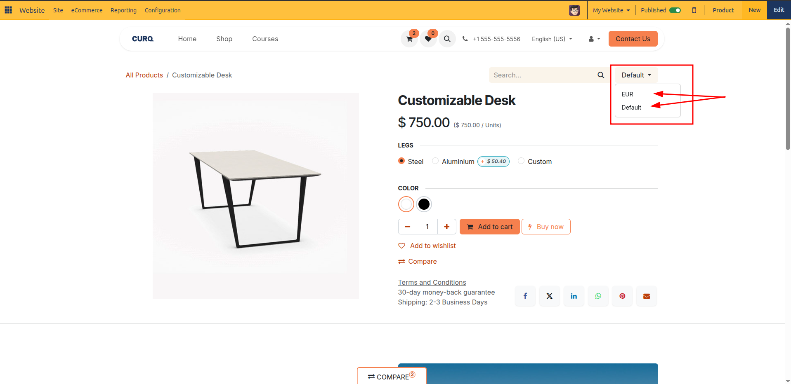

* **Applying Promotional Codes at Checkout**:
  * Standard catalog orders display regular base pricing:

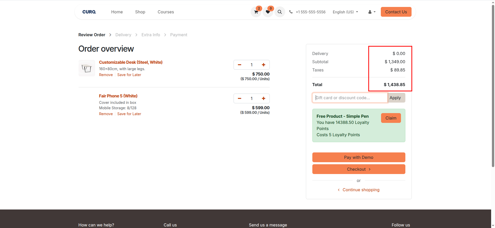

  * When shoppers enter the promotional code into the **Gift card or discount code** field and click **Apply**, CURQ recalculates the order lines using the discount rules defined on the pricelist:

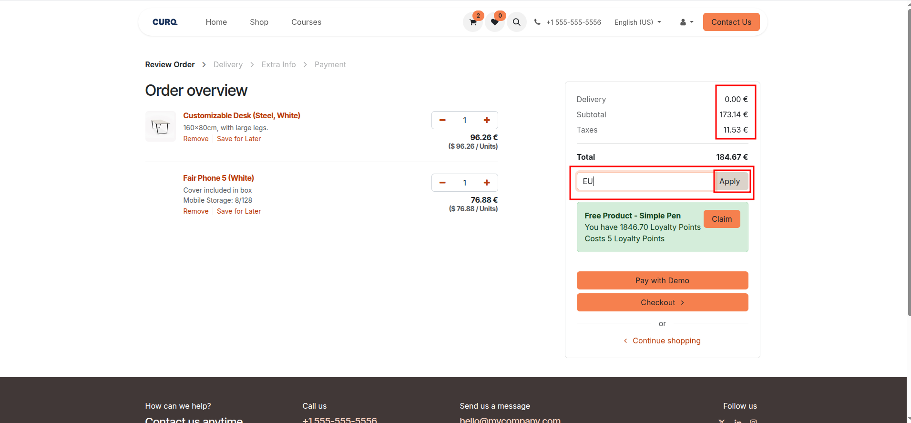

#### eCommerce Categories

Organize how items are grouped and navigated in your online store (`/shop`):

1. In the top administrative bar, click **eCommerce** > **Products** > **eCommerce Categories**.

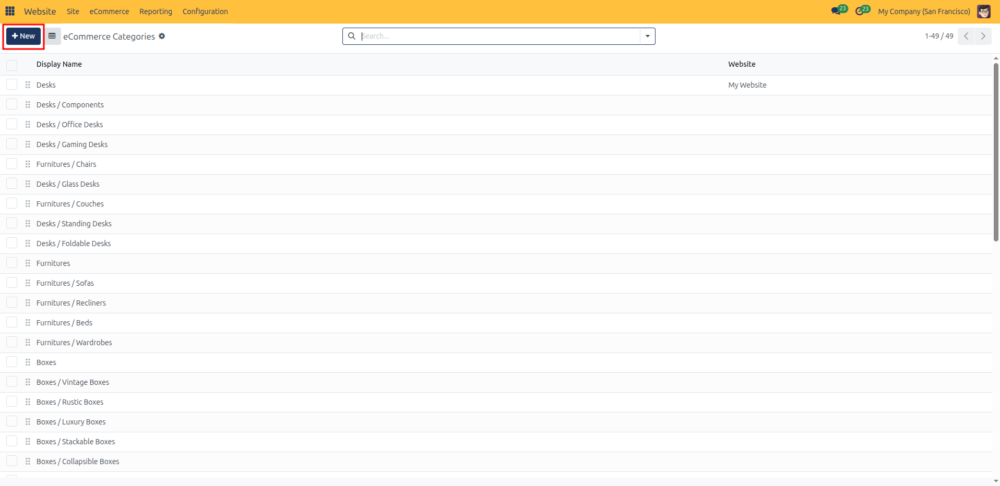

2. Click **New** to create a category, or select an existing one to edit.
3. Configure category settings:
   * **Category Image**: Upload an image or icon representing the category.
   * **Name**: Enter the category title displayed in store navigation *(e.g., `Desks`)*.
   * **Parent Category**: Select a parent category to create nested hierarchical menus and breadcrumbs.
   * **Website**: Restrict the category to a specific website, or leave blank to display across all websites.
   * **Description**: Enter promotional or informational text displayed on the category browsing page.

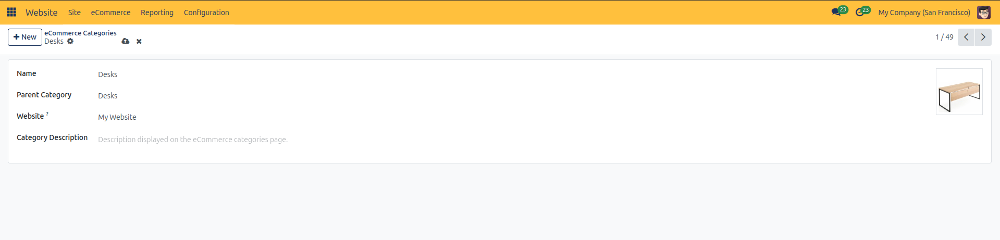

4. Click **Save**.
5. **Assigning to Products**: Open any product (**eCommerce** > **Products** > **Products**), switch to the **Sales** tab, and select one or more categories in the **Categories** field under **Ecommerce Shop**. Items immediately appear in those category navigation aisles on your website (`/shop`).

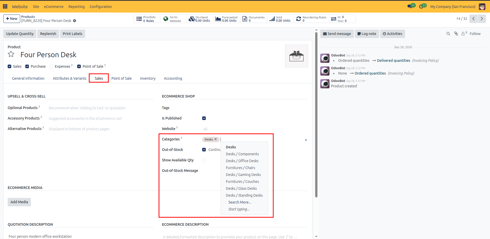

#### Attributes, Combo Choices & Tags

General variant attributes, combo choices, and product tags are managed in Sales; for complete setup instructions, see [Configuring Product Attributes and Variants](../../Sales/procedures/02-product-variants.md), [Combo Choices Setup](../../Sales/procedures/11-combo-choices-setup.md), and [Product Tags Setup](../../Sales/procedures/13-product-tags-setup.md).

Under **eCommerce** > **Products**, configure variant options, bundling, and catalog tags with website-specific settings:

##### Attributes (`eCommerce > Products > Attributes`)

Configure product attributes and their visibility in the online store:

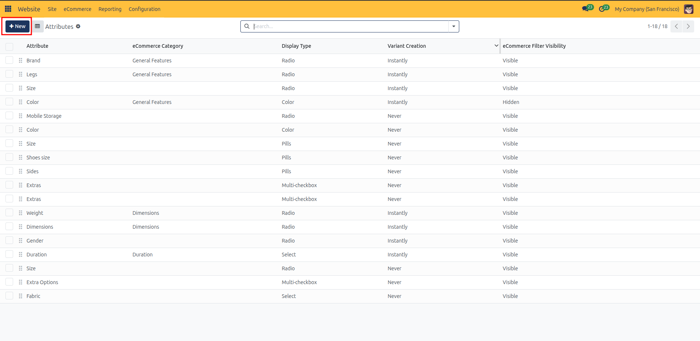

Open an attribute to configure its website controls:

* **eCommerce Filter**:
  * Set to **Hidden** to keep the attribute selectable on individual product pages while hiding it from the `/shop` sidebar filter list:

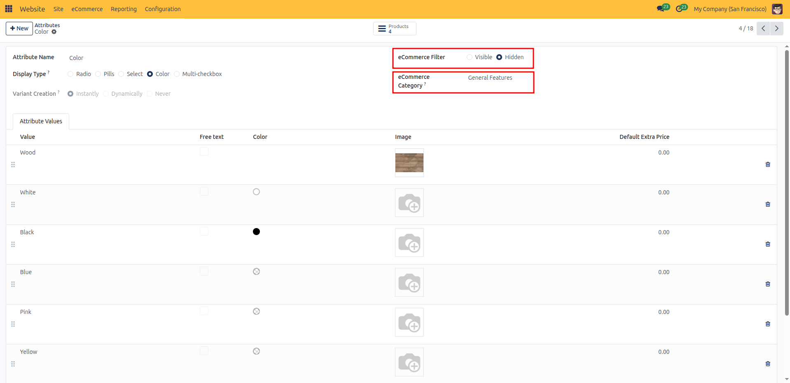

  * Set to **Visible** *(default)* to include the attribute as an interactive filtering facet in the `/shop` sidebar:

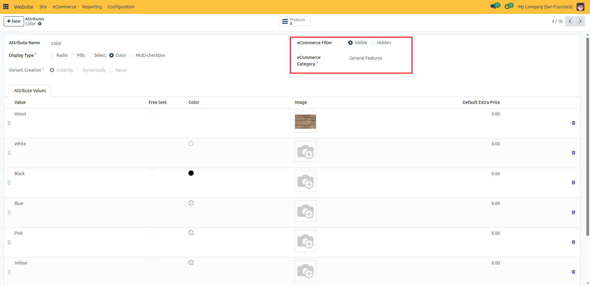

* **eCommerce Category**: Assign an attribute category *(such as `General Features` or `Dimensions`)* to group related attributes into structured sections on the product comparison page (`/shop/compare`) and the frontend specifications table.

##### Shopper Experience with Attribute Filters

When attributes are set to **Visible**, shoppers can filter catalog products directly from the left sidebar on `/shop`:

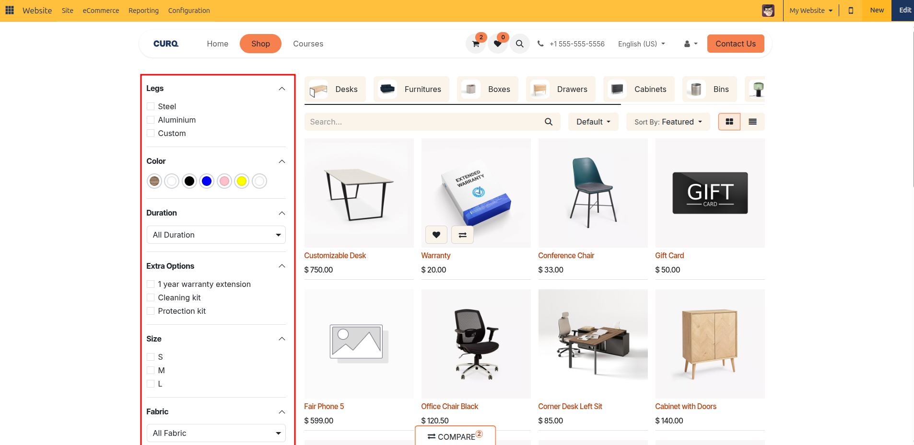

Selecting an attribute facet immediately refines the displayed product catalog:

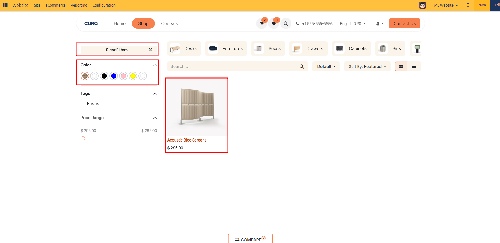

##### Combo Choices (`eCommerce > Products > Combo Choices`)

Group complementary products into combo choices or packaged sets for promotional website ordering:

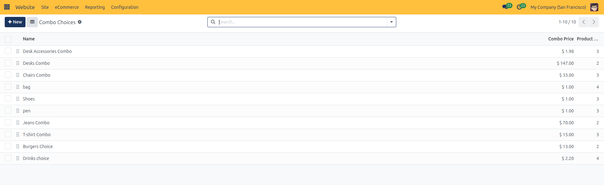

Click **New** or open an existing combo choice to configure the bundled product lines and extra prices:

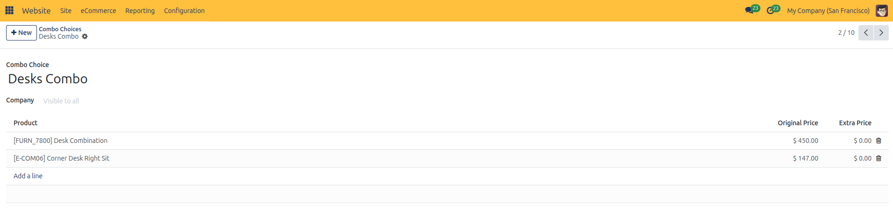

When ordering a combo product online, shoppers can customize each bundle selection in a dedicated modal:

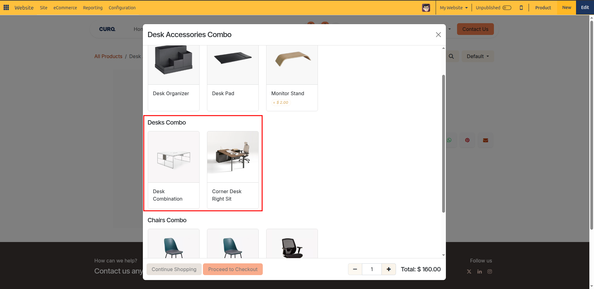

##### Product Tags (`eCommerce > Products > Product Tags`)

Create searchable tags to classify catalog items and showcase badge highlights on website product cards:

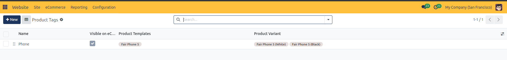

Open a tag to configure its website display options:

* **Visible on eCommerce**: Check this box to display the tag badge on website product cards and product pages. Uncheck to keep the tag strictly internal.
* **Color / Image**: Choose a badge color or upload a custom image/icon badge *(uploading an image overrides the badge color on the website)*.

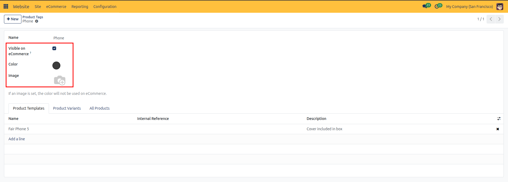

When enabled, tag badges display directly on the website product page:

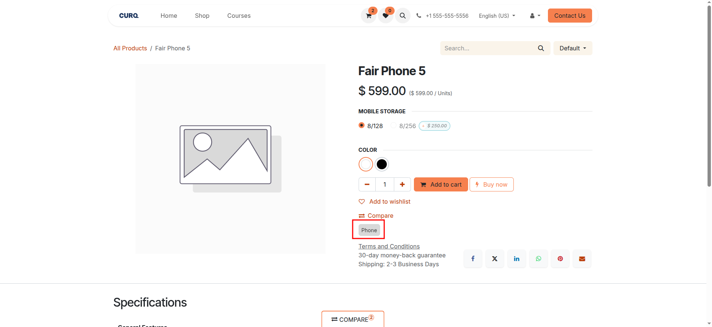

Online shoppers can also use tags as filtering facets in the store sidebar:

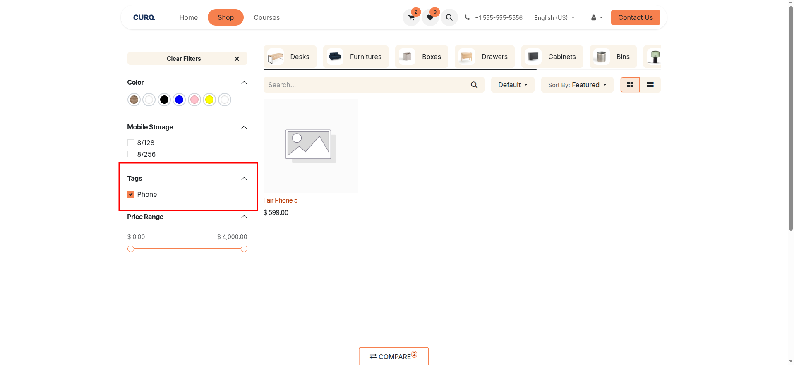

#### Product Ribbons

Highlight specific items on the website with visual badge ribbons *(such as "Sale", "New!", "Sold out", or "Out of stock")*:

##### Defining Ribbons

1. In the top administrative bar, click **eCommerce** > **Products** > **Product Ribbons**.

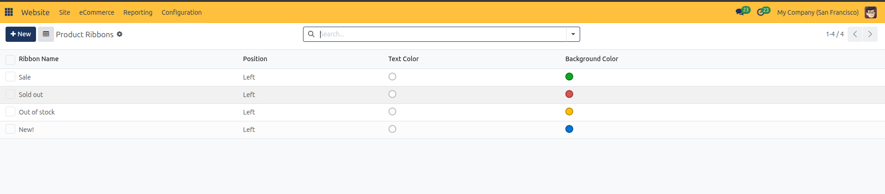

2. Click **New** to define a ribbon badge:
   * **Ribbon Name**: Enter the text displayed directly on the badge *(e.g., `Sale`, `New!`, `Featured`)*.
   * **Position**: Choose **Left** or **Right** to control badge placement on the product card.
   * **Background Color**: Select the badge background color using the color picker *(defaults to black `#000000`)*.
   * **Text Color**: Select the text font color using the color picker *(defaults to white `#FFFFFF`)*.

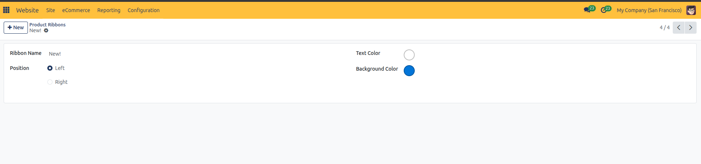

3. Click **Save**.

##### Applying a Ribbon to a Product

Ribbons cannot be assigned inline from backend list views (the product list view is read-only for ribbons, and the backend form view hides the field behind Developer Mode). 

To apply a ribbon to a product as a standard user:

1. Open the website store catalog by navigating to `/shop`.
2. Click **Edit** in the top navigation bar to open the website builder.
3. Click on the product card inside the catalog grid (`#products_grid`).
4. In the right-hand **Customize** sidebar under product options, click the **Ribbon** dropdown.

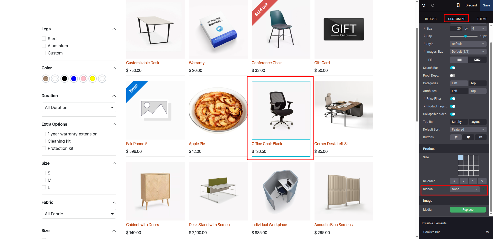

5. Select the desired ribbon *(such as `Sale`, `New!`, `Sold out`, or `Out of stock`)*, or choose **None** to remove an assigned ribbon.
   * You can also click the **`+`** (create) button next to the dropdown to define and style a new ribbon directly from the sidebar.

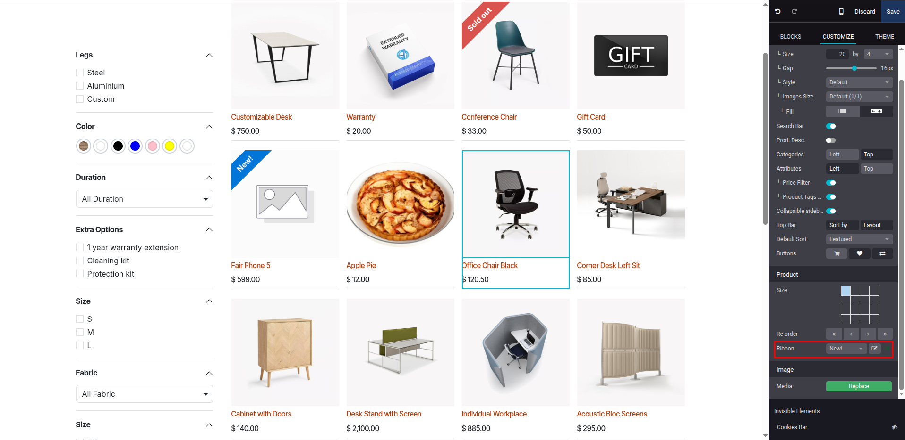

6. Click **Save** in the top bar. The ribbon badge immediately displays on the product card:

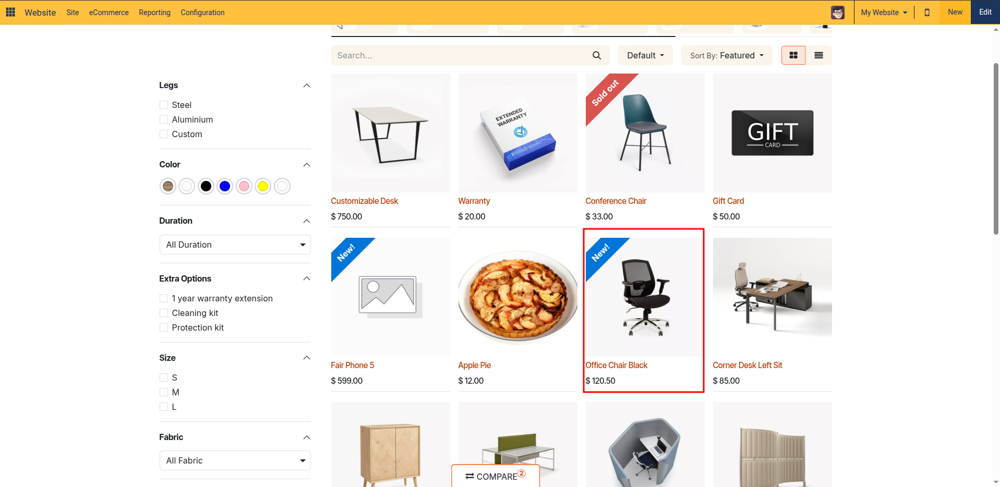

*(Note: In the backend, the `Ribbon` field on the product template form view is restricted to Developer Mode. When Developer Mode is active, the Ribbon field appears under the **Sales** tab > **Ecommerce Shop** section).*

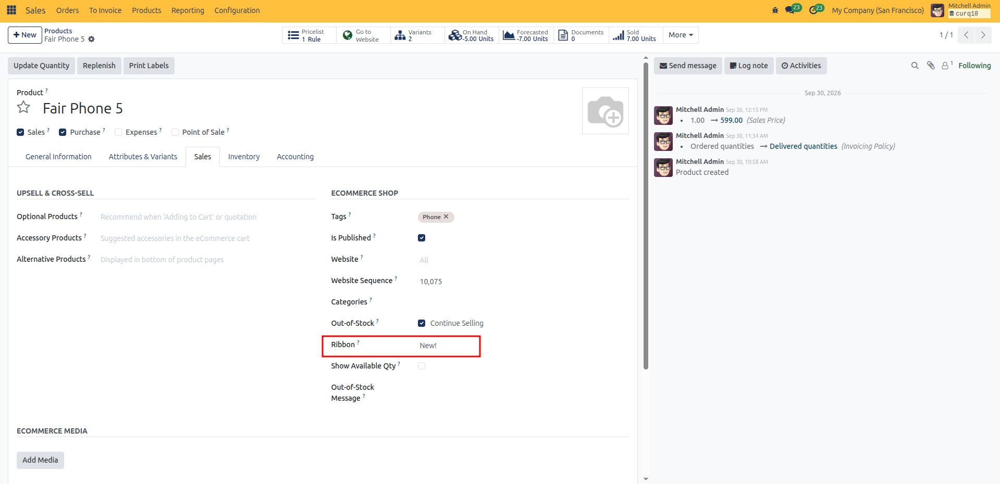

---

### 4. Loyalty, Discounts & Gift Cards

General promotional campaigns, loyalty programs, and gift card generation are managed in Sales; for complete setup instructions, see [Configuring Discount and Loyalty Programs](../../Sales/procedures/06-discount-and-loyalty-programs.md).

#### Enabling or Disabling Programs for the Website

All promotional, coupon, and gift card programs share the same master records between Sales and eCommerce. To control whether a program is active on your website:

1. In the top administrative bar, navigate to the target menu under **eCommerce** > **Loyalty**:
   * Click **Discount & Loyalty** for promotional codes, coupons, loyalty point schemes, or Buy X Get Y programs.
   * Click **Gift cards & eWallet** for digital gift cards and prepaid electronic wallets.

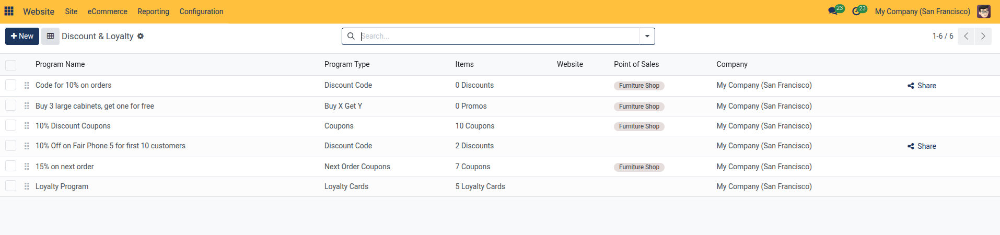

2. Click on the target program *(e.g., `Code for 10% on orders` or `Gift Card`)* to open its form view.
3. Locate the **Available On** section on the right side of the form:
   * **To Enable for Website**:
     1. Check the **Website** checkbox. This immediately activates the promotion or gift card program for online shoppers during `/shop` checkout.
     2. *(Optional Website Restriction)*: In the **Website** dropdown that appears directly below the checkbox, leave it blank (*All websites*) to allow redemption across all websites, or select a specific website domain in multi-website databases.
   * **To Disable for Website**:
     1. Uncheck the **Website** checkbox.
     2. The program is immediately deactivated for the website. Shoppers will no longer be able to apply promo codes, earn points, or redeem gift cards/eWallets during checkout.

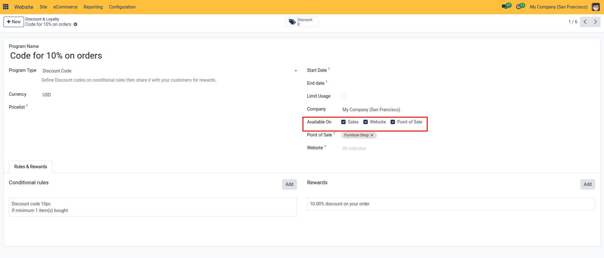

4. Click the manual save icon or navigate away to save changes.

#### Program Types and Website Capabilities

* **Discount & Loyalty**:
  * **Share Promo Code Link**: In the **Discount & Loyalty** list view, click the **Share** button *(share icon)* on any Discount Code row to copy a direct URL that automatically applies the promo code to the customer's online shopping cart. *(The Share button appears only in the list view for Discount Code programs and is not present on the form view)*.

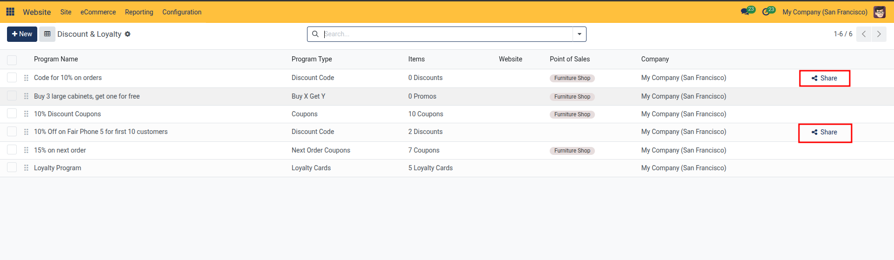

Clicking **Share** opens the **Share Discounts** dialog, providing the direct promotional link and target redirect route *(such as `/shop`)*:

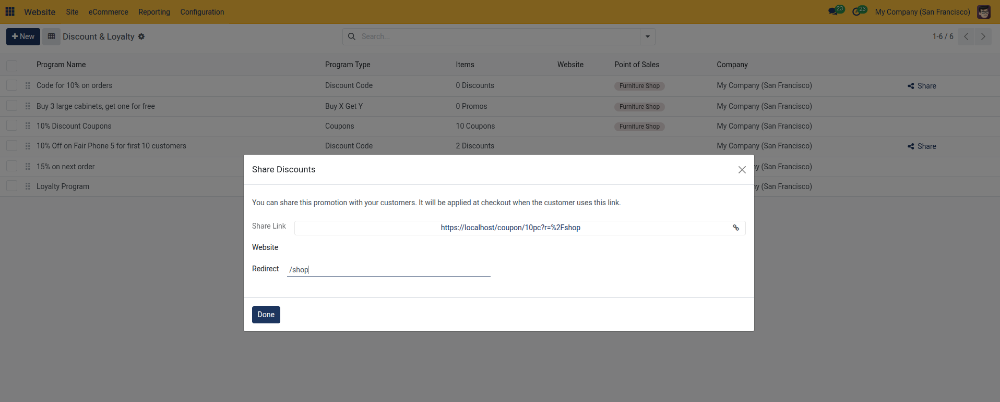

* **Gift cards & eWallet**:

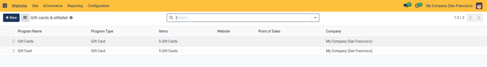

  * **Selling Gift Cards Online**: In the program form, ensure the item specified in the **Gift Card Products** field is published (**eCommerce** > **Products** > **Products** > **Sales** tab > check **Is Published**). When purchased online, CURQ automatically generates and emails the gift card code using the configured **Email template**.
  * **Online Checkout Redemption**: Ensure **Available On > Website** is checked so shoppers can enter their gift card code or pay using their eWallet balance directly in the website checkout interface.

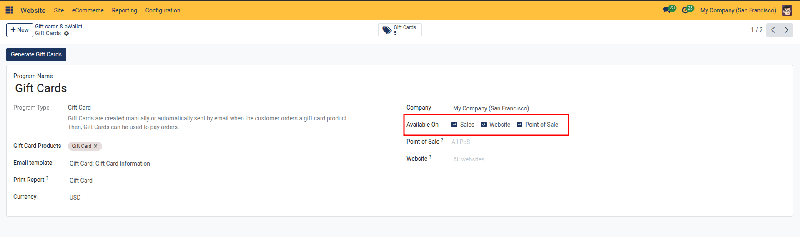
