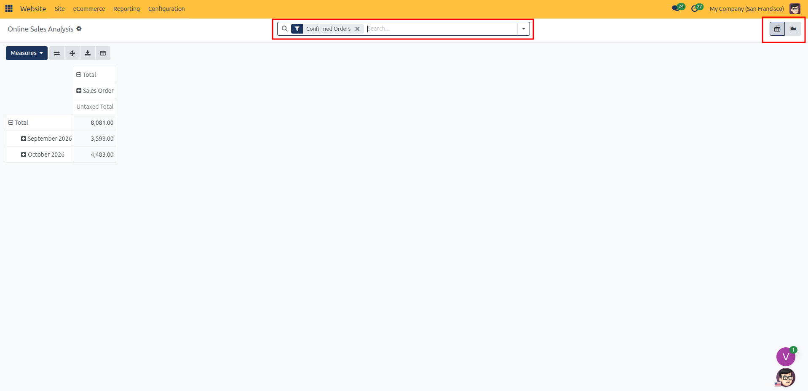
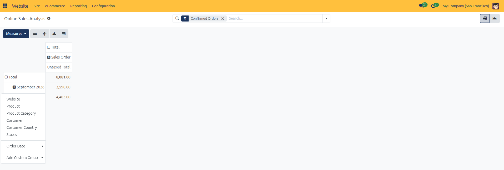
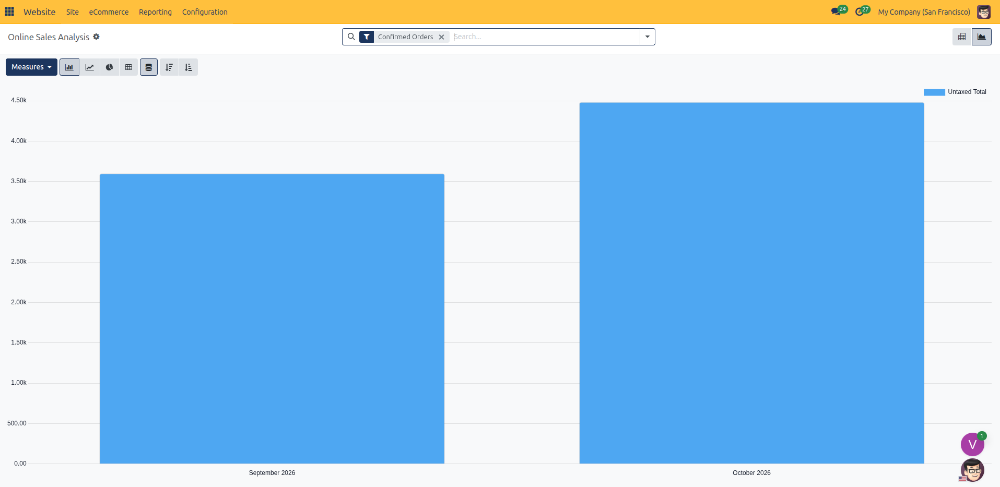
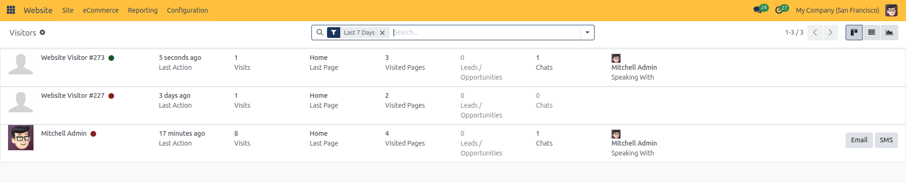
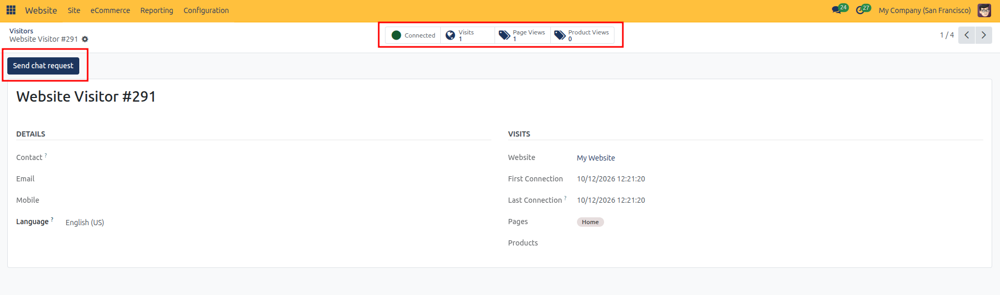
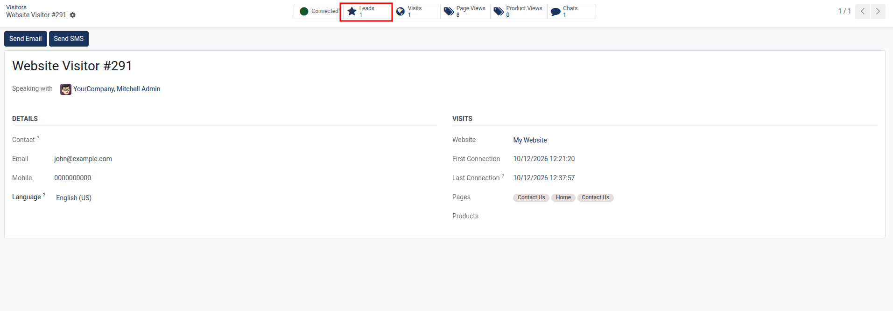
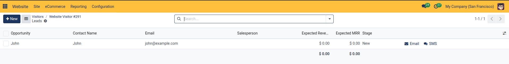
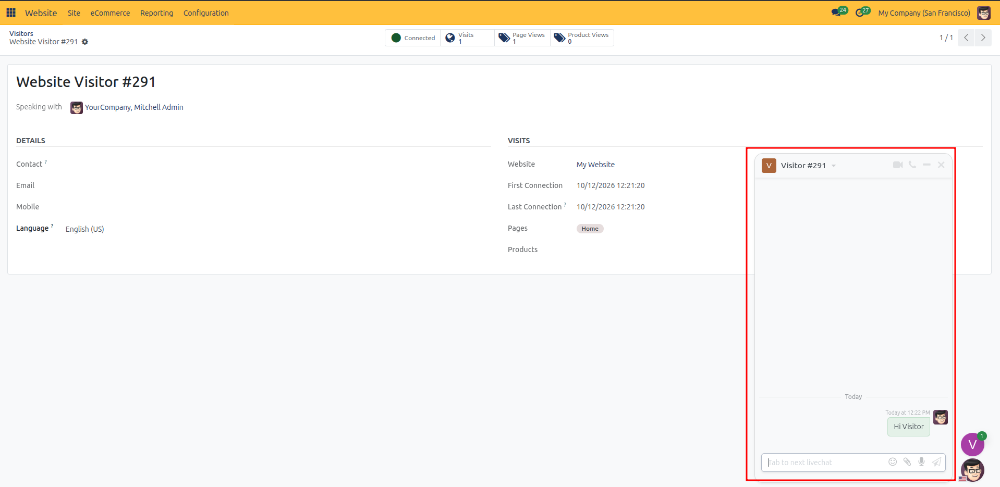
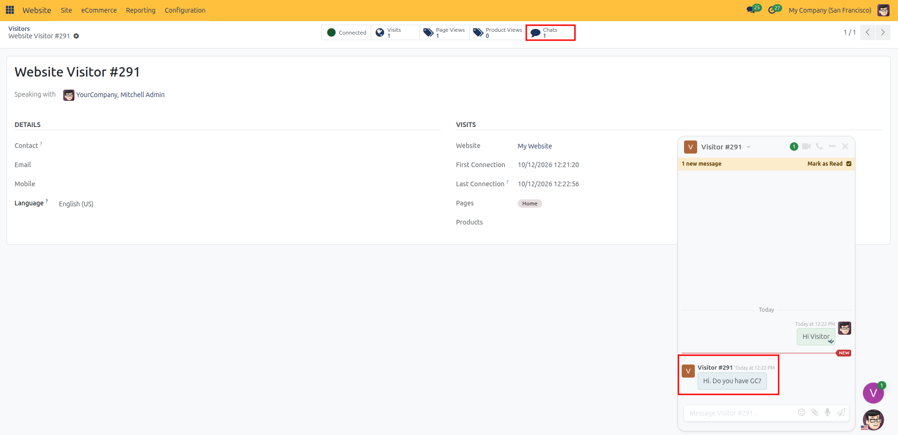
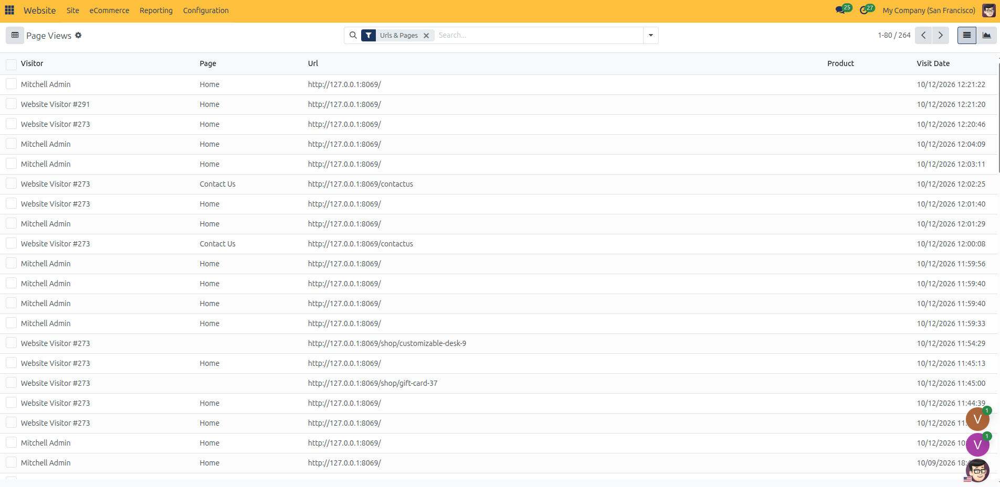

# Website Reporting & Analytics

Monitor online store revenue, track web visitor engagement, audit granular page views, and analyze website conversion performance in CURQ 18.

---

> [!NOTE]
> Website reporting features are accessible to users with the **Website / Editor and Designer** or **Sales / Administrator** access rights.

---

### Accessing Website Reporting Menus

All website analytics and reporting tools are consolidated in the top administrative bar under the **Reporting** menu:

1. In the backend, open the **Website** application.
2. Click **Reporting** in the top navigation bar to access the active reporting submenus:
   * **Analytics**: Opens the web analytics dashboard for high-level visitor insights and traffic tracking.
   * **Online Sales**: Launches multi-dimensional pivot tables and graphical analysis for sales orders placed through the website.
   * **Visitors**: Tracks live and historical visitor sessions, customer identification, and engagement activities.
   * **Page Views**: Displays the granular audit log of individual URLs, pages, and products viewed across your site.

| Menu Option | Available Views | Primary Focus |
| --- | --- | --- |
| **Analytics** | Dashboard | Visitor traffic overview, page impressions, and web analytics integration *(Plausible)*. |
| **Online Sales** | Pivot, Graph | Multi-dimensional analysis of confirmed web sales, product lines, customer countries, and revenue. |
| **Visitors** | Kanban, List, Form, Graph | Online user tracking, visitor connection status, page histories, product interest, and direct outreach. |
| **Page Views** | List, Graph | Granular event logging of every visited URL, timestamp, visitor session, and product page impression. |

---

### 1. Web Analytics Dashboard

The **Analytics** view (**Reporting** > **Analytics**) serves as the central traffic monitoring dashboard for your website.

#### Features and Capabilities

* **Multi-Website Switching**: In multi-website environments, use the website selector buttons in the upper-right corner of the control panel to switch between domains and view isolated analytics per website.
* **Go to Website**: Click the **Go to Website** button in the top bar to immediately navigate to the frontend of the active website.
* **Web Analytics Integration**: CURQ connects natively with privacy-friendly Plausible Analytics to render real-time traffic statistics directly inside the backend dashboard:
  * Unique visitor count and total visits.
  * Page bounce rate and average visit duration.
  * Top entry pages, exit pages, and referral domains.
  * Geographic visitor heatmaps and device breakdown *(desktop, mobile, tablet)*.

---

### 2. Online Sales Analysis

The **Online Sales Analysis** (**Reporting** > **Online Sales**) provides deep analytical reporting using CURQ's multi-dimensional reporting engine.

The report automatically filters to show only orders placed through the website, isolating online transactions from direct backend sales or point-of-sale orders.

#### Default View and Filters

* **Default Filter**: Pre-filtered with **Confirmed Orders**, focusing exclusively on validated customer purchases.
* **Default Display**: Opens in a **Pivot** view with **Order Date** grouped along rows, **Status** across columns, and **Untaxed Amount** as the initial measure.
* **Toggle View**: Switch between **Pivot** and **Graph** views using the view icons in the upper-right corner.

#### Available Measures

Click the **Measures** dropdown in the top-left corner of the view to plot or calculate any of the following metrics:

| Measure | Description |
| --- | --- |
| **Untaxed Amount** | Subtotal amount of sold items before taxes *(default measure)*. |
| **Total** | Gross sales order total including applied taxes. |
| **Qty Ordered** | Total number of product units ordered by online customers. |
| **Qty Delivered** | Number of units fulfilled and delivered to customers. |
| **Qty Invoiced** | Number of product units billed on customer invoices. |
| **Qty to Invoice** | Fulfilled units pending invoice generation. |
| **Discount Amount** | Cumulative discount amounts deducted from retail prices. |
| **Gross Weight** | Total shipping weight of ordered products. |
| **Volume** | Total cubic volume of ordered goods. |
| **Count** | Total count of sales order line records matching the criteria. |

#### Grouping and Dimension Breakdown

Expand rows and columns in the Pivot table or group data points in the Graph view using standard dimensions:

* **Website**: Segment sales across different websites in multi-website setups.
* **Product**: Analyze revenue and volume generated by specific items.
* **Product Category**: Group revenue by catalog classification.
* **Customer**: Inspect top online purchasers and customer account totals.
* **Customer Country**: Track geographic origin of online orders based on shipping or billing addresses.
* **Status**: Compare confirmed orders against cancelled or draft orders.
* **Order Date**: Aggregate sales by Year, Quarter, Month, Week, or Day.

#### Graph View Customization

When switching to **Graph** view, select between:

* **Bar Chart**: Compare discrete categories or products side by side (supports stacked or grouped presentation).
* **Line Chart**: Track revenue or quantity progression continuously over time.
* **Pie Chart**: Visualize proportional category or geographic market share.
* **Sorting**: Sort data in ascending or descending order directly from the graph control bar.

---

### 3. Website Visitors Tracking

The **Visitors** menu (**Reporting** > **Visitors**) tracks individual web sessions, providing real-time audience intelligence, browsing history, and lead generation tools.

#### View Modes and Filters

* **Default Filter**: Automatically filters for activity within the **Last 7 Days**.
* **Supported Views**: **Kanban**, **List**, **Form**, and **Graph**.
* **Visual Status**: In List and Kanban views, visitors currently browsing the site display a green presence indicator, while inactive visitors display an offline indicator.

#### Visitor List View

| Column | Description |
| --- | --- |
| **Country Flag** | Country flag icon representing the visitor's detected geographic location. |
| **Name** | Identified contact name *(if customer is logged into the portal)* or auto-assigned anonymous visitor tag *(e.g., `Visitor #128`)*. |
| **Last Connection** | Date and timestamp of the visitor's most recent interaction on the website. |
| **Language** | Preferred browsing language detected from the visitor's browser or selected on the site. |
| **Visits** | Cumulative count of site visits initiated by this visitor. |
| **Pages** | Badges showing specific web pages visited during the session. |
| **Products** | Badges listing eCommerce products inspected by the visitor. |
| **Leads** | Total CRM leads associated with or generated by this visitor. |
| **Direct Outreach** | Contextual action buttons allowing operators to trigger **Email**, **SMS**, or **Livechat** directly from the list row. |

#### Visitor Form View and Smart Buttons

Clicking any visitor opens the detailed **Visitor Form**, displaying browsing history and related records:

* **Connected / Offline Badge**: Real-time presence indicator showing whether the visitor is currently browsing.
* **Visits Counter**: Total visits logged for the visitor profile.
* **Page Views Smart Button**: Opens the full list of URL tracks and timestamps recorded for this individual.
* **Product Views Smart Button**: Displays catalog items browsed by the user along with view frequencies.
* **Leads Smart Button**: Dynamic button that appears once the visitor has at least one linked CRM opportunity (requires the **CRM** application).
* **Chats Smart Button**: Dynamic button that appears once the visitor has at least one recorded live chat conversation (requires the **Live Chat** application).

> [!NOTE]
> **Application Requirements for Visitor Actions**:
> * **Live Chat Application**: Required for the **Chats** smart button and the **Send chat request** button in the form header. If the Live Chat app is not installed, these controls do not appear on the visitor form.
> * **CRM Application**: Required for the **Leads** smart button. If the CRM app is not installed, lead tracking controls do not appear on the visitor form.

When a visitor submits an inquiry through a website form configured to create opportunities, the **Leads** smart button displays the count of linked opportunities:

Clicking the **Leads** smart button opens the list of CRM opportunities associated with that visitor:

#### Direct Visitor Engagement

Operators can initiate outbound communication directly from the visitor form header:

1. **Send Email**: Click **Send Email** in the form header to dispatch an email to known contacts.
2. **Send SMS**: If a mobile phone number has been captured, click **Send SMS** to transmit a targeted text message.
3. **Send Chat Request**: If the visitor is actively browsing online, click **Send chat request** to open a proactive live chat prompt on the visitor's screen (requires the **Live Chat** application).

Once a message is exchanged, the conversation is permanently logged and the **Chats** smart button appears on the visitor profile:

---

### 4. Page Views Audit Log

The **Page Views** view (**Reporting** > **Page Views**) provides a granular log of page impressions across the site.

#### Event Logging and Search Filters

Every time a visitor navigates to a URL, CURQ records an entry capturing the destination and session:

* **Default Filter**: Pre-filtered with **Urls & Pages**, displaying all tracked web visits.
* **Available Filters**:
  * **Pages**: Filters exclusively for managed website pages.
  * **Urls & Pages**: Displays all tracked URLs including dynamic system routes.
  * **Products**: Filters for impressions on published eCommerce product pages.

#### Page View Data Fields

| Field | Description |
| --- | --- |
| **Visitor** | Reference to the visitor profile that triggered the page impression. |
| **Page** | Title of the managed page record *(if visiting a page created in Page Manager)*. |
| **URL** | Complete relative route accessed by the visitor *(e.g., `/shop/furn-8888-desk` or `/contactus`)*. |
| **Product** | Linked product record if the URL corresponds to an eCommerce product page. |
| **Visit Date** | Exact date and timestamp when the URL was loaded. |

#### Grouping and Traffic Analysis

Use the **Group By** menu to aggregate traffic patterns:

* **Group by Visitor**: Review the complete navigation sequence of individual shoppers.
* **Group by Page / URL**: Identify the most visited web pages and discover traffic concentration.
* **Group by Product**: Discover which products attract the highest shopper attention regardless of sales conversions.
* **Group by Date**: Analyze daily, weekly, or hourly traffic distribution to spot browsing surges.

Switch to **Graph** view to plot URL impression volumes over time or compare product page popularity using bar and line charts.

