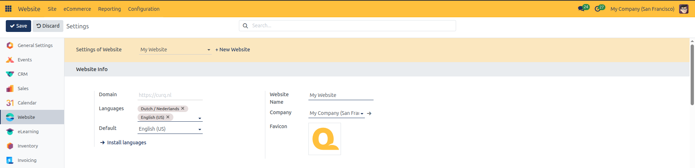

# Website Info Setup

Configure website domain, language localization, company ownership, brand identity, and browser favicon branding in CURQ 18.

---

## Prerequisites

* **Administration**: User must have **Settings** rights to access and modify system configurations.
* **Website**: User must have **Editor and Designer** access rights to manage website properties.

---

### 1. Overview of Website Info

The **Website Info** block under **Website** > **Configuration** > **Settings** establishes the foundational identity, routing address, language availability, and brand icon for your website in CURQ 18.

| Configuration Field | Field Type | Example Value | Description |
| :--- | :--- | :--- | :--- |
| **Domain** | Text input | `https://curq.nl` | Defines the public web address where this website resolves. |
| **Languages** | Tags selection | `English (US)` | Defines all active languages accessible to visitors on the website. |
| **Default** | Dropdown | `English (US)` | Sets the primary language loaded when visitors access the root website path. |
| **Website Name** | Text input | `My Website` | Internal label used across the backend to identify the website. |
| **Company** | Dropdown | `My Company (San Francisco)` | Assigns the legal operating company responsible for online orders and accounting. |
| **Favicon** | Image upload | *(Graphic)* | The browser tab icon displayed alongside the website title in browsers. |

---

### 2. Accessing Website Info Settings

To access and configure Website Info:

1. In the backend, open the **Website** application.
2. Click **Configuration** in the top navigation bar.
3. Select **Settings** to open the Website configuration page.
4. At the top of the page under **Settings of Website**, select the target website from the dropdown menu *(for example, `My Website`)*.

---

### 3. Step-by-Step Configuration

Under the **Website Info** block, configure the identity parameters:

1. **Select Target Website**: In the header bar under **Settings of Website**, select the website you want to update *(for example, `My Website`)*.
2. **Domain**: In the **Domain** field, enter the full public URL of the website *(for example, `https://curq.nl`)*. If left empty, the site serves as the fallback website for unmatched domains.
3. **Languages**: In the **Languages** field, select the active languages available to visitors on this site.
4. **Default Language**: If two or more languages are active, the **Default** field appears. Select the primary baseline language *(for example, `English (US)`)*.
5. **Install Languages**: If a required language is not in the list, click the **Install languages** link button to open the installation wizard, select your target language, and click **Add**.
6. **Website Name**: In the **Website Name** field, enter the clear operational name *(for example, `My Website`)*.
7. **Company**: In the **Company** field, select the legal company entity associated with the website *(for example, `My Company (San Francisco)`)*.
8. **Favicon**: Click the edit icon on the **Favicon** image box and upload a graphic file. CURQ automatically formats and converts the image into a 256x256 ICO icon.
9. Click **Save** in the top-left corner of the settings view to apply changes.
