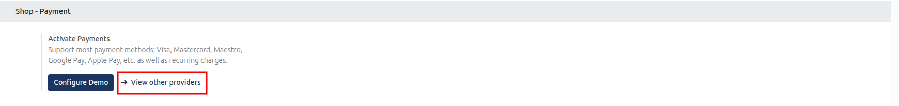
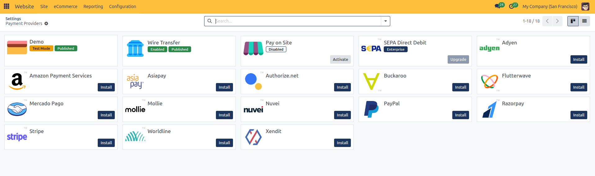
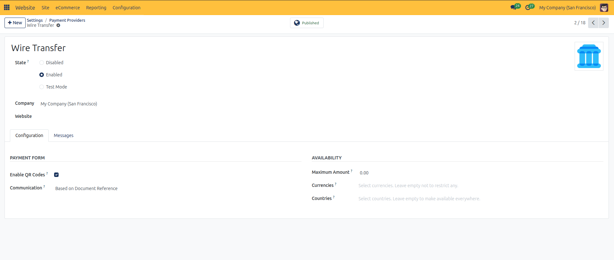
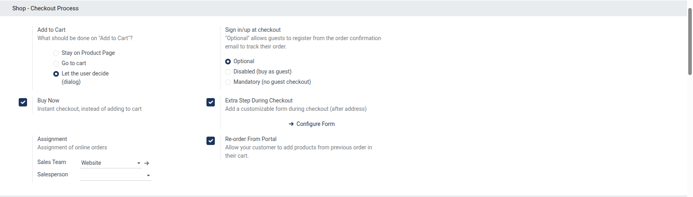
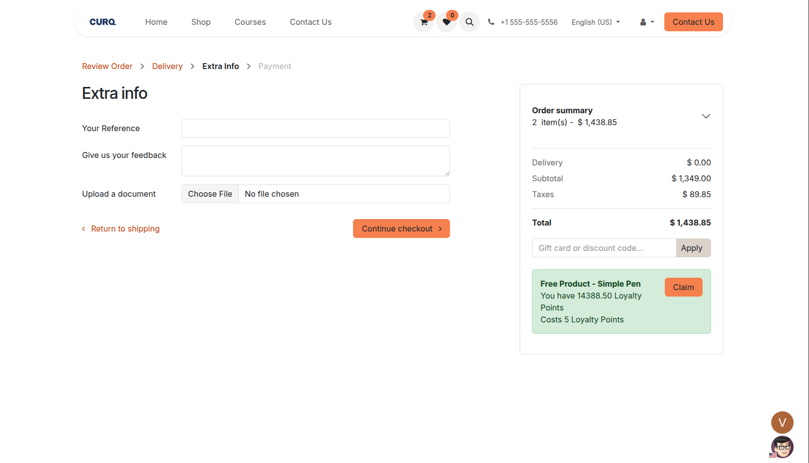
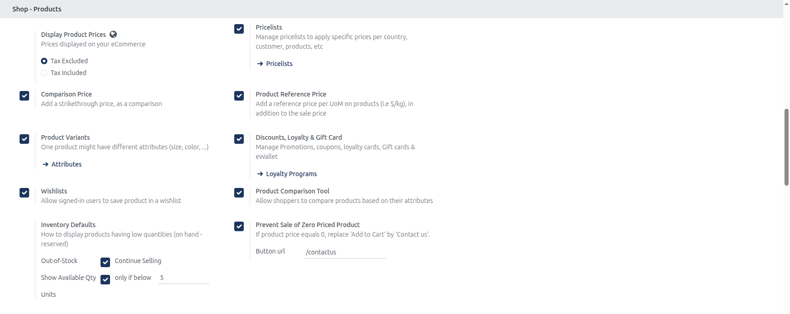

# Shop and Checkout Settings Setup

Configure payment activation, cart redirection, guest checkout policies, order assignment, tax display, and catalog pricing rules in CURQ 18.

---

## Prerequisites

* **Administration**: User must have **Settings** rights to access and modify system configurations.
* **Website**: User must have **Editor and Designer** access rights to manage eCommerce settings.
* **eCommerce Application**: The **eCommerce** app must be installed in the database to display the Shop settings sections.

---

### 1. Overview of Shop Settings

Under **Website** > **Configuration** > **Settings**, the Shop configuration controls three critical operational areas:

| Operational Area | Focus | Primary Business Controls |
| :--- | :--- | :--- |
| **Shop: Payment** | Transaction Processing | Activates customer payment gateways and recurring payment support. |
| **Shop: Checkout Process** | Cart and Conversion Flow | Configures cart button redirection, guest checkout policy, instant checkout, and sales assignment. |
| **Shop: Products** | Merchandising and Pricing | Controls tax display, strikethrough comparison pricing, unit pricing, inventory notices, and zero-price restrictions. |

---

### 2. Accessing Shop Settings

To access and configure Shop and Checkout settings:

1. In the backend, open the **Website** application.
2. Click **Configuration** in the top navigation bar.
3. Select **Settings** to open the Website configuration page.
4. In the top header bar under **Settings of Website**, select the target website from the dropdown menu *(for example, `My Website`)*.
5. Scroll down to the **Shop: Payment**, **Shop: Checkout Process**, and **Shop: Products** configuration blocks.

---

### 3. Shop: Payment Settings

The payment block manages online payment gateways and transaction methods:

| Setting | Type | Description |
| :--- | :--- | :--- |
| **Activate Payments** | Gateway Setup | Enables payment provider integrations supporting credit cards *(Visa, Mastercard, Maestro)*, digital wallets *(Google Pay, Apple Pay)*, and recurring subscription charges. |

Click **Activate Payments** or click **View other providers** to open the centralized registry of online payment gateways:

Clicking any provider card opens its parameters to manage operational state, publishing status, currency restrictions, and maximum transaction amounts:

---

### 4. Shop: Checkout Process Settings

Configure shopper purchasing journeys, registration requirements, and sales order assignments:

| Setting Field | Available Options | Practical Function and Behavior |
| :--- | :--- | :--- |
| **Add to Cart** | * **Stay on Product Page** * **Go to cart** * **Let the user decide (dialog)** | Dictates what happens when a customer clicks the Add to Cart button on a product page. Choosing the dialog option prompts the buyer to either continue shopping or proceed immediately to checkout. |
| **Sign in/up at checkout** | * **Optional** * **Disabled (buy as guest)** * **Mandatory (no guest checkout)** | Regulates customer registration during checkout. **Optional** allows guest checkout while offering account creation from order confirmation emails. **Mandatory** enforces portal login or signup before completing payment. |
| **Buy Now** | Checkbox toggle | Activates an instant checkout button on product pages, bypassing the shopping cart and taking the buyer directly to payment. |
| **Extra Step During Checkout** | Checkbox toggle *(with Configure Form link)* | Injects a customizable questionnaire form after the shipping address step to collect custom delivery notes, VAT numbers, or survey information. |
| **Assignment** | * **Sales Team** *(e.g., `Website`)* * **Salesperson** | Automatically assigns online orders to a designated internal commercial team and account representative for fulfillment and commission tracking. |
| **Re-order From Portal** | Checkbox toggle | Displays a Re-order button in the customer portal order history, allowing registered clients to duplicate past orders directly into a fresh cart. |

#### Step-by-Step Checkout Configuration

1. **Select Add to Cart Flow**: Choose **Go to cart** for quick checkouts, or **Let the user decide (dialog)** if your store sells related accessories and items.
2. **Define Checkout Registration**:
   * For B2C retail shops, select **Optional** to reduce checkout abandonment.
   * For private clubs or trade storefronts, select **Mandatory (no guest checkout)**.
3. **Toggle Buy Now**: Check **Buy Now** if you want one-click purchasing enabled on your product pages.
4. **Configure Extra Form Step**: Check **Extra Step During Checkout** and click **Configure Form** to design custom field requirements. This inserts an **Extra info** page in the checkout pipeline between delivery and payment:

5. **Assign Sales Ownership**: Set **Sales Team** to `Website` and optionally assign a default online order manager in **Salesperson**.
6. **Enable Portal Re-ordering**: Check **Re-order From Portal** to streamline repeat B2B purchasing.

---

### 5. Shop: Products and Merchandising Settings

Configure how prices, discounts, attributes, and stock quantities appear across your eCommerce catalog:

| Setting Field | Available Options | Practical Function and Behavior |
| :--- | :--- | :--- |
| **Display Product Prices** | * **Tax Excluded** * **Tax Included** | Sets catalog pricing presentation. **Tax Excluded** is standard for B2B wholesale portals, while **Tax Included** complies with consumer B2C retail regulations. |
| **Pricelists** | Checkbox toggle | Enables multi-currency, wholesale tiers, and country-specific pricing rules, managed in [Pricelists and Pricing Rules](../../Sales/procedures/04-pricelists-and-pricing-rules.md) and [eCommerce Pricelists](../manual/07-ecommerce.md#4-pricelists-and-currency-selection). |
| **Comparison Price** | Checkbox toggle | Displays a strikethrough original price next to promotional prices to highlight customer savings *(e.g., ~~$ 100.00~~ $ 79.00)*. |
| **Product Reference Price** | Checkbox toggle | Displays unit comparison pricing per unit of measure *(such as `$ 12.50 / kg`)* alongside total retail price. |
| **Product Variants** | Checkbox toggle | Enables attributes and values *(such as size, color, material)* on product pages, managed in [Product Variants](../../Sales/procedures/02-product-variants.md) and [eCommerce Attributes](../manual/07-ecommerce.md#3-product-attributes-and-variants). |
| **Discounts, Loyalty & Gift Card** | Checkbox toggle | Activates promotional coupon codes, loyalty cards, eWallets, and gift voucher redemption fields in shopping carts, managed in [Discount and Loyalty Programs](../../Sales/procedures/06-discount-and-loyalty-programs.md) and [eCommerce Loyalty](../manual/07-ecommerce.md#5-loyalty-programs-and-gift-cards). |
| **Wishlists** | Checkbox toggle | Allows logged-in portal shoppers to bookmark favorite items for future purchase. |
| **Product Comparison Tool** | Checkbox toggle | Enables a side-by-side comparison tray where shoppers compare specifications across multiple products. |
| **Inventory Defaults** | * **Continue Selling** * **Show Available Qty** *(e.g., threshold below `5` Units)* | Dictates inventory display when stock is low. Controls whether out-of-stock items allow backorders and defines threshold alerts for limited inventory. |
| **Prevent Sale of Zero Priced Product** | Checkbox toggle *(Button url: `/contactus`)* | Replaces the Add to Cart button with a Contact Us link whenever a product has a zero sale price, preventing accidental free orders. |

#### Step-by-Step Product Settings Configuration

1. **Set Price Display**: Select **Tax Included** for retail storefronts or **Tax Excluded** for wholesale portals.
2. **Enable Pricelists**: Check **Pricelists** to apply tiered and multi-currency pricing, configured in [Pricelists and Pricing Rules](../../Sales/procedures/04-pricelists-and-pricing-rules.md).
3. **Enable Product Variants**: Check **Product Variants** to add multi-attribute options on product pages, configured in [Product Variants](../../Sales/procedures/02-product-variants.md).
4. **Enable Loyalty & Discounts**: Check **Discounts, Loyalty & Gift Card** to activate coupon codes and rewards, configured in [Discount and Loyalty Programs](../../Sales/procedures/06-discount-and-loyalty-programs.md).
5. **Enable Promotional Strikethroughs**: Check **Comparison Price** to visually highlight discounts.
6. **Enable Unit Pricing**: Check **Product Reference Price** if selling grocery, fabric, bulk chemical, or weighted items requiring unit comparison.
7. **Activate Shopping Aids**: Enable **Wishlists** and **Product Comparison Tool** to enhance catalog browsing.
8. **Set Stock Alert Thresholds**: Under **Inventory Defaults**, choose whether to display stock counters and specify the low stock warning limit *(such as `5` Units)*.
9. **Protect Zero-Priced Items**: Check **Prevent Sale of Zero Priced Product** and confirm the destination URL *(default `/contactus`)* to route quotation inquiries to your sales team.
10. Click **Save** in the top-left corner of the settings view to apply changes.
