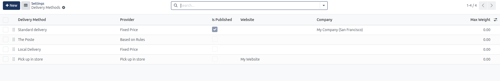
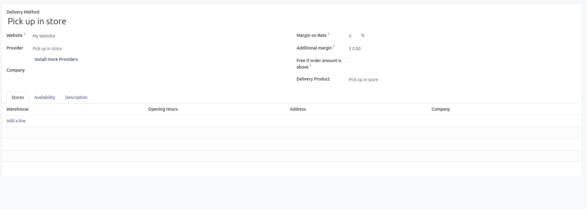
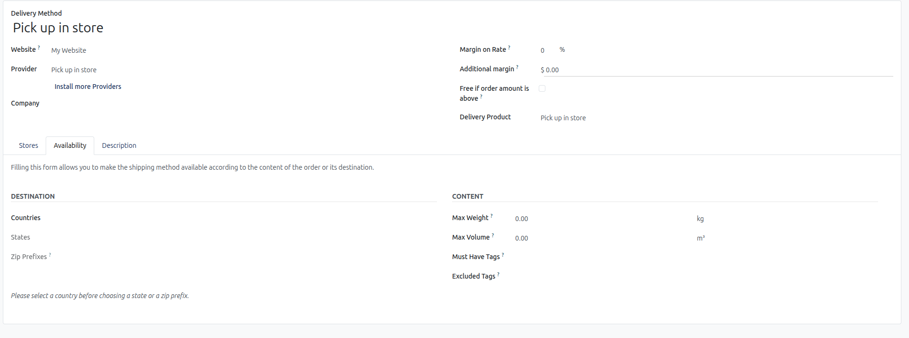

# Shipping and Delivery Setup

Configure customer delivery address entry, shipping fee calculation, Click & Collect store pickup, and Sendcloud delivery methods in CURQ 18.

---

## Prerequisites

* **Administration**: User must have **Settings** rights to access and modify system configurations.
* **Website**: User must have **Editor and Designer** access rights to manage eCommerce settings.
* **eCommerce Application**: The **eCommerce** app must be installed in the database to display the Delivery settings block.

---

### 1. Overview of Website Delivery Settings

Under **Website** > **Configuration** > **Settings**, the **Delivery** block controls how customer addresses are captured, how shipping charges are computed, and how local collection is handled:

| Setting Field | Type | Practical Purpose and Behavior |
| :--- | :--- | :--- |
| **Shipping Address** | Checkbox toggle | Allows customers to enter a distinct delivery address during checkout when shipping differs from their invoicing address. |
| **Shipping Costs** | Checkbox toggle *(with Delivery Methods link)* | Enables automated shipping cost calculation on online carts and provides access to configure delivery methods. |
| **Click & Collect** | Checkbox toggle | Allows customers to select store pickup during checkout and collect online purchases in person with on-site payment. |

---

### 2. Accessing Delivery Settings

To access and configure Website Delivery settings:

1. In the backend, open the **Website** application.
2. Click **Configuration** in the top navigation bar.
3. Select **Settings** to open the Website configuration page.
4. In the top header bar under **Settings of Website**, select the target website from the dropdown menu *(for example, `My Website`)*.
5. Scroll down to the **Delivery** configuration block.

---

### 3. Detailed Setting Breakdown

#### Shipping Address
Checking **Let the customer enter a delivery address** activates dual-address support at checkout:
* Customers can specify both a billing address for invoice generation and a separate delivery address for order fulfillment.
* If left unchecked, the billing address is automatically reused as the delivery destination for all orders.

#### Shipping Costs
Checking **Compute shipping costs on orders** activates dynamic shipping calculation during the checkout pipeline:
* Clicking the **Delivery Methods** button opens the centralized shipping registry (`Website` > `Configuration` > `eCommerce` > `Delivery Methods`).
* Supports **Fixed Price** flat rates, conditional **Based on Rules** tiers *(by order weight, volume, or price subtotal)*, and automated **Free Shipping** thresholds *(e.g., free shipping on orders above $ 100.00)*.
* Connects natively with the **Sendcloud** shipping integration for automated parcel rate computation and shipping label generation. For comprehensive carrier rules, follow [Configuring Shipping and Delivery Methods](../../Sales/procedures/07-shipping-and-delivery-methods.md).

In the Delivery Methods list view, configure operational rules across columns:
* **Delivery Method**: The customer-facing title of the shipping option.
* **Provider**: Calculation method *(Fixed Price, Based on Rules, or Pick up in store)*.
* **Is Published**: Controls online visibility in the checkout shipping selector.
* **Website**: Isolates the carrier to a specific website *(e.g., `My Website`)* or makes it available across all websites.
* **Company**: Limits carrier availability to a specific multi-company operating unit.
* **Max Weight**: Enforces an upper weight limit on the shipment before the method is hidden from checkout.

#### Click & Collect
Checking **Allow customers to pick up their online purchases at your store and pay in person** activates localized physical store fulfillment:
* Adds a **Pick up in store** fulfillment method to the checkout screen.
* Shoppers who choose Click & Collect bypass third-party shipping charges and can pay in person at the retail counter upon collection.

Clicking into the **Pick up in store** delivery method opens its parameters:
* **Website**: Restricts store pickup availability to the selected website *(e.g., `My Website`)*.
* **Delivery Product**: References the designated service product representing store collection on sales orders *(default `Pick up in store`)*.
* **Stores Tab**: Define physical pickup locations. Click **Add a line** to specify the fulfillment **Warehouse**, customer-facing **Opening Hours**, location **Address**, and operating **Company**.

The **Availability** tab defines geographic and parcel limitations for store collection:
* **Destination**: Restrict eligible pickup customers by **Countries**, **States**, and **Zip Prefixes**.
* **Content Limits**: Restrict orders by **Max Weight** *(in kg)* and **Max Volume** *(in m³)*.
* **Tag Rules**: Enforce catalog requirements using **Must Have Tags** *(order must contain tagged items to qualify)* or **Excluded Tags** *(prevents pickup if bulky or restricted items are in the cart)*.

---

### 4. Step-by-Step Delivery Configuration

1. **Select Target Website**: In the header bar under **Settings of Website**, choose the website you want to update *(for example, `My Website`)*.
2. **Enable Distinct Delivery Address**: Check **Shipping Address** to allow customers to supply independent billing and shipping destinations.
3. **Enable Shipping Calculations**: Check **Shipping Costs** to calculate delivery fees on customer shopping carts.
4. **Configure Delivery Methods**: Click the **Delivery Methods** link button to define flat delivery services, threshold rules, or Sendcloud carrier options, configured in [Configuring Shipping and Delivery Methods](../../Sales/procedures/07-shipping-and-delivery-methods.md).
5. **Enable Click & Collect**: Check **Click & Collect** if your business offers physical store pickup.
6. **Configure Store Locations and Availability**: Open the **Pick up in store** method from the Delivery Methods list, add physical warehouses under the **Stores** tab, and set geographic or weight limits under the **Availability** tab.
7. Click **Save** in the top-left corner of the settings view to apply changes.
