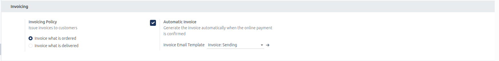
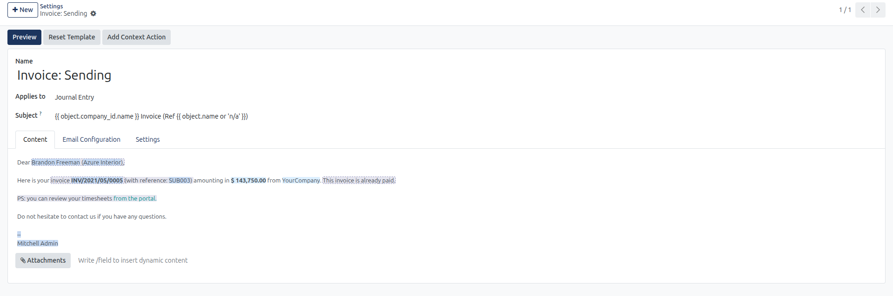
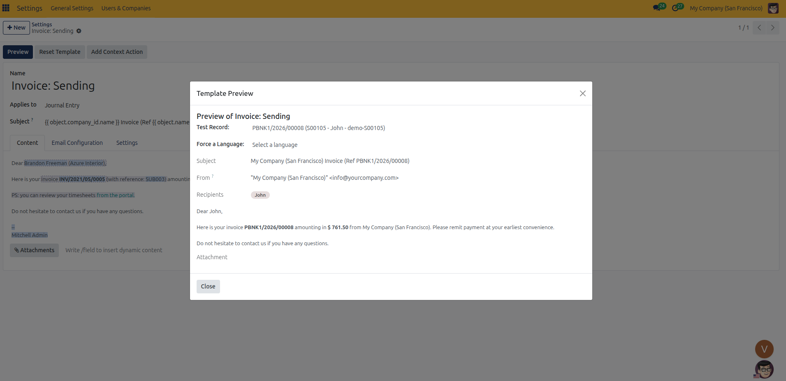

# Invoicing Setup

Configure customer invoicing policies, automatic online invoice generation, and transactional billing email templates in CURQ 18.

---

## Prerequisites

* **Administration**: User must have **Settings** rights to access and modify system configurations.
* **Website**: User must have **Editor and Designer** access rights to manage eCommerce settings.
* **Accounting or Invoicing**: The **Invoicing** app must be installed in the database to display the Invoicing configuration block.

---

### 1. Overview of Website Invoicing Settings

Under **Website** > **Configuration** > **Settings**, the **Invoicing** block dictates when invoices are created and whether online checkouts receive automated invoices upon payment confirmation:

| Setting Field | Field Type | Available Options / Default | Business Function |
| :--- | :--- | :--- | :--- |
| **Invoicing Policy** | Radio selection | * **Invoice what is ordered** * **Invoice what is delivered** | Determines whether products become eligible for billing immediately upon order placement or only after warehouse delivery is validated. |
| **Automatic Invoice** | Checkbox toggle | Checked / Unchecked | Automatically generates and posts customer invoices as soon as online payment is confirmed by payment providers. |
| **Invoice Email Template** | Dropdown selection | `Invoice: Sending` | Dictates the email notification and PDF attachment sent to the customer once the automated invoice is generated. |

---

### 2. Accessing Invoicing Settings

To access and configure Website Invoicing settings:

1. In the backend, open the **Website** application.
2. Click **Configuration** in the top navigation bar.
3. Select **Settings** to open the Website configuration page.
4. In the top header bar under **Settings of Website**, select the target website from the dropdown menu *(for example, `My Website`)*.
5. Scroll down to the **Invoicing** configuration block.

---

### 3. Detailed Setting Breakdown

#### Invoicing Policy
The **Issue invoices to customers** setting establishes the baseline billing rule applied to all newly created products:

* **Invoice what is ordered**: Products are immediately available for invoicing upon sales order confirmation. This option is required when using online automatic invoicing, services, digital downloads, or immediate credit card payments.
* **Invoice what is delivered**: Products only become eligible for invoicing once warehouse fulfillment staff validates the outbound delivery slip. This protects customers from being billed before physical merchandise ships.

Applying this setting sets the default rule for future products. Existing products retain their individual invoicing policies, which can be modified directly on their product templates as detailed in [Invoicing Sales Orders and Down Payments](../../Sales/manual/04-invoicing-sales-order.md).

#### Automatic Invoice
Checking **Generate the invoice automatically when the online payment is confirmed** streamlines digital accounting for eCommerce transactions:

* **Trigger**: Fires immediately when an online payment gateway *(such as credit card, digital wallet, or instant transfer)* successfully confirms transaction settlement.
* **Invoice Posting**: CURQ automatically generates the customer invoice in posted status without requiring manual back-office intervention.
* **Payment Registration**: The transaction is automatically marked as **Paid**, reconciling against the payment journal configured on the payment provider.
* **Portal Availability**: The completed invoice PDF is immediately available in the customer portal under their order history.
* **Dependency Requirement**: This option is visible only when the Invoicing Policy is set to **Invoice what is ordered**. Setting the policy to **Invoice what is delivered** hides this feature because goods have not yet shipped at checkout.

#### Invoice Email Template
When Automatic Invoice is enabled, the **Invoice Email Template** selector appears:

* Choose the transactional email template dispatched to the customer upon payment settlement *(default `Invoice: Sending`)*.
* Automatically includes the standardized invoice PDF attachment, transaction summary, payment confirmation, and portal link.

Clicking the arrow icon next to **Invoice Email Template** opens the template editor:
* **Name**: Identifies the operational title of the template *(such as `Invoice: Sending`)*.
* **Applies to**: Context model target (`Journal Entry`).
* **Subject**: Formats dynamic company and invoice reference strings *(such as `{{ object.company_id.name }} Invoice (Ref {{ object.name or 'n/a' }})`)*.
* **Content Tab**: Edit visual customer messaging, billing summaries, payment receipts, and customer portal links.
* **Attachments Button**: Verifies dynamic document generation attaching the finalized invoice PDF.

Click the **Preview** button in the template editor top bar to test live dynamic rendering:
* **Test Record**: Select an existing invoice record *(for example, `PBNK1/2026/00008`)* to evaluate dynamic variable resolution.
* **Force a Language**: Validate localized translations for multi-language storefront visitors.
* **Rendered Preview**: Displays the exact customer greeting, invoice amounts, sender address, and attached PDF layout prior to sending.

---

### 4. Step-by-Step Invoicing Configuration

1. **Select Target Website**: In the header bar under **Settings of Website**, choose the website you want to update *(for example, `My Website`)*.
2. **Set Invoicing Policy**: Under **Invoicing Policy**, select **Invoice what is ordered** for instant checkout billing or **Invoice what is delivered** for physical fulfillment verification.
3. **Enable Automatic Invoice**: Check **Automatic Invoice** to eliminate manual invoice creation for paid eCommerce orders.
4. **Select Email Template**: In the **Invoice Email Template** field, select the customer notification template *(default `Invoice: Sending`)*.
5. **Verify Email Template Design**: Click the arrow button next to **Invoice Email Template**, click **Preview** in the top bar, and verify dynamic message rendering.
6. Click **Save** in the top-left corner of the settings view to apply changes.
