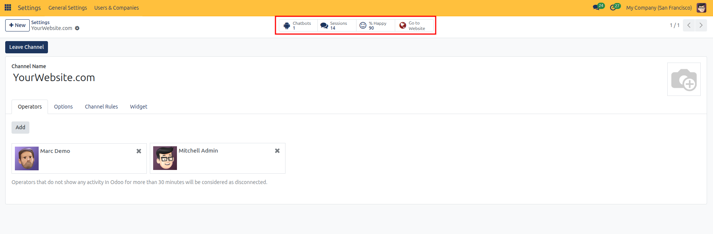
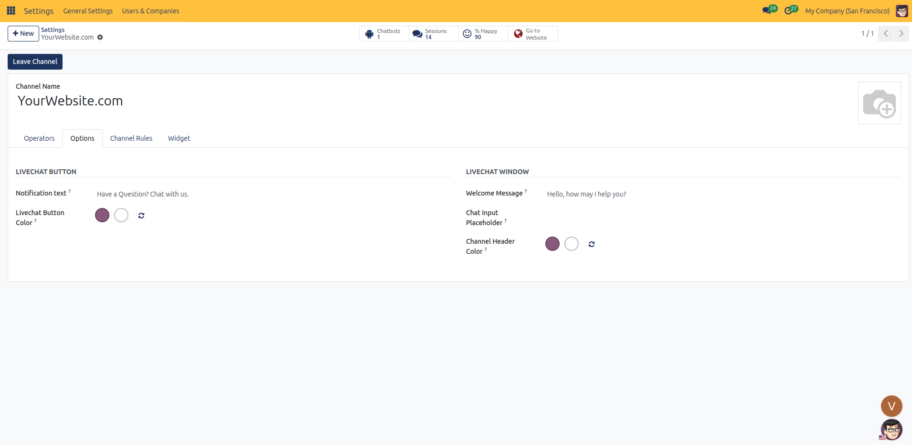
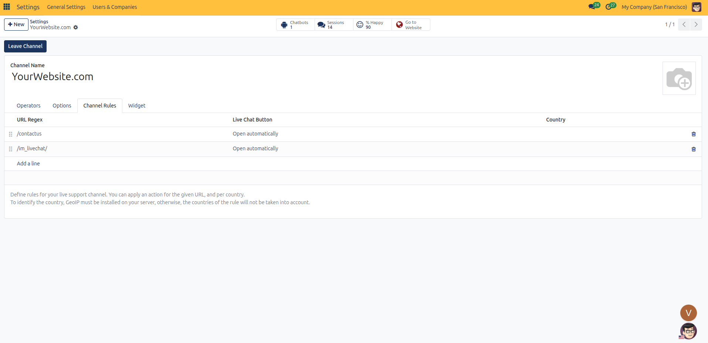
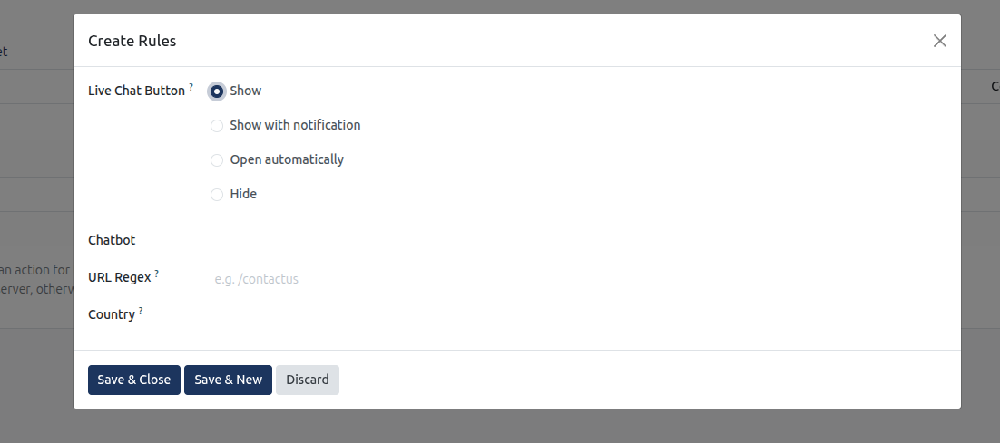
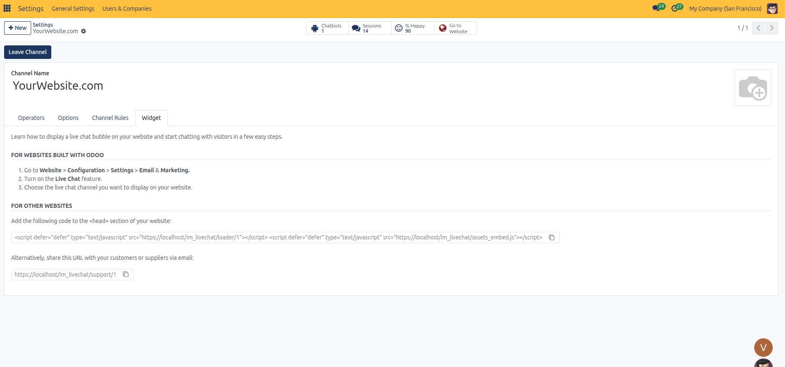
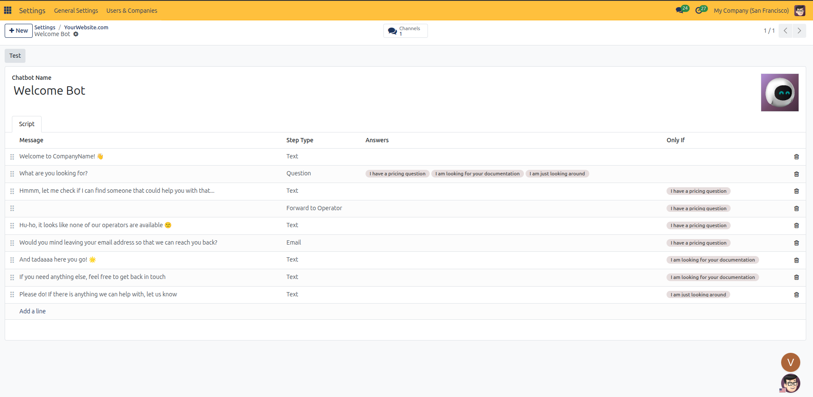
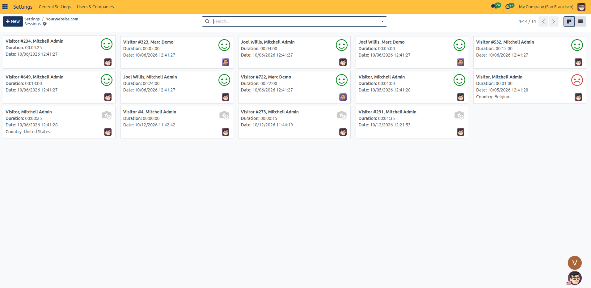
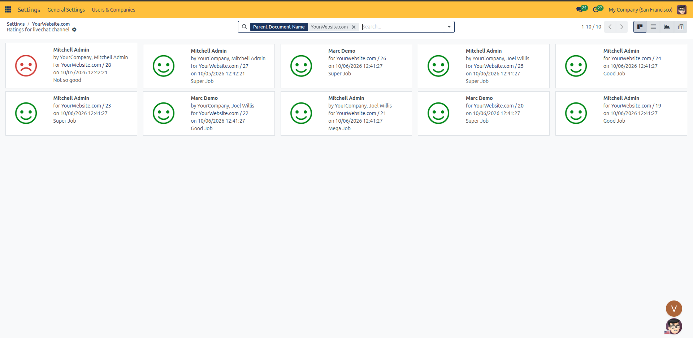

# Email and Marketing Setup

Configure website live chat visitor engagement, operator routing, chatbot scripts, customer satisfaction ratings, and automated abandoned cart recovery emails in CURQ 18.

---

## Prerequisites

* **Administration**: User must have **Settings** rights to access and modify system configurations.
* **Website**: User must have **Editor and Designer** access rights to manage website settings.
* **Live Chat Application**: The **Live Chat** app must be installed in the database to bind customer chat channels to the website.
* **eCommerce Application**: The **eCommerce** app must be installed to activate abandoned checkout tracking and email automation.

---

### 1. Overview of Website Email & Marketing Settings

Under **Website** > **Configuration** > **Settings**, the **Email & Marketing** block connects visitor communication widgets, interactive chatbots, and automated sales recovery tools:

| Setting Field | Field Type | Available Options / Default | Business Function |
| :--- | :--- | :--- | :--- |
| **Livechat** | Checkbox toggle | Checked / Unchecked | Activates a real-time conversational messaging widget on website pages to answer visitor questions. |
| **Channel** | Dropdown selection | `YourWebsite.com` | Designates the specific live chat channel routing conversations to available operators and chatbots. |
| **Automatically send abandoned checkout emails** | Checkbox toggle | Checked / Unchecked | Triggers automated recovery emails to signed-in visitors who added items to their shopping cart but left before completing checkout. |
| **Send after** | Time duration input | `10:00` Hours | Dictates the inactivity duration after which an unfinished shopping session triggers an automated recovery email. |

---

### 2. Accessing Email & Marketing Settings

To access and configure Website Email & Marketing settings:

1. In the backend, open the **Website** application.
2. Click **Configuration** in the top navigation bar.
3. Select **Settings** to open the Website configuration page.
4. In the top header bar under **Settings of Website**, select the target website from the dropdown menu *(for example, `My Website`)*.
5. Scroll down to the **Email & Marketing** configuration block.

---

### 3. Detailed Setting Breakdown

#### Livechat
Checking **Allows your visitors to chat with you** injects the CURQ Live Chat widget onto the storefront:

* **Channel Selection**: In the **Channel** field, select the operational channel *(such as `YourWebsite.com`)* assigned to this website.
* **Operator Routing**: Incoming chats route directly to assigned staff members active in the Live Chat application.
* **Display Rules**: The selected channel governs widget visibility rules, button color palettes, automated welcome messages, and target website URLs.

Clicking the arrow icon next to the **Channel** dropdown opens the centralized Live Chat channel manager:

##### Channel Header and Smart Stats
* **Smart Buttons**:
  * **Chatbots**: Displays linked conversational flow bots *(e.g., `Chatbots 1`)*.
  * **Sessions**: Tracks total visitor conversation sessions *(e.g., `Sessions 14`)*.
  * **% Happy**: Aggregates visitor satisfaction percentage *(e.g., `% Happy 90`)*.
  * **Go to Website**: Opens the front-end website to preview the live chat widget in real time.
* **Leave Channel Button**: Allows the logged-in administrator to unassign themselves from the active operator roster.

##### Operators Tab
* **Operators List**: Displays active operators responding to visitor inquiries *(e.g., `Marc Demo`, `Mitchell Admin`)*. Click **Add** to assign internal users, or click the **x** icon on any operator card to unassign them.
* **Automatic Disconnection Note**: A system notice at the bottom informs users that operators showing no activity in CURQ for more than 30 minutes are automatically treated as disconnected to prevent routing incoming chats to inactive users.

##### Options Tab
Configure customer-facing aesthetics and greeting copy for the floating widget:

* **Livechat Button**:
  * **Notification text**: Enter prompt text appearing next to the floating bubble *(default `Have a Question? Chat with us.`)*.
  * **Livechat Button Color**: Use the color picker to set the background tone and icon hue of the collapsed button.
* **Livechat Window**:
  * **Welcome Message**: Automated greeting displayed to the visitor upon opening the chat *(default `Hello, how may I help you?`)*.
  * **Chat Input Placeholder**: Optional guide text inside the composition box prompting user input.
  * **Channel Header Color**: Sets the theme color for the title banner on the expanded chat window.

##### Channel Rules Tab
Define URL path triggers, automated popup actions, and geographic restrictions governing when the chat window displays:

Clicking **Add a line** or selecting an existing rule row opens the **Create Rules** modal:

Configure rule parameters across the dialog:
* **Live Chat Button**: Select the operational display behavior on matching pages:
  * **Show**: Displays the standard collapsed floating chat button in the corner of the browser.
  * **Show with notification**: Displays the chat button accompanied by a notification text prompt.
  * **Open automatically**: Automatically expands the conversational window upon page load to prompt immediate visitor interaction.
  * **Hide**: Completely hides the live chat button on matching pages.
* **Chatbot**: Optionally assign a designated automated bot *(such as `Welcome Bot`)* to engage the visitor on this route before transferring to human operators.
* **URL Regex**: Enter the target URL path expression *(for example, `/contactus`)*.
* **Country**: Select a specific country to restrict rule execution geographically *(requires server GeoIP lookup)*.

##### Widget Integration Tab
Review integration methods for native and third-party web properties:

* **Websites Built with CURQ**: Managed directly via **Website** > **Configuration** > **Settings** under **Email & Marketing**.
* **External Websites**: Copy the provided `<script>` embed code to deploy the live chat bubble on external non-CURQ domains.
* **Direct Shareable URL**: Provides a permanent web chat URL *(e.g., `https://localhost/im_livechat/support/1`)* for inclusion in email signatures or direct support correspondence.

---

### 4. Chatbots, Sessions, and Quality Monitoring

#### Conversational Chatbot Builder
Clicking the **Chatbots** smart button on the channel form opens the linked automated conversational bot:

* **Test Button**: Launches an interactive preview window to validate conversational branches.
* **Script Structure**:
  * **Message**: Bot prompts sent to the visitor *(e.g., `Welcome to CompanyName!`, `What are you looking for?`)*.
  * **Step Type**: Functional behavior of the node, including **Text**, **Question**, **Email**, and **Forward to Operator**.
  * **Answers**: Interactive clickable choice pills presented to the visitor *(e.g., `I have a pricing question`, `I am looking for your documentation`, `I am just looking around`)*.
  * **Only If**: Branch condition evaluating previous visitor selections to trigger relevant sub-paths.

#### Monitoring Visitor Chat Sessions
Clicking the **Sessions** smart button displays the archive of visitor conversations:

* Each session card records the visitor identifier, assigned operator, total talk duration, timestamp, customer country, and satisfaction rating.

#### Customer Satisfaction Ratings
Clicking the **% Happy** smart button opens the feedback quality dashboard:

* Tracks operator ratings with positive, neutral, or negative feedback cards alongside customer feedback notes *(e.g., `Super Job`, `Good Job`, `Not so good`)*.

---

### 5. Automatically Send Abandoned Checkout Emails

Checking **Automatically send abandoned checkout emails** turns lost shopping carts into recovered sales through automated follow-up:

* **Inactivity Window (`Send after`)**: Set the delay threshold *(such as `10:00` Hours)*. CURQ monitors active shopping sessions and flags carts as abandoned once inactivity surpasses this timeframe.
* **Recovery Email Link**: Dispatches a branded recovery email containing a single-click cart recovery link that repopulates the shopper items and takes them directly to checkout.
* **Automated Dispatch Rules**:
  * **Known Contact Requirement**: Carts must belong to signed-in portal users or shoppers who entered their email address during the checkout address step. Anonymous visitors without captured emails cannot receive recovery emails.
  * **Prior Sale Protection**: If a customer completes their purchase before the delay expires, no email is sent.
  * **Duplicate Prevention**: If backend staff manually dispatches a recovery email from the orders list, CURQ skips automated sending to prevent duplicate customer outreach.
  * **Payment Failure Isolation**: Transactions interrupted by gateway payment processing errors are held for manual review rather than triggering automated sales recovery.
  * **Inventory and Delivery Verification**: Emails are suppressed if items fall out of stock or if the customer delivery destination cannot be fulfilled.
* **Email Template Customization**: Click the **Customize Abandoned Email Template** link button to format the default `Ecommerce: Cart Recovery` email layout, adjust messaging, and configure promotional discount incentives. Detailed manual tracking workflows are documented in [eCommerce Management](../manual/07-ecommerce.md#abandoned-carts-ecommerce--orders--abandoned-carts).

---

### 6. Step-by-Step Email & Marketing Configuration

1. **Select Target Website**: In the header bar under **Settings of Website**, choose the website you want to update *(for example, `My Website`)*.
2. **Enable Live Chat**: Check the **Livechat** setting to display the chat widget on the website.
3. **Assign Live Chat Channel**: In the **Channel** dropdown, select the target routing channel *(for example, `YourWebsite.com`)*.
4. **Configure Channel Parameters**: Click the arrow button next to **Channel** to assign operators, adjust widget theme colors, define URL regex rules, and test chatbot flows.
5. **Enable Abandoned Checkout Automation**: Check **Automatically send abandoned checkout emails** to recover incomplete carts.
6. **Set Recovery Delay**: In the **Send after** field, enter the required inactivity delay *(for example, `10:00` Hours)*.
7. **Review Recovery Email Template**: Click **Customize Abandoned Email Template** to review customer copy and design before launching automation.
8. Click **Save** in the top-left corner of the settings view to apply changes.
