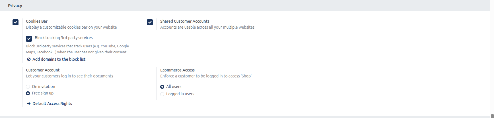
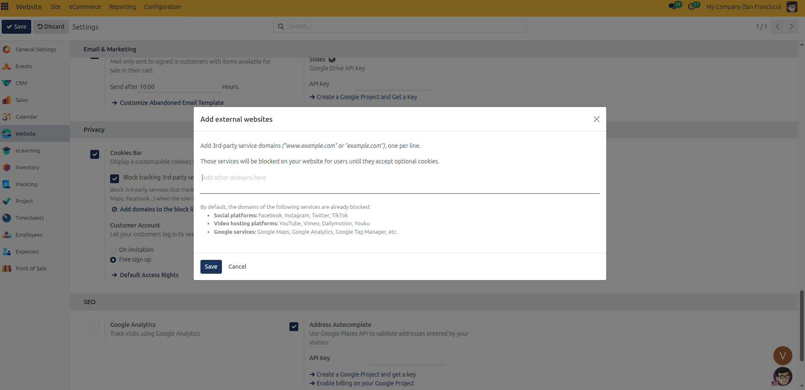
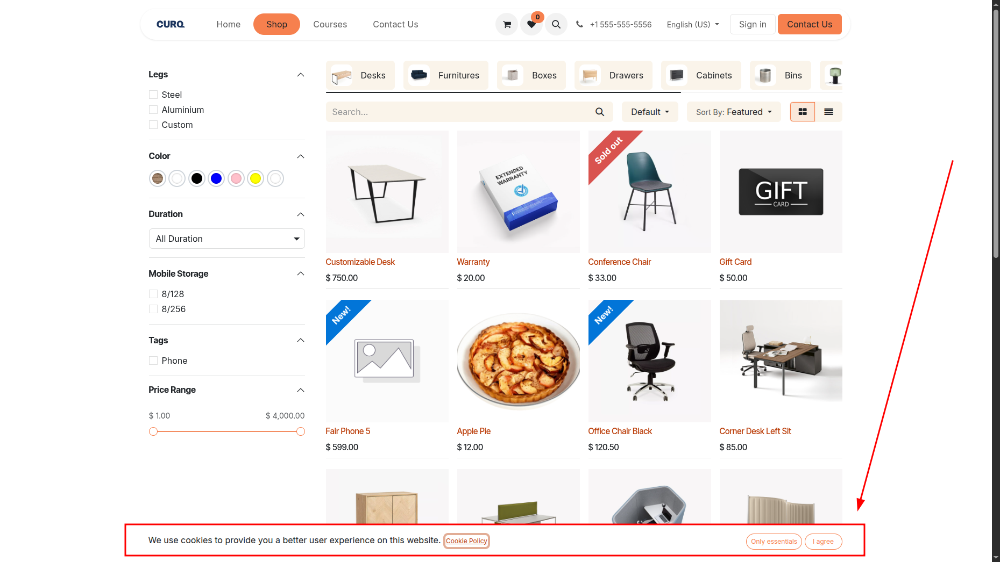

# Privacy and Customer Accounts Setup

Configure cookie consent banners, third-party tracking blocks, multi-website shared accounts, customer portal registration policies, and eCommerce shop access restrictions in CURQ 18.

---

## Prerequisites

* **Administration**: User must have **Settings** rights to access and modify system configurations.
* **Website**: User must have **Editor and Designer** access rights to manage website settings.

---

### 1. Overview of Website Privacy Settings

Under **Website** > **Configuration** > **Settings**, the **Privacy** block governs user consent compliance, portal account creation rules, and storefront access boundaries:

| Setting Field | Field Type | Available Options / Default | Business Function |
| :--- | :--- | :--- | :--- |
| **Cookies Bar** | Checkbox toggle | Checked / Unchecked | Displays a customizable cookie consent notification banner to website visitors. |
| **Block tracking 3rd-party services** | Checkbox toggle *(with Block List button)* | Checked / Unchecked | Halts scripts and embeds from tracking third-party platforms until the visitor provides consent. |
| **Shared Customer Accounts** | Checkbox toggle | Checked / Unchecked | Allows customer login credentials to authenticate across all websites in the database. |
| **Customer Account** | Radio selection | * **On invitation** * **Free sign up** | Regulates whether customers can self-register or require administrator invitation to access their portal account. |
| **Ecommerce Access** | Radio selection | * **All users** * **Logged in users** | Dictates whether catalog browsing, product prices, and shopping carts are public or restricted to authenticated accounts. |

---

### 2. Accessing Privacy Settings

To access and configure Website Privacy settings:

1. In the backend, open the **Website** application.
2. Click **Configuration** in the top navigation bar.
3. Select **Settings** to open the Website configuration page.
4. In the top header bar under **Settings of Website**, select the target website from the dropdown menu *(for example, `My Website`)*.
5. Scroll down to the **Privacy** configuration block.

---

### 3. Detailed Setting Breakdown

#### Cookies Bar and Third-Party Tracking
Checking **Display a customizable cookies bar on your website** activates compliance tracking on your storefront:

* **Cookies Bar**: Displays a floating banner asking visitors to accept or customize their cookie preferences upon landing on the site.
* **Block tracking 3rd-party services**: Checking this sub-option blocks scripts, tracking pixels, and embeds *(such as YouTube, Google Maps, Facebook)* from collecting visitor data until explicit consent is granted.
* **Add domains to the block list**: Clicking this button launches the **Add external websites** modal dialog:

In the **Add external websites** dialog, configure custom tracking restrictions:
* **Custom Blocked Domains**: Enter third-party service domains *(e.g., `www.example.com` or `example.com`)*, one per line. These services remain blocked on the website until visitors accept optional cookies.
* **Default Blocked Services**: CURQ automatically blocks the following categories out of the box until visitor consent:
  * **Social platforms**: Facebook, Instagram, Twitter, TikTok.
  * **Video hosting platforms**: YouTube, Vimeo, Dailymotion, Youku.
  * **Google services**: Google Maps, Google Analytics, Google Tag Manager.

When active, visitors arriving on any public web page see the consent bar anchored to the bottom of the viewport:
* **Consent Notice**: Displays the compliance statement informing visitors about cookie usage.
* **Cookie Policy Link**: Provides direct access to the website cookie policy page (`/cookie-policy`).
* **Only essentials Button**: Limits cookies strictly to required operational session data and maintains third-party service blocks.
* **I agree Button**: Grants full consent, allowing optional tracking cookies and unblocking embedded third-party services.

#### Shared Customer Accounts
In multi-website architectures, checking **Accounts are usable across all your multiple websites** establishes unified customer identity:

* **Global Credentials**: Customers register once and use the same login credentials across every web property operating in the database.
* **Isolated Accounts**: When unchecked, accounts remain isolated to the specific website where they were created. A shopper registered on one site cannot log into another site without creating a separate account.

#### Customer Account
The **Let your customers log in to see their documents** setting dictates portal onboarding policy:

* **On invitation** *(B2B mode)*: Disables public self-registration. New portal users can only access the site after administrative staff explicitly sends an email invitation from the backend via **Contacts** > **Action** > **Portal Access Management**.
* **Free sign up** *(B2C mode)*: Displays a **Sign up** link on the website login page, enabling any public visitor to register their own portal account.
* **Default Access Rights**: When Free sign up is enabled, clicking **Default Access Rights** opens the template portal user form to configure access privileges assigned to self-registered accounts.

#### Ecommerce Access
The **Enforce a customer to be logged in to access 'Shop'** setting controls visibility for `/shop`, product catalog pages, shopping carts, and wishlists:

* **All users**: The entire eCommerce store is open to the public. Anonymous guests can browse products, inspect catalog prices, and add items to their shopping cart.
* **Logged in users**: Locks the eCommerce storefront behind authentication. Anonymous visitors attempting to access `/shop`, view products, or open a shopping cart are immediately redirected to the customer portal login page. Ideal for private wholesale portals, member clubs, and exclusive B2B storefronts.

---

### 4. Step-by-Step Privacy Configuration

1. **Select Target Website**: In the header bar under **Settings of Website**, choose the website you want to update *(for example, `My Website`)*.
2. **Enable Cookie Banner**: Check **Cookies Bar** to show cookie consent notices to incoming visitors.
3. **Enforce Script Blocking**: Check **Block tracking 3rd-party services** to hold external trackers until consent is given.
4. **Define Custom Blocked Domains**: Click **Add domains to the block list**, enter any additional external domains in the modal *(one per line)*, and click **Save**.
5. **Configure Shared Accounts**: Check **Shared Customer Accounts** if your business uses unified customer logins across multiple websites.
6. **Set Registration Policy**: Under **Customer Account**, select **Free sign up** for public retail storefronts or **On invitation** for verified client portals.
7. **Set Store Access Scope**: Under **Ecommerce Access**, select **All users** for open storefronts or **Logged in users** to enforce login before browsing products.
8. Click **Save** in the top-left corner of the settings view to apply changes.
