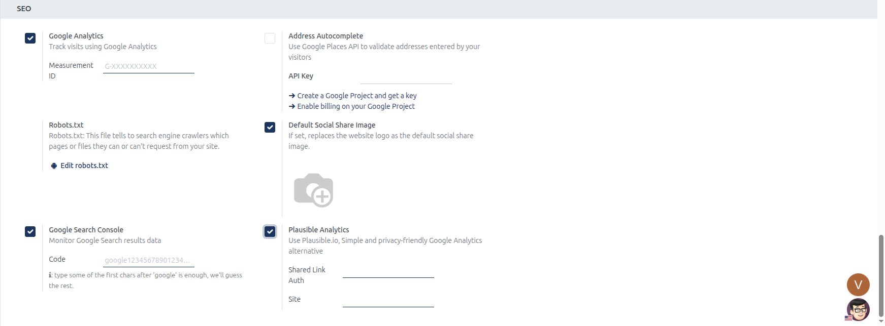
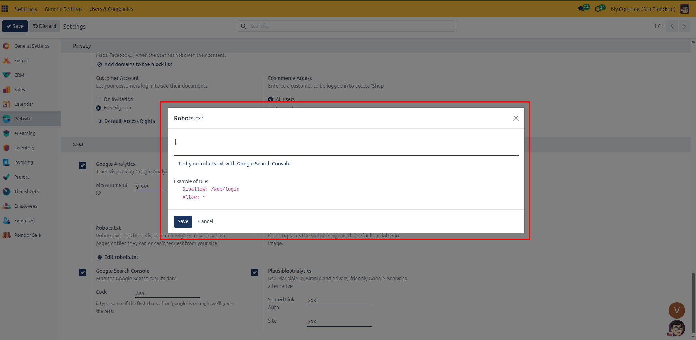

# SEO and Analytics Setup

Configure search engine crawler rules, Google Search Console verification, social preview images, Google Analytics, and Plausible Analytics in CURQ 18.

---

## Prerequisites

* **Administration**: User must have **Settings** rights to access and modify system configurations.
* **Website**: User must have **Editor and Designer** access rights to manage website settings.

---

### 1. Overview of Website SEO and Analytics Settings

Under **Website** > **Configuration** > **Settings**, the **SEO** block establishes search engine indexing instructions, web analytics tracking, and social media share previews:

| Setting Field | Field Type | Available Inputs / Defaults | Business Function |
| :--- | :--- | :--- | :--- |
| **Google Analytics** | Checkbox toggle *(with Measurement ID input)* | `G-XXXXXXXXXX` | Injects Google Analytics 4 tracking tags to analyze site traffic, conversion funnels, and visitor journeys free of charge. |
| **Robots.txt** | Action button | Direct modal editor | Provides direct management of search crawler directives governing which directories and URLs engines can index. |
| **Default Social Share Image** | Checkbox toggle *(with Image upload)* | Graphic image | Replaces the standard company logo with a dedicated Open Graph image used when URLs are shared across social platforms. |
| **Google Search Console** | Checkbox toggle *(with Code input)* | `google1234567890123456.html` | Verifies free domain ownership with Google to monitor search ranking queries, impression trends, and indexation coverage. |
| **Plausible Analytics** | Checkbox toggle *(with Shared Link Auth and Site inputs)* | Link auth token and domain | Integrates privacy-centric, lightweight web analytics from Plausible.io without requiring cookie consent banners. |

---

### 2. Accessing SEO and Analytics Settings

To access and configure Website SEO settings:

1. In the backend, open the **Website** application.
2. Click **Configuration** in the top navigation bar.
3. Select **Settings** to open the Website configuration page.
4. In the top header bar under **Settings of Website**, select the target website from the dropdown menu *(for example, `My Website`)*.
5. Scroll down to the **SEO** configuration block.

---

### 3. Detailed Setting Breakdown

#### Google Analytics
Checking **Track visits using Google Analytics** activates automated script injection across all storefront templates:

* **Measurement ID**: In the **Measurement ID** field, enter your free GA4 web data stream identifier *(formatted as `G-XXXXXXXXXX`)*.
* **Tag Injection**: Once saved, CURQ automatically injects the Google tag into the page `<head>` across all website pages.
* **Documentation Shortcut**: Click the **How to get my Measurement ID** link to access configuration guides directly.

#### Robots.txt
The **Robots.txt** setting provides direct administrative control over search engine bot instructions:

* Click **Edit robots.txt** to launch the code editor modal.
* Define directives such as `User-agent: *`, `Disallow: /web/login`, `Disallow: /shop/cart`, or custom paths to guide indexing bots.
* Changes update the public `/robots.txt` endpoint immediately for crawlers.

Inside the **Robots.txt** modal dialog:
* **Rule Editor**: Enter custom crawl instructions directly into the text editor.
* **Search Console Testing**: Click the **Test your robots.txt with Google Search Console** link to test and validate your live directives using Google search webmaster tools.
* **Syntax Examples**: The modal outlines standard syntax conventions:
  * `Disallow: /web/login`: Restricts web crawlers from indexing authentication and login portals.
  * `Allow: *`: Permits search engine robots to crawl public website pages and assets across the domain.
* Click **Save** in the modal to apply the robots directives.

#### Default Social Share Image
The **If set, replaces the website logo as the default social share image** setting optimizes link previews:

* Check **Default Social Share Image** and upload a dedicated graphic file *(recommended 1200x630 pixels)*.
* When visitors or staff share page URLs on platforms like LinkedIn, Facebook, or Twitter, CURQ injects this graphic as the fallback `og:image` meta tag if the specific page lacks an individual custom share image. Individual page overrides are configured via [SEO Optimization](../manual/04-seo-optimization.md).

#### Google Search Console
Checking **Monitor Google Search results data** handles free Google site ownership verification:

* **Verification Code**: In the **Code** field, paste your Google HTML verification file string *(such as `google1234567890123456.html`)*.
* **Format Convenience**: Entering the initial alphanumeric string after `google` is sufficient; CURQ automatically resolves the file format to satisfy Google verification crawlers.

#### Plausible Analytics
Checking **Use Plausible.io, Simple and privacy-friendly Google Analytics alternative** activates cookie-free traffic monitoring:

* **Shared Link Auth**: Paste the shared link authorization token generated in your Plausible dashboard.
* **Site**: Enter your domain identifier as registered in Plausible *(e.g., `curq.nl`)*.
* **Privacy Benefit**: Because Plausible operates without personal tracking cookies, tracking can run without requiring consent confirmation via cookie banners.

---

### 4. Step-by-Step SEO Configuration

1. **Select Target Website**: In the header bar under **Settings of Website**, choose the website you want to update *(for example, `My Website`)*.
2. **Configure Analytics**: Check **Google Analytics** and enter your `G-XXXXXXXXXX` Measurement ID, or check **Plausible Analytics** and enter your shared link credentials.
3. **Customize Robots Directive**: Click **Edit robots.txt**, review or amend crawler exclusion paths, and save the record.
4. **Set Brand Share Image**: Check **Default Social Share Image** and upload your standardized 1200x630 social banner.
5. **Verify Google Search Console**: Check **Google Search Console** and supply your verification code token.
6. Click **Save** in the top-left corner of the settings view to apply changes.
