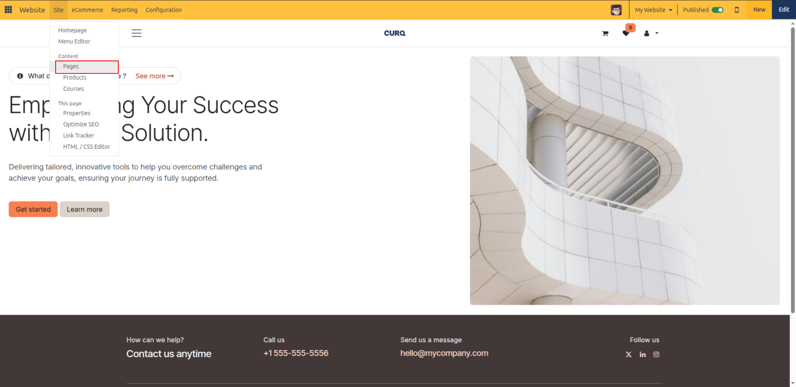
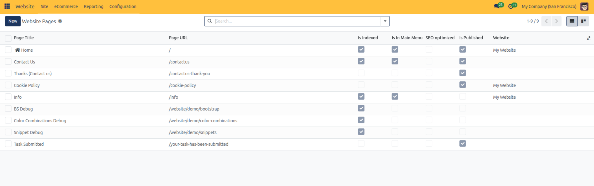
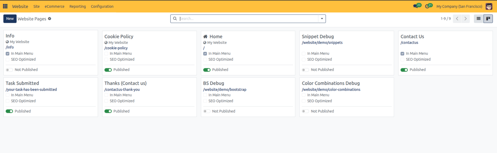
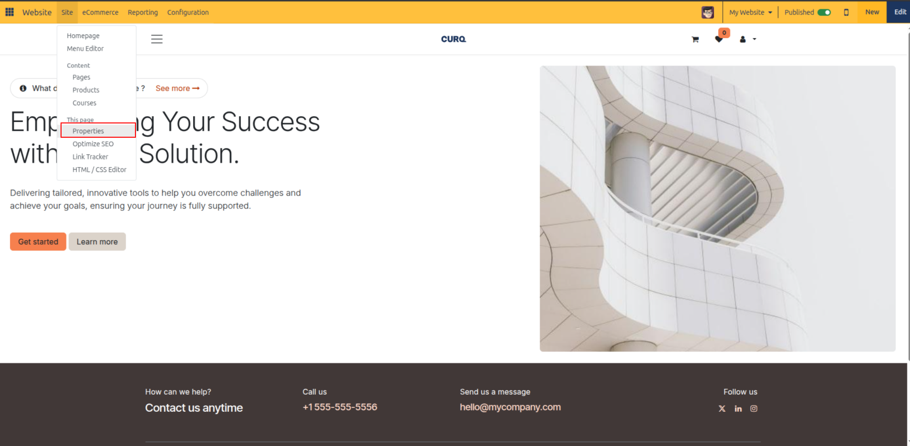
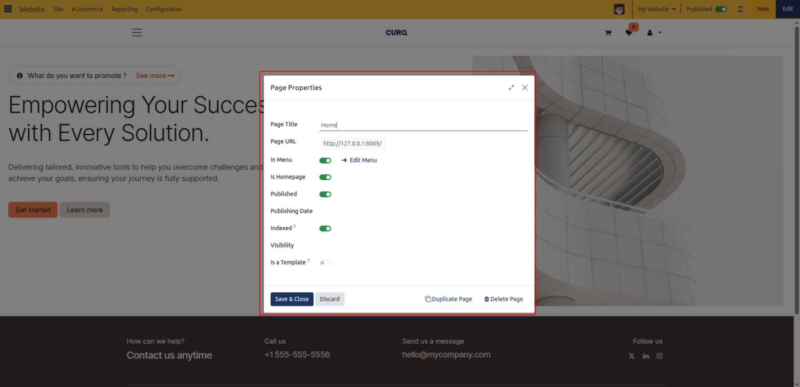

# Manage Webpages and Redirections

This guide covers how to access the central Page Manager, configure page access permissions, publish or archive pages, and set up 301/302 URL redirects.

Organize, configure, secure, and maintain web pages across your CURQ 18 websites using the centralized Page Manager and Page Properties dialog.

---

## Task 1: Accessing the Page Manager

The **Page Manager** provides a comprehensive control center where administrators can monitor publication status, SEO indexing, menu visibility, and website assignments across all pages.

To open the Page Manager:

1. Open your CURQ 18 website in frontend preview mode.
2. In the top administrative control bar, click **Site** > **Pages**.

   

CURQ opens the **Website Pages** manager interface with view-switching controls and filter tools:

* **List View** *(Default)*: Tabular grid displaying all page attributes, ideal for comparing settings, sorting, and executing batch operations.

  

* **Kanban View**: Visual card layout highlighting page titles, homepage badges, URLs, and status indicators.

  

* **Search & Filters**: Quick-filter options to isolate published, unpublished, or tracked pages.

---

## Task 2: Page Manager Columns & Indicators

In List view, the Page Manager provides an operational grid summarizing publication status, SEO indexing, menu placement, and multi-website routing for all site content.

> For complete column definitions, indexing flags, and operational attributes, see [Website Page, Product, and Reporting Field Definitions](../settings-and-fields/05-website-page-product-and-reporting-field-definitions.md).

Review your page records across the following core attributes:
* **Page Title & URL**: Click any page title or path to launch live preview editing on the canvas.
* **Indexing & SEO**: Verify whether search engines are permitted to crawl the page and check if custom metadata has been saved.
* **Menu & Publication Status**: Check whether the page is linked in the main navbar and toggle the **Is Published** switch to make content public or internal.
* **Website Assignment**: In multi-brand databases, confirm which website domain owns the page.

---

## Task 3: Searching, Filtering, and Grouping Pages

When managing extensive websites with dozens or hundreds of pages, use the search and filter bar to locate specific content quickly:

1. In the search box at the top of the Page Manager, type keywords to match against **Page URL** or **Page Title**.
2. Click the search dropdown menu to apply pre-configured filters:
   * **Published**: Displays only live, publicly accessible pages.
   * **Not published**: Isolates drafts, internal staging pages, and unreleased content.
   * **Tracked**: Filters pages where website visitor analytics tracking is explicitly enabled.
   * **Not tracked**: Displays untracked pages.
3. In multi-website setups, use the **Website** filter to restrict the view to pages belonging to a specific company or brand site.

---

## Task 4: Performing Batch Actions on Pages

The Page Manager allows administrators to perform bulk maintenance operations across multiple selected pages simultaneously:

1. In the Page Manager list view, select the checkboxes next to the target pages *(or check the top checkbox in the table header to select all pages)*.
2. Click the **Action** cog menu at the top of the control panel:
   * **Publish**: Bulk-publishes all selected pages, making them live immediately.
   * **Unpublish**: Bulk-unpublishes all selected pages, instantly removing them from public access.
   * **Duplicate**: Clones the selected pages into new drafts with custom name prefixes.
   * **Delete**: Removes selected pages after evaluating URL dependencies across the system.

> [!WARNING]
> When deleting pages, CURQ analyzes URL dependencies *(such as links in menu items, internal buttons, or custom views)*. A confirmation dialog will list detected references and require checking **"I am sure about this"** before confirming deletion.

---

## Task 5: Configuring Page Properties

The **Page Properties** dialog allows granular control over page URLs, redirects, homepage assignment, and search engine visibility.

### Opening Page Properties

You can access Page Properties through two methods:

* **From the live page**: Navigate to the target page, then click **Site** > **This page** > **Properties** in the top administrative bar.

  

* **From the visual editor sidebar**: Click **Page** in the editor sidebar while editing.

CURQ opens the **Page Properties** modal dialog:

### Core Page Properties

> For technical specifications of page attributes, redirection codes (301 vs 302), and template behaviors, see [Website Page, Product, and Reporting Field Definitions](../settings-and-fields/05-website-page-product-and-reporting-field-definitions.md).

* **Page Title**: The human-readable name of the webpage, displayed in browser title bars and search results.
* **Page URL**: The route path of the page *(e.g., `/our-mission`)*.
* **Redirect Old URL**: When modifying an existing page URL, toggle this option to automatically create an HTTP redirect from the old URL to the new URL:
  * **301 Moved permanently**: Recommended for permanent URL migrations to preserve search engine rankings and backlinks.
  * **302 Moved temporarily**: Used for temporary rerouting without altering canonical search engine indexes.
  * **Dependencies**: Click the **Dependencies** helper link to inspect any internal blocks, menus, or records referencing the old URL.
* **In Menu**: Toggle whether this page is included in the website header navigation menu. Clicking the **Edit Menu** arrow jumps directly to the Menu Editor modal.
* **Is Homepage**: Toggle switch to designate this page as the root homepage (`/`) for the active website.
* **Published**: Quick toggle to switch between draft and live status.
* **Publishing Date**: Set an optional scheduled date and time when the page should automatically become published.

---

## Task 6: Page Visibility & Access Security

Control visitor access to individual pages using the **Visibility** setting in Page Properties:

> For detailed security group parameters, password protection constraints, and access rules, see [Website Page, Product, and Reporting Field Definitions](../settings-and-fields/05-website-page-product-and-reporting-field-definitions.md).

1. Open **Site** > **This page** > **Properties**.
2. Locate the **Visibility** dropdown field and select the desired security rule:
   * **Public**: Default setting. Anyone visiting the website can view the page.
   * **Signed In**: Restricts page access to authenticated portal users and internal employees. Anonymous visitors are prompted to log in.
   * **Restricted Group**: Restricts page access to users belonging to specific security user groups *(e.g., Portal, Editor, Sales / User)*.
   * **With Password**: Protects the page behind a direct access code that visitors must supply.
3. Click **Save** to enforce access restrictions immediately.

---

## Task 7: Creating and Managing Page Templates

Standardize brand layout designs by converting custom pages into reusable templates:

1. Design and build a page layout using the drag-and-drop editor.
2. Open **Site** > **This page** > **Properties**.
3. Toggle the **Is a Template** switch to enabled.
4. Click **Save**.
5. When any team member clicks **+ New** > **Page**, this custom layout will now appear as an available template option under the page selector library, allowing instant replication of standard company page layouts.

---

## Related Documentation

* [Design Pages with Building Blocks](./01-design-pages-with-building-blocks.md)
* [Optimize SEO and Search Metadata](./04-optimize-seo-and-search-metadata.md)
* [Website Page, Product, and Reporting Field Definitions](../settings-and-fields/05-website-page-product-and-reporting-field-definitions.md)
* [Website Configuration and Domain Settings](../settings-and-fields/01-website-configuration-and-domain-settings.md)

