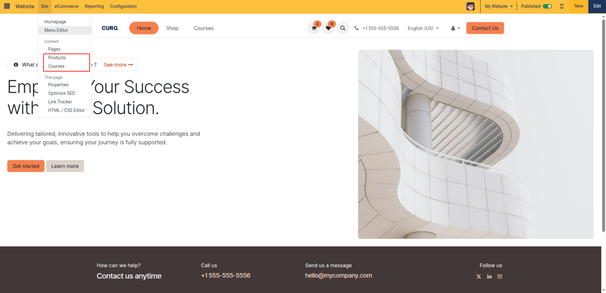
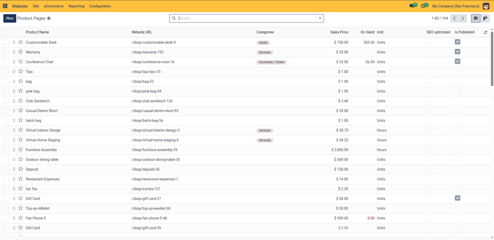
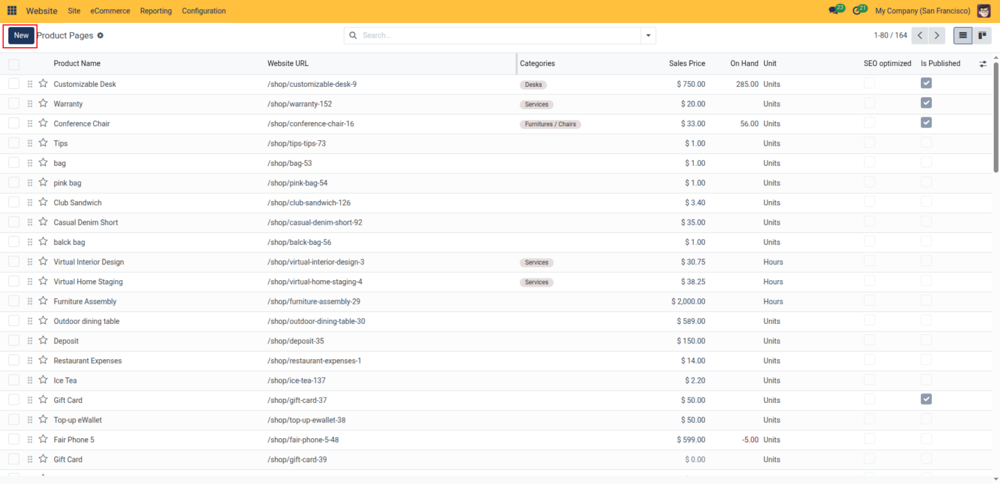
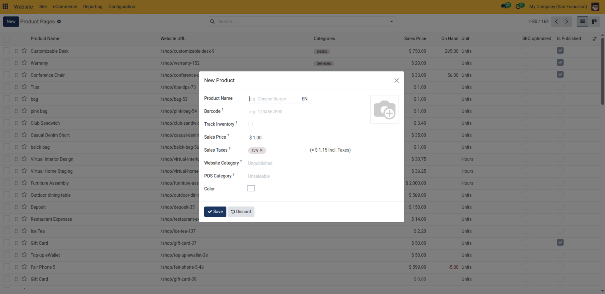
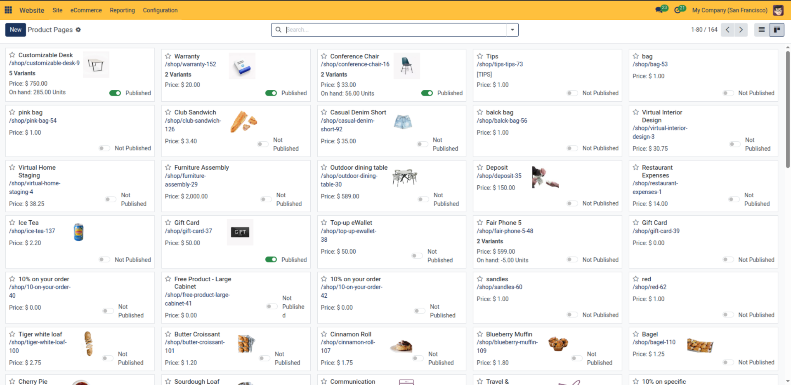
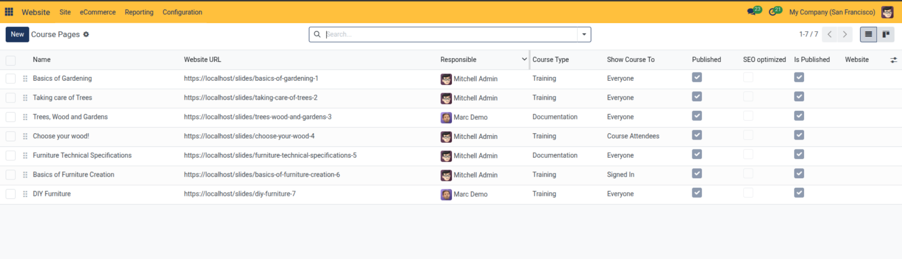
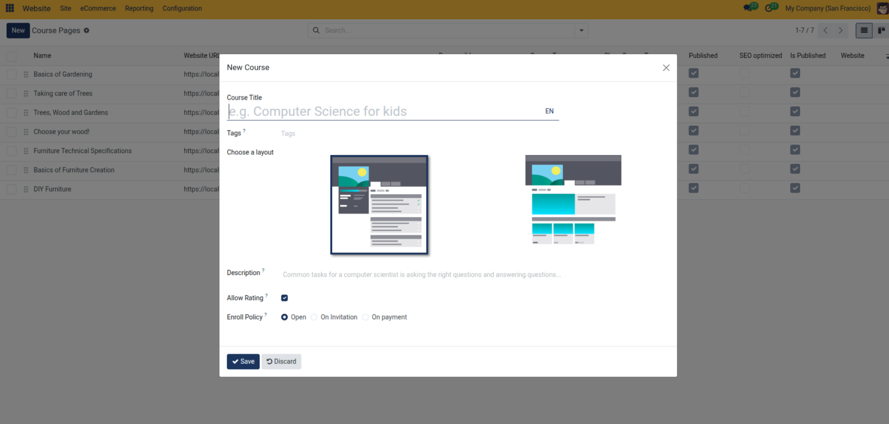
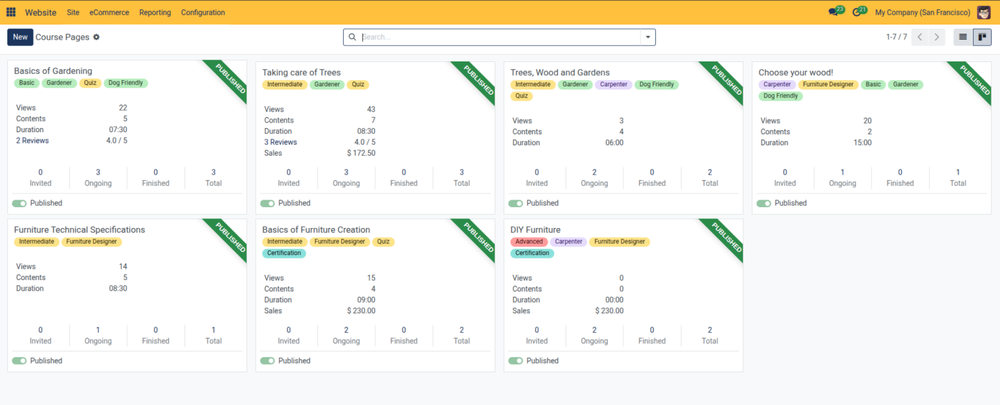

# Publish and Manage Products and Courses

This guide details how to manage the publication status, SEO visibility, layout designs, and catalog listings for retail products and eLearning courses.

Monitor, publish, and manage eCommerce products and eLearning course pages in CURQ 18 using the frontend Page Manager.

> **Prerequisites**
> * Active user account with **Website / Editor** rights.
> * Configured base system records and access permissions.

---

> **Note:** The **Products** option requires the **eCommerce** app to be installed, while the **Courses** option requires the **eLearning** app. If either app is not installed in your database, its corresponding option will not appear in the **Site** menu.

---

## 1. Access Product & Course Pages

Administrators can inspect all published and unpublished catalog items directly from the frontend top bar without opening backend settings:

* **Product Pages**: In the top administrative bar, click **Site** > **Products**.
* **Course Pages**: In the top administrative bar, click **Site** > **Courses**.

Both menus open a unified manager interface providing synchronized List and Kanban views tailored to your products and courses.

---

## 2. Managing Product Pages

The **Product Pages** manager displays your store catalog with website-specific indicators across List and Kanban views:

### 2.1 List View

> For complete column definitions, inventory indicators, and quick-creation field formats, see [**Website Page, Product, and Reporting Field Definitions**](../settings-and-fields/05-website-page-product-and-reporting-field-definitions.md).

The List view displays key storefront attributes including product display names, public URL paths (`/shop/...`), assigned eCommerce categories, retail sales prices, real-time on-hand stock quantities, SEO optimization flags, and read-only publication toggles.

### 2.2 Creating a New Product from Product Pages

You can add a new product directly from the Product Pages manager without navigating away to backend sales forms:

1. In the top-left corner of the Product Pages manager, click the blue **New** button:

   

2. In the **New Product** dialog, enter initial catalog details:
   * **Product Name**: Enter the title of the item.
   * **Photo**: Upload a thumbnail image for the store.
   * **Barcode**: Optional product barcode number.
   * **Track Inventory**: Check to enable inventory tracking.
   * **Sales Price** & **Sales Taxes**: Set retail pricing and tax rule.
   * **Website Category**: Assign website product category.
   * Click **Save**.

   

### 2.3 Kanban View

Click the **Kanban** icon in the upper-right corner of the control bar to view products as cards:

* **Card Information**: Each card displays the product image, title, website URL route, retail price, and website domain badge *(in multi-website mode)*.
* **One-Click Publishing**: The footer of each card includes an interactive **Published / Not Published** toggle switch. Clicking this toggle immediately publishes or unpublishes the product online without requiring you to open the full product form or frontend page.

### 2.4 Product Batch Actions

From the list view:
1. Select target products using the checkboxes on the left.
2. Open the **Action** menu:
   * **Publish / Unpublish**: Batch-toggle website visibility across catalog selections.
   * **Duplicate**: Clone products into new draft items.
   * **Delete**: Remove selected product pages.

---

## 3. Managing Course Pages

The **Course Pages** manager organizes online learning programs with progress, audience access, and visibility tracking:

### 3.1 List View

> For course manager columns, audience access rules, and enrollment policy specifications, see [**Website Page, Product, and Reporting Field Definitions**](../settings-and-fields/05-website-page-product-and-reporting-field-definitions.md).

The List view provides real-time course oversight, displaying course titles, public URL routes (`/slides/...`), designated responsible instructors, course classification types, target audience access permissions, SEO optimization badges, and publication status toggles.

### 3.2 Creating a New Course from Course Pages

You can create an online course directly from the Course Pages manager:

1. Click the blue **New** button in the top-left corner of the Course Pages manager.
2. In the **New Course** dialog, configure the following options:
   * **Course Title**: Enter the public name of the course.
   * **Tags**: Assign relevant subject tags to facilitate website filtering and search.
   * **Choose a layout**: Select your preferred content layout format (sidebar syllabus structure or card grid view).
   * **Description**: Enter an overview summary explaining the course objectives to prospective students.
   * **Allow Rating**: Enable this checkbox to permit student star ratings and reviews.
   * **Enroll Policy**: Select how learners join the course:
     * **Open**: Anyone can enroll freely.
     * **On Invitation**: Enrollment is restricted to invited users.
     * **On payment**: Enrollment requires purchasing the associated course product through the website.
3. Click **Save** to create the course and open its landing page in edit mode.

### 3.3 Kanban View

Click the **Kanban** icon in the upper-right corner to view courses in card format:

* **Card Information**: Each card presents the course cover image, title, instructor, visibility settings, and enrolled attendee metrics.
* **One-Click Publishing**: An interactive **Published / Not Published** toggle switch is located in the card footer, enabling you to publish or take a course offline without opening the course form.

### 3.4 Course Batch Actions

From the list view:
1. Select target courses using the row checkboxes.
2. Open the **Action** menu to perform bulk operations:
   * **Publish / Unpublish**: Batch-update public course availability.
   * **Duplicate**: Duplicate course structures.
   * **Delete**: Remove selected course pages.

---

## Related Documentation

* [Set Up an eCommerce Storefront and Checkout](../getting-started/02-set-up-an-ecommerce-storefront-and-checkout.md)
* [Configure Product Attributes, Ribbons, and Categories](./08-configure-product-attributes-ribbons-and-categories.md)
* [Website Page, Product, and Reporting Field Definitions](../settings-and-fields/05-website-page-product-and-reporting-field-definitions.md)
* [eCommerce Shop and Checkout Settings](../settings-and-fields/02-ecommerce-shop-and-checkout-settings.md)
