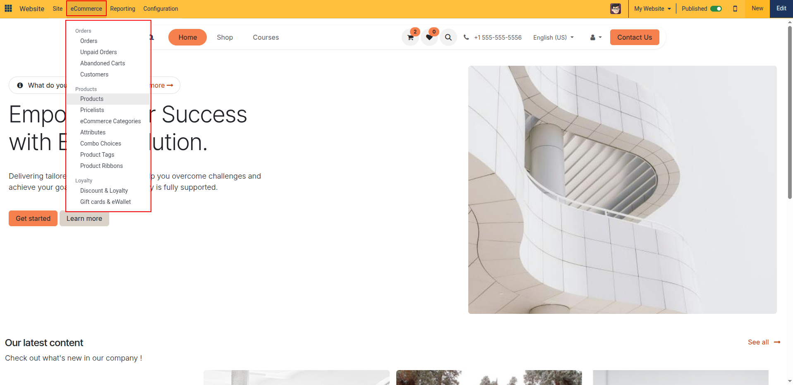
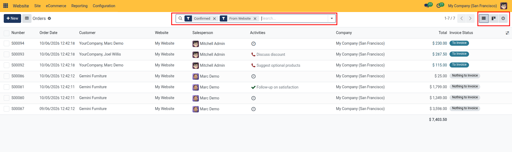
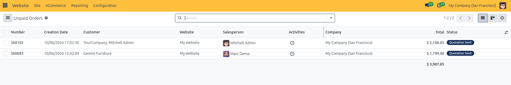
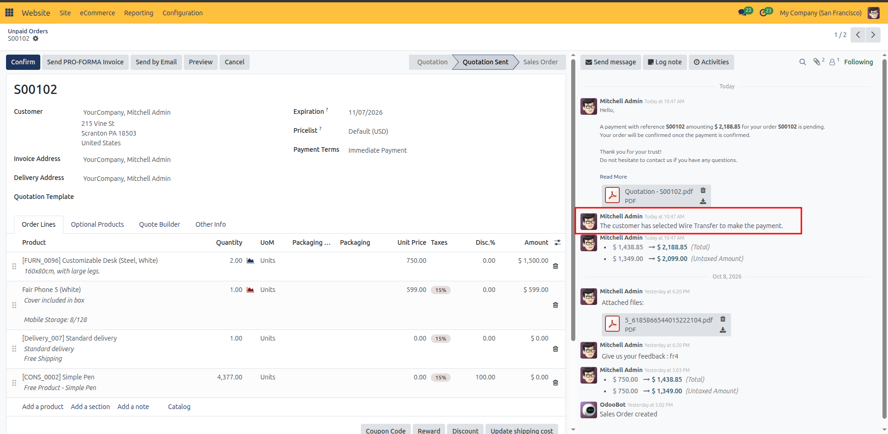
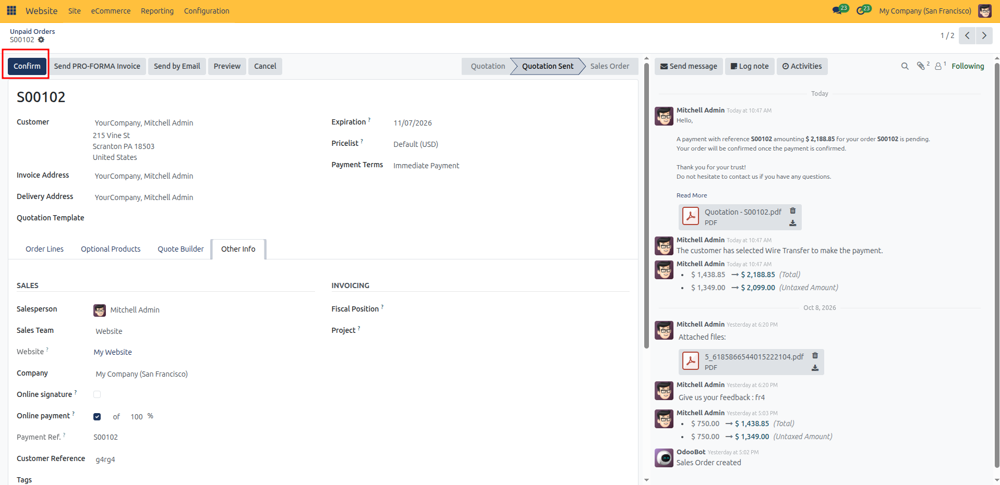
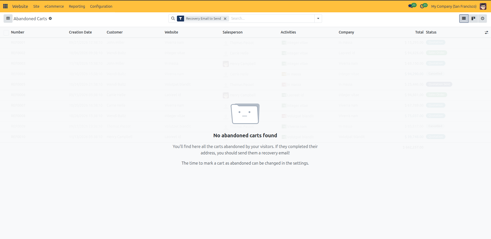
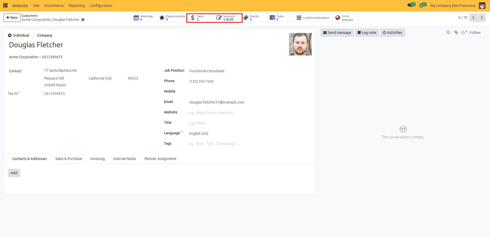

# Manage Online Orders and Abandoned Carts

This guide explains how to access online customer orders, review quotations, confirm sales orders, recover abandoned checkouts, and manage customer portal accounts.

Manage online sales orders, recover abandoned shopping carts, and configure website catalog rules in CURQ 18.

> **Prerequisites**
> * Active user account with **Website / Editor** rights.
> * Published website domain and access to the CURQ website builder.

---

> **Note:** Installing the **eCommerce** app automatically creates the **Shop** navigation menu (`/shop`) in your website header, along with the shopping cart, wishlist shortcuts, and product catalog pages. The top administrative **eCommerce** menu also becomes available for managing orders and catalog settings. If your database only uses the base website builder without eCommerce, configure standard pages via [**Page Management**](./03-manage-webpages-and-redirections.md).

---

## 1. Access eCommerce Orders Workspace

In the top administrative bar, click **eCommerce** to open the menu dropdown:

The menu organizes your online store into three functional areas:

* **Orders**: Track online checkouts, review unpaid orders, manage customer recovery for abandoned shopping carts, and browse registered online customers.
* **Products**: Configure master products, pricelists, eCommerce categories, variant attributes, combo choices, product tags, and promotional ribbons.
* **Loyalty**: Set up discount promotions, customer loyalty programs, gift cards, and eWallets.

---

## 2. Managing Online Orders and Cart Recovery

### 2.1 Orders (`eCommerce > Orders > Orders`)

* **Automatic Default Filters**:
  * **Confirmed**: Displays only sales orders in confirmed status (**Sales Order**).
  * **From Website**: Filters out backend manual quotations, displaying only sales originating from your website (`/shop`).

* **Key Columns Displayed**:
  The Orders view tracks sales order numbers, checkout timestamps, customer contact accounts, originating website domains, assigned sales representatives, follow-up activities, legal companies, order totals, and invoice statuses.

> For descriptions of sales order columns, invoice status values, and activity tracking, see [**Website Page, Product, and Reporting Field Definitions**](../settings-and-fields/05-website-page-product-and-reporting-field-definitions.md).

* **View Switcher**: Use the view icons in the upper-right corner to toggle between **List**, **Kanban cards**, and **Activities calendar**.

* **All Sales Orders Filter**: To see orders across both physical and digital channels, remove the **From Website** filter chip in the search bar.
* **Order Processing Guides**: For step-by-step instructions on confirming orders, delivery validation, and invoice generation, see [**Confirm Sales Order**](../../Sales/task-guides/03-confirm-and-lock-sales-orders.md), [**Invoicing Sales Order**](../../Sales/task-guides/04-invoice-sales-orders.md), and [**Analyze Sales Orders**](../../Sales/task-guides/13-sales-reporting-and-analytics.md).

### 2.2 Unpaid Orders (`eCommerce > Orders > Unpaid Orders`)

Clicking **Unpaid Orders** displays website checkout orders that reached the payment step with a quotation sent to the customer, but where the final payment was not confirmed:

* **Automatic Default Filter**: Automatically filters for website orders where the order status is **Quotation Sent**.
* **How an Order Enters Unpaid Orders**:
  * **Pending / Wire Transfer Payments**: When a customer checks out using offline payment providers *(such as Wire Transfer / SEPA / Custom payment methods)*, the payment transaction enters a pending state. CURQ automatically moves the quotation into **Quotation Sent** and emails the payment instructions to the customer.

  * **Failed / Interrupted Online Transactions**: If a shopper completes checkout and receives a quotation link or their payment gateway transaction is awaiting asynchronous authorization, the record remains in this view until settled.
* **Processing Unpaid Orders**:
  1. Once the customer completes the bank transfer or offline payment, open the order from this list.
  2. Click **Confirm** to convert the quotation into a confirmed sales order. The order automatically moves from **Unpaid Orders** to the confirmed **Orders** list.

### 2.3 Abandoned Carts (`eCommerce > Orders > Abandoned Carts`)

Clicking **Abandoned Carts** displays shopping sessions where visitors added items to their shopping cart and provided their contact details, but left before completing checkout.

* **How CURQ Qualifies an Abandoned Cart**:
  An online shopping session is automatically classified as an abandoned cart when all of the following conditions are met:
  * **Originated on Website**: The order was created through your online store (`/shop`), not manually entered by backend sales staff.
  * **Quotation State**: The order remains in unconfirmed quotation status (**Quotation**).
  * **Contains Products**: The shopping cart contains at least one product line.
  * **Identified Customer**: The shopper logged into their customer portal account or entered their contact email on the checkout address step. Completely anonymous visitors who never entered an email cannot be targeted with recovery emails.
  * **Inactivity Time Window**: The shopper has been inactive for longer than the configured abandoned cart delay *(set to 1 hour by default)*. Active browsing sessions within this window are not considered abandoned.

* **Automatic Default Filter**:
  * **Recovery Email to Send**: Automatically filters the list to show only abandoned carts where a recovery email has not yet been dispatched.

* **Recovering the Cart**:
  1. In the top bar, click **eCommerce** > **Orders** > **Abandoned Carts**.
  2. Review the list showing customer names, creation dates, and cart totals.
  3. Click an abandoned order row to inspect the cart items.
  4. On the order form, click the primary **Send a Recovery Email** button.
  5. CURQ sends a personalized recovery email containing a direct link that restores the visitor's shopping cart so they can complete checkout with a single click. Once sent, the order receives the **Recovery Email Sent** badge and clears from the default view to prevent duplicate messages.

### 2.4 Order Status Comparison

CURQ tracks customer shopping journeys through three progressive stages: **Abandoned Carts** (uncompleted checkout sessions awaiting recovery), **Unpaid Orders** (submitted checkouts awaiting offline payment settlement like Wire Transfer), and **Confirmed Orders** (validated purchases ready for fulfillment and billing).

> For detailed comparison criteria, transition states, and recovery triggers, see [**Website Page, Product, and Reporting Field Definitions**](../settings-and-fields/05-website-page-product-and-reporting-field-definitions.md).

### 2.5 Customers (`eCommerce > Orders > Customers`)

Clicking **Customers** opens your address book of customer contacts and buyer accounts:

* **Default View**: Opens directly in **Kanban card view** by default, with an option to toggle to **List view** using the switcher in the upper-right corner.
* **Card Details**: Each card displays the contact avatar, display name, job title, company link, city, and country.
* **Creating a Customer**: Clicking the **New** button opens a blank contact form with **Company** selected by default. Follow the step-by-step creation guide in [**Create and Manage Contacts**](../../Contacts/task-guides/01-create-and-manage-contacts.md).
* **Customer Profile & Metrics**: Clicking any card opens the customer profile form:
  * **Sales Smart Button**: Displays the total count of quotations and sales orders, opening their full order history.
  * **Invoiced Smart Button**: Displays the cumulative billing amount for the customer.
  * **Contacts & Addresses Tab**: Displays and manages secondary shipping locations, invoice addresses, and company contact persons.

* **Search & Filters**: Search by name, email, or company, or use custom filters and grouping as described in [**Search, Filter, and Group Contacts**](../../Contacts/task-guides/02-search-filter-and-group-contacts.md).

---

## Related Documentation

* [Set Up an eCommerce Storefront and Checkout](../getting-started/02-set-up-an-ecommerce-storefront-and-checkout.md)
* [Configure Delivery Methods and Shipping Zones](./11-configure-delivery-methods-and-shipping-zones.md)
* [Website Page, Product, and Reporting Field Definitions](../settings-and-fields/05-website-page-product-and-reporting-field-definitions.md)
* [eCommerce Shop and Checkout Settings](../settings-and-fields/02-ecommerce-shop-and-checkout-settings.md)
