# Configure Product Attributes, Ribbons, and Categories

This guide covers organizing the public storefront catalog using eCommerce product categories, promotional ribbons, attribute filters, and combo choices.

## Task 3: Website Catalog Configuration

While general product settings (such as cost, invoicing policies, and warehouse routes) are managed in standard sales catalogs, website merchandising rules are configured under **eCommerce** > **Products**.

* **Master Catalog & Inventory**: For setting up product templates, variants, and stock tracking, see [**View All Products**](../../Sales/task-guides/06-configure-products-and-variants.md).
* **Frontend Pages & SEO**: For product page URLs, SEO metadata, and frontend layout editing, see [**Products & Courses Management**](./06-publish-and-manage-products-and-courses.md).

### Products & Website Visibility

In product list views, the **Is Published** column is read-only and displays whether an item is active online without permitting inline edits.

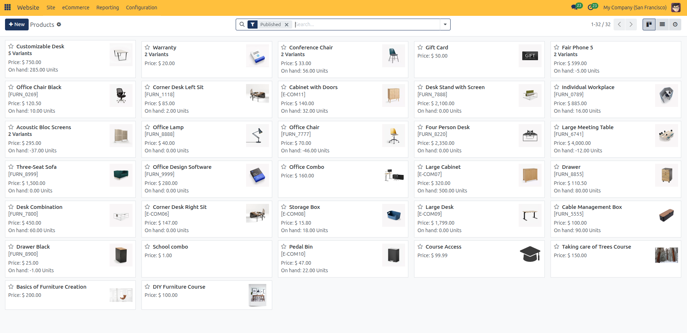

You can publish or unpublish a product using either of two methods:

* **From the Product Form**:
  1. In the top administrative bar, click **eCommerce** > **Products** > **Products**.
     * *Catalog Search Tip*: This view filters for **Published** products by default. If your product is currently unpublished, remove the **Published** filter chip from the search bar to locate it.
  2. Click on the product row to open its form view.
  3. Switch to the **Sales** tab.
  4. Under the **Ecommerce Shop** section:
     * **Is Published**: Check this box to make the product visible to shoppers in `/shop`. Uncheck it to hide the product from the public catalog.
     * **Website**: Leave blank to publish across all websites, or select a specific website domain in multi-website databases.

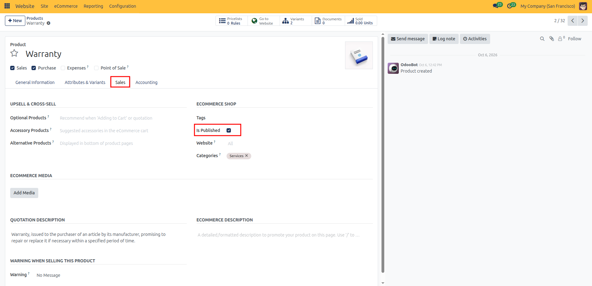

* **From Product Pages Kanban View**:
  1. In the top administrative bar, click **Site** > **Products**.
  2. Click the **Kanban view** switcher icon in the upper-right corner.
  3. On the target product card, click the interactive **Published / Not Published** toggle switch in the footer to change its status instantly without opening the product form.

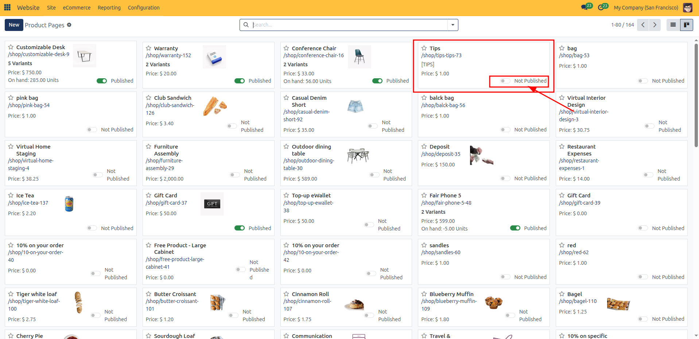

### Product Merchandising & Media

When editing a product (**eCommerce** > **Products** > **Products**), configure promotional presentation and upselling rules across the **General Information** and **Sales** tabs:

> For comprehensive field definitions, upsell mechanisms, and media specifications, see [**Website Page, Product, and Reporting Field Definitions**](../settings-and-fields/05-website-page-product-and-reporting-field-definitions.md).

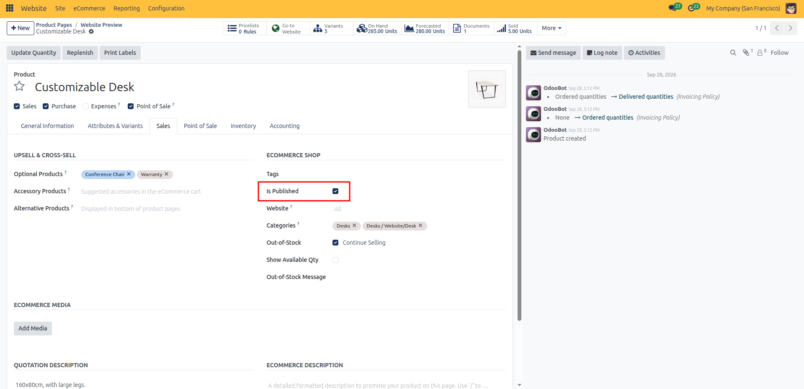

* **Compare to Price** (`General Information` tab): Set an original baseline price to display a strikethrough comparison *(e.g., ~~$120~~ $99)*, visually highlighting promotional discounts to shoppers.
* **Alternative Products** (`Sales` tab > **Upsell & Cross-sell**): Select related products to display as recommendations at the bottom of the product detail page under *"Alternative Products"*.
* **Accessory Products** (`Sales` tab > **Upsell & Cross-sell**): Select add-on items suggested in the shopping cart pop-up drawer when customers add this item to their cart.

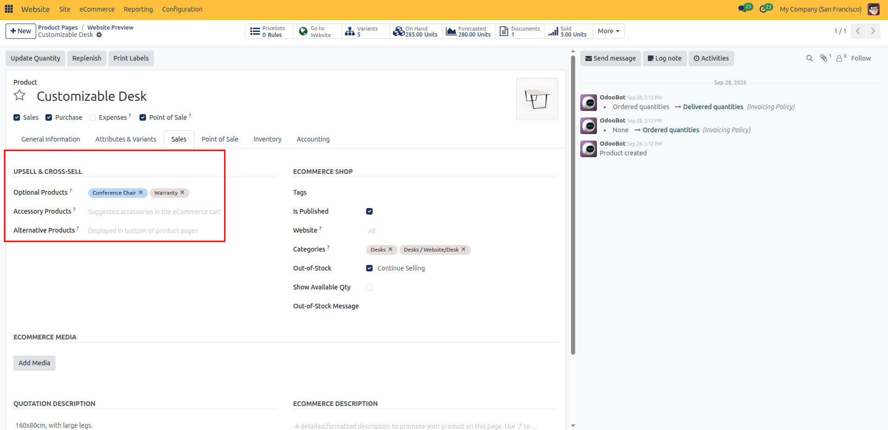

When shoppers add items with configured optional or accessory products to their cart, CURQ displays a configuration modal showcasing available add-ons directly before checkout:

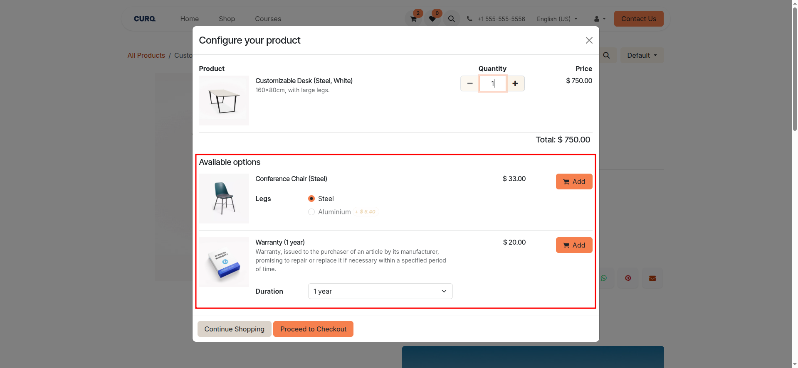

* **eCommerce Media** (`Sales` tab > **eCommerce Media**): Click **Add Media** to upload additional high-resolution images or embed video links for the product page image gallery.

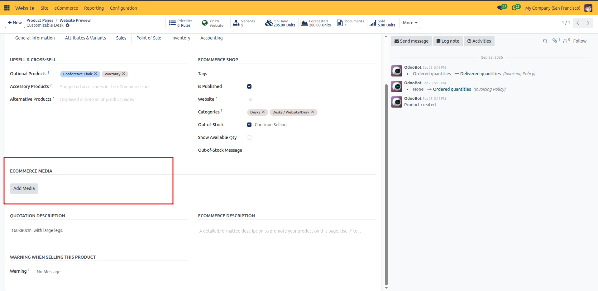

* **eCommerce Description** (`Sales` tab > **Ecommerce Description**): Enter formatted rich-text marketing copy to showcase product specifications and features directly on the `/shop` product page.

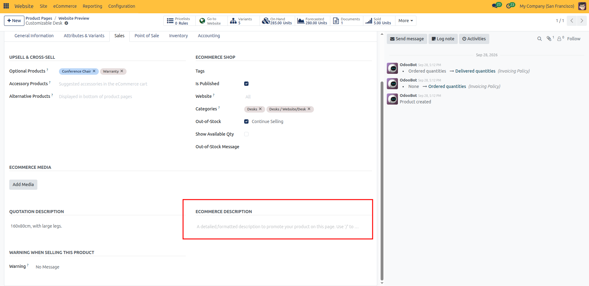

### Pricelists & Web Pricing Rules

General pricelist creation, pricing formulas, and wholesale tiers are managed in Sales; for complete setup instructions, see [**Configuring Pricelists and Pricing Rules**](../../Sales/task-guides/08-configure-pricelists-and-pricing-rules.md).

Under **eCommerce** > **Products** > **Pricelists**, view and configure website-specific pricing rules:

> For pricelist parameters, promo code syntax, and multi-currency rules, see [**Website Page, Product, and Reporting Field Definitions**](../settings-and-fields/05-website-page-product-and-reporting-field-definitions.md).

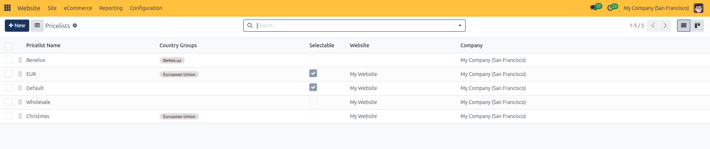

Open any pricelist to configure options under the **Price Rules** and **Ecommerce** tabs:

* **Price Rules Tab**: Define percentage discounts, formula margins, or fixed prices for specific products or entire catalogs:

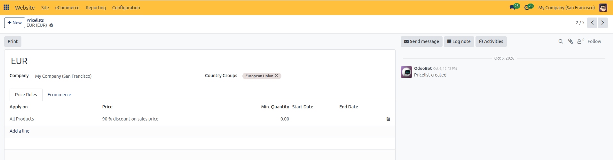

* **Ecommerce Tab**:
  * **Website**: Restrict the pricelist to a specific website domain, or leave blank to make it available across all websites.
  * **Selectable**: Enable this option to let online shoppers manually choose this pricelist from the website currency and pricing dropdown menu.
  * **Code / E-commerce Promotional Code**: Enter a promotional code *(e.g., `EU`)* that automatically activates this pricelist when entered during online checkout or visited via promotional link.

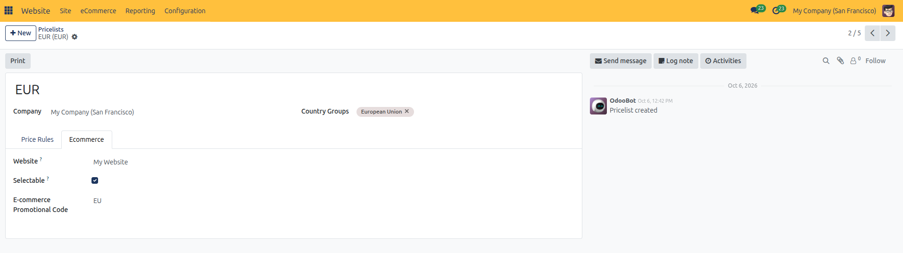

#### Shopper Experience with Selectable Pricelists and Promo Codes

* **Selectable Pricelist Dropdown**: When **Selectable** is enabled, shoppers can switch pricing and currencies from the dropdown located on the catalog page or individual product pages:

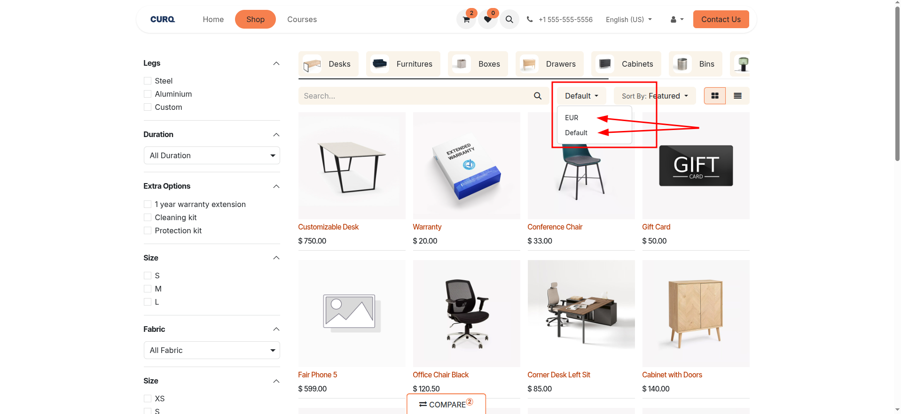

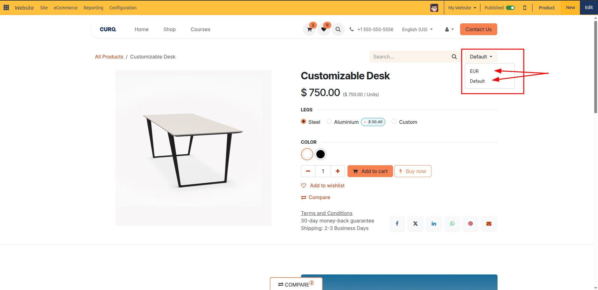

* **Applying Promotional Codes at Checkout**:
  * Standard catalog orders display regular base pricing:

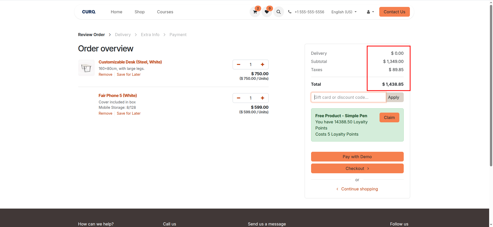

  * When shoppers enter the promotional code into the **Gift card or discount code** field and click **Apply**, CURQ recalculates the order lines using the discount rules defined on the pricelist:

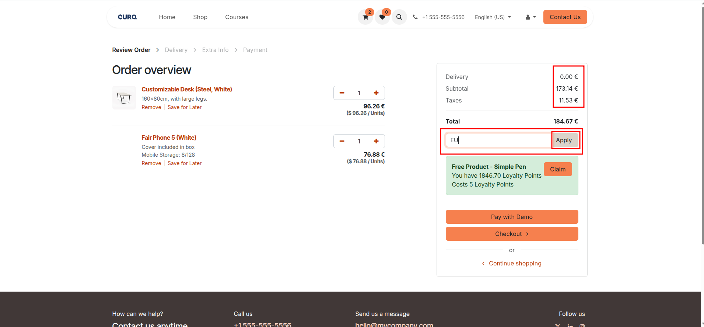

### eCommerce Categories

Organize how items are grouped and navigated in your online store (`/shop`):

> For category hierarchy settings and navigation properties, see [**Website Page, Product, and Reporting Field Definitions**](../settings-and-fields/05-website-page-product-and-reporting-field-definitions.md).

1. In the top administrative bar, click **eCommerce** > **Products** > **eCommerce Categories**.

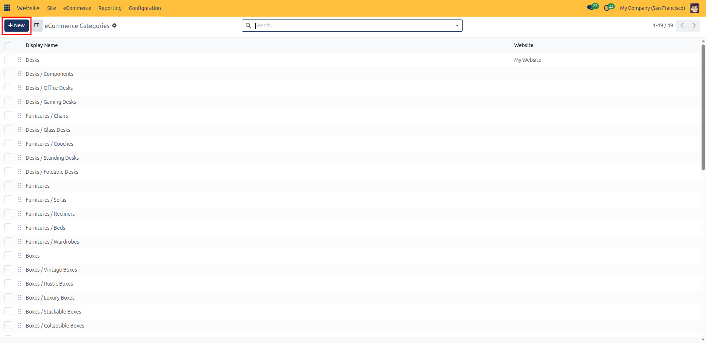

2. Click **New** to create a category, or select an existing one to edit.
3. Configure category settings:
   * **Category Image**: Upload an image or icon representing the category.
   * **Name**: Enter the category title displayed in store navigation *(e.g., `Desks`)*.
   * **Parent Category**: Select a parent category to create nested hierarchical menus and breadcrumbs.
   * **Website**: Restrict the category to a specific website, or leave blank to display across all websites.
   * **Description**: Enter promotional or informational text displayed on the category browsing page.

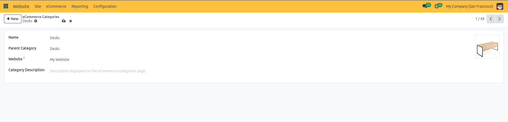

4. Click **Save**.
5. **Assigning to Products**: Open any product (**eCommerce** > **Products** > **Products**), switch to the **Sales** tab, and select one or more categories in the **Categories** field under **Ecommerce Shop**. Items immediately appear in those category navigation aisles on your website (`/shop`).

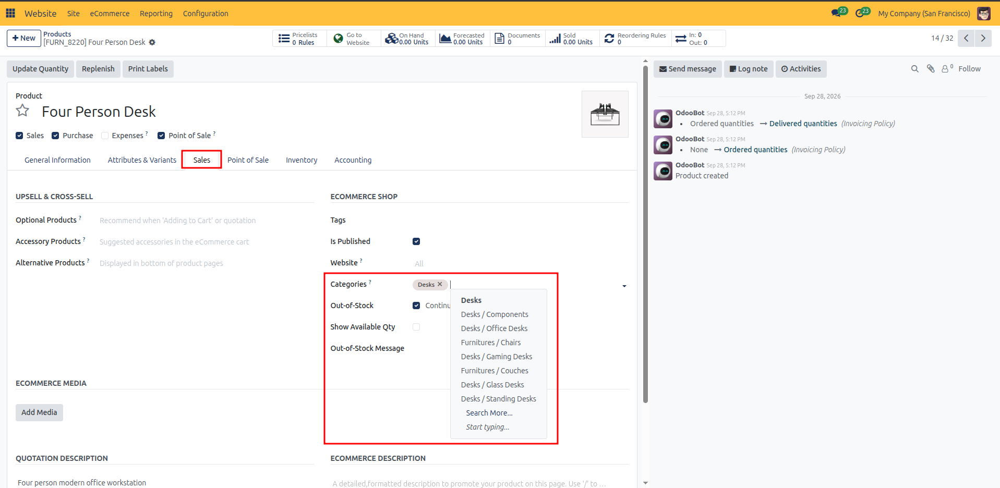

### Attributes, Combo Choices & Tags

General variant attributes, combo choices, and product tags are managed in Sales; for complete setup instructions, see [**Configuring Product Attributes and Variants**](../../Sales/task-guides/06-configure-products-and-variants.md), [**Combo Choices Setup**](../../Sales/task-guides/10-configure-product-combos.md), and [**Product Tags Setup**](../../Sales/task-guides/07-configure-product-categories-and-tags.md).

Under **eCommerce** > **Products**, configure variant options, bundling, and catalog tags with website-specific settings:

#### Attributes (`eCommerce > Products > Attributes`)

Configure product attributes and their visibility in the online store:

> For attribute display types, facet visibility modes, and ribbon styling options, see [**Website Page, Product, and Reporting Field Definitions**](../settings-and-fields/05-website-page-product-and-reporting-field-definitions.md).

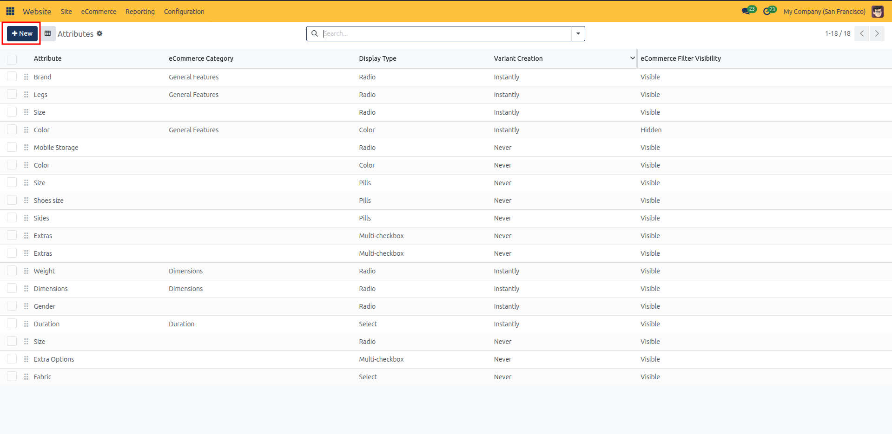

Open an attribute to configure its website controls:

* **eCommerce Filter**:
  * Set to **Hidden** to keep the attribute selectable on individual product pages while hiding it from the `/shop` sidebar filter list:

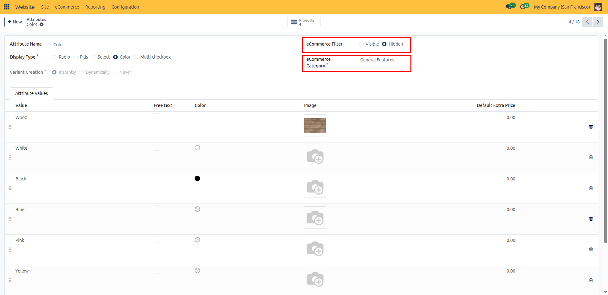

  * Set to **Visible** *(default)* to include the attribute as an interactive filtering facet in the `/shop` sidebar:

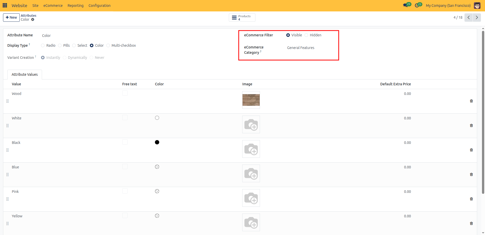

* **eCommerce Category**: Assign an attribute category *(such as `General Features` or `Dimensions`)* to group related attributes into structured sections on the product comparison page (`/shop/compare`) and the frontend specifications table.

#### Shopper Experience with Attribute Filters

When attributes are set to **Visible**, shoppers can filter catalog products directly from the left sidebar on `/shop`:

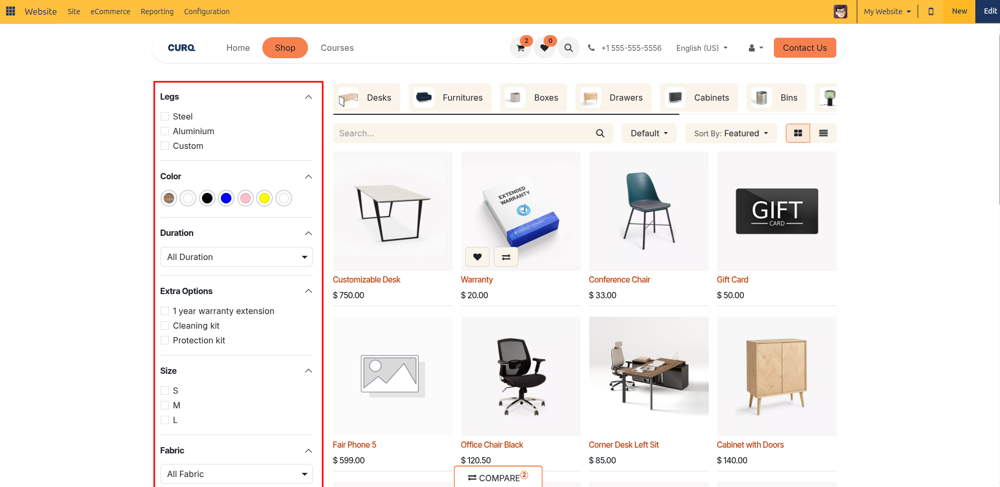

Selecting an attribute facet immediately refines the displayed product catalog:

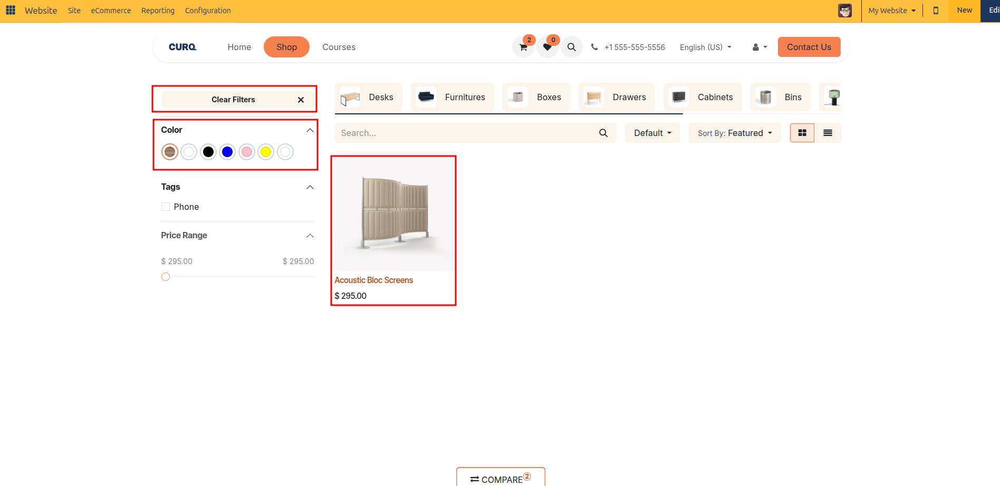

#### Combo Choices (`eCommerce > Products > Combo Choices`)

Group complementary products into combo choices or packaged sets for promotional website ordering:

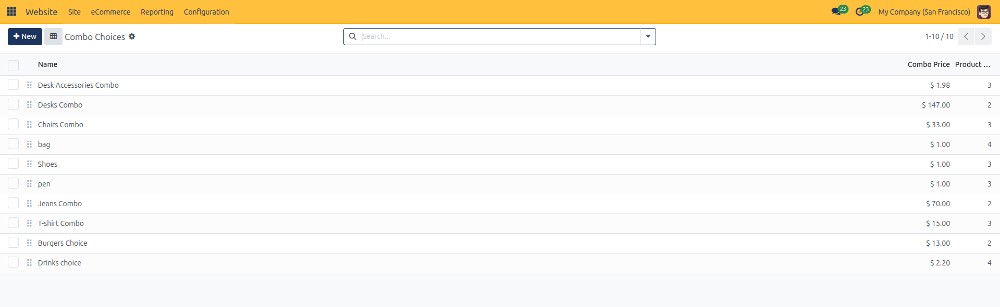

Click **New** or open an existing combo choice to configure the bundled product lines and extra prices:

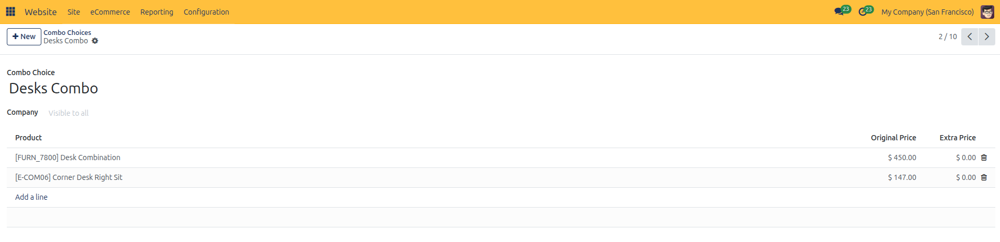

When ordering a combo product online, shoppers can customize each bundle selection in a dedicated modal:

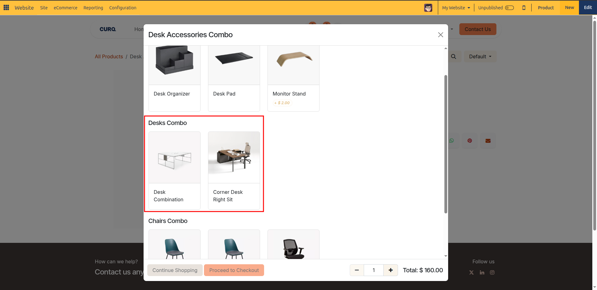

#### Product Tags (`eCommerce > Products > Product Tags`)

Create searchable tags to classify catalog items and showcase badge highlights on website product cards:

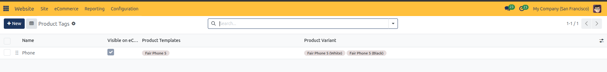

Open a tag to configure its website display options:

* **Visible on eCommerce**: Check this box to display the tag badge on website product cards and product pages. Uncheck to keep the tag strictly internal.
* **Color / Image**: Choose a badge color or upload a custom image/icon badge *(uploading an image overrides the badge color on the website)*.

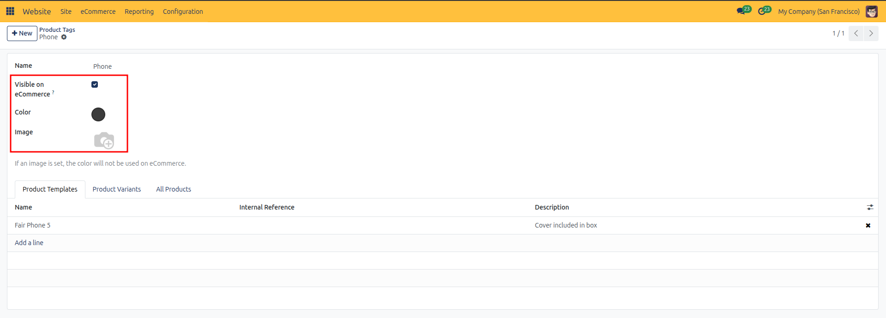

When enabled, tag badges display directly on the website product page:

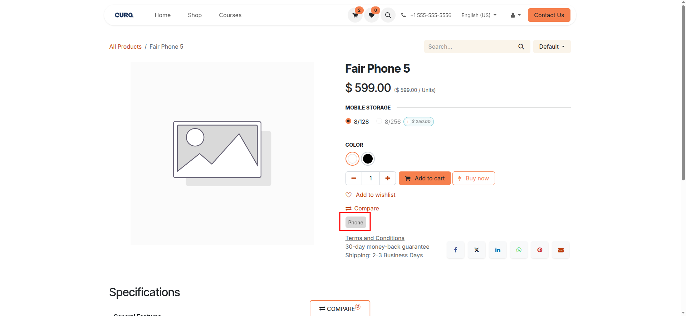

Online shoppers can also use tags as filtering facets in the store sidebar:

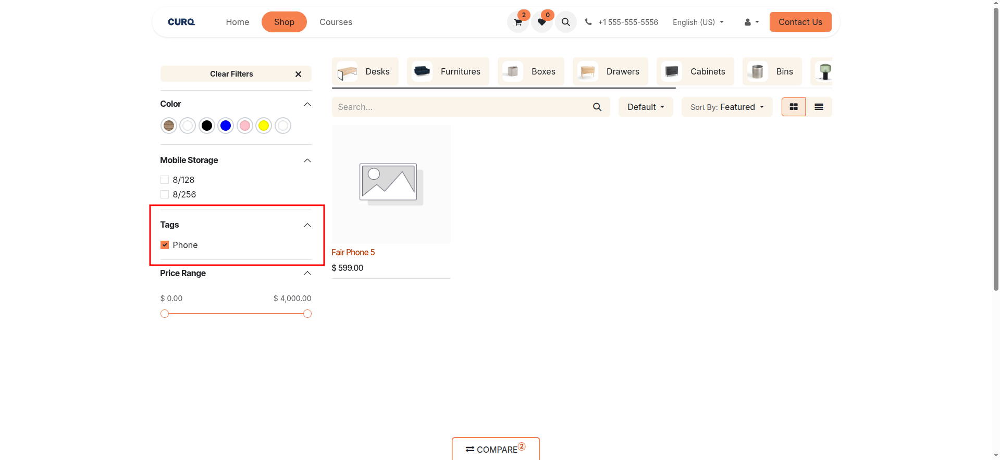

### Product Ribbons

Highlight specific items on the website with visual badge ribbons *(such as "Sale", "New!", "Sold out", or "Out of stock")*:

#### Defining Ribbons

1. In the top administrative bar, click **eCommerce** > **Products** > **Product Ribbons**.

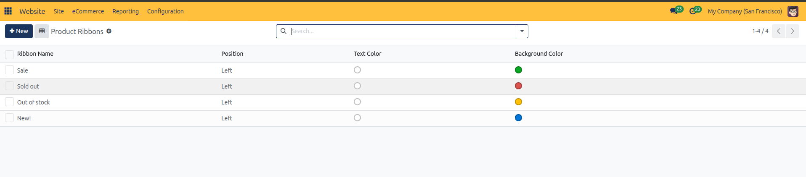

2. Click **New** to define a ribbon badge:
   * **Ribbon Name**: Enter the text displayed directly on the badge *(e.g., `Sale`, `New!`, `Featured`)*.
   * **Position**: Choose **Left** or **Right** to control badge placement on the product card.
   * **Background Color**: Select the badge background color using the color picker *(defaults to black `#000000`)*.
   * **Text Color**: Select the text font color using the color picker *(defaults to white `#FFFFFF`)*.

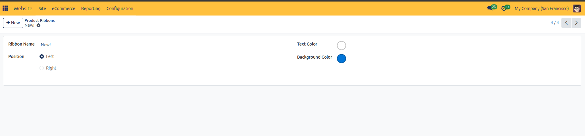

3. Click **Save**.

#### Applying a Ribbon to a Product

Ribbons cannot be assigned inline from backend list views (the product list view is read-only for ribbons, and the backend form view hides the field behind Developer Mode). 

To apply a ribbon to a product as a standard user:

1. Open the website store catalog by navigating to `/shop`.
2. Click **Edit** in the top navigation bar to open the website builder.
3. Click on the product card inside the catalog grid (`#products_grid`).
4. In the right-hand **Customize** sidebar under product options, click the **Ribbon** dropdown.

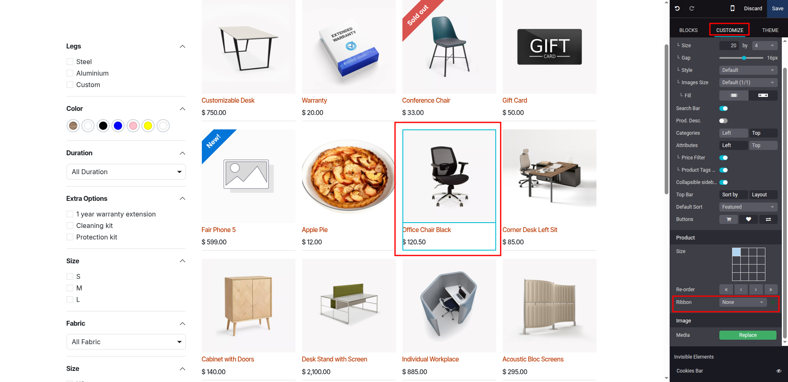

5. Select the desired ribbon *(such as `Sale`, `New!`, `Sold out`, or `Out of stock`)*, or choose **None** to remove an assigned ribbon.
   * You can also click the **`+`** (create) button next to the dropdown to define and style a new ribbon directly from the sidebar.

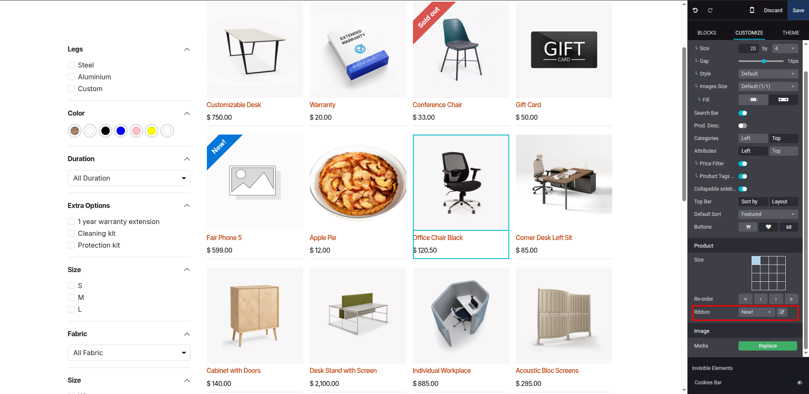

6. Click **Save** in the top bar. The ribbon badge immediately displays on the product card:

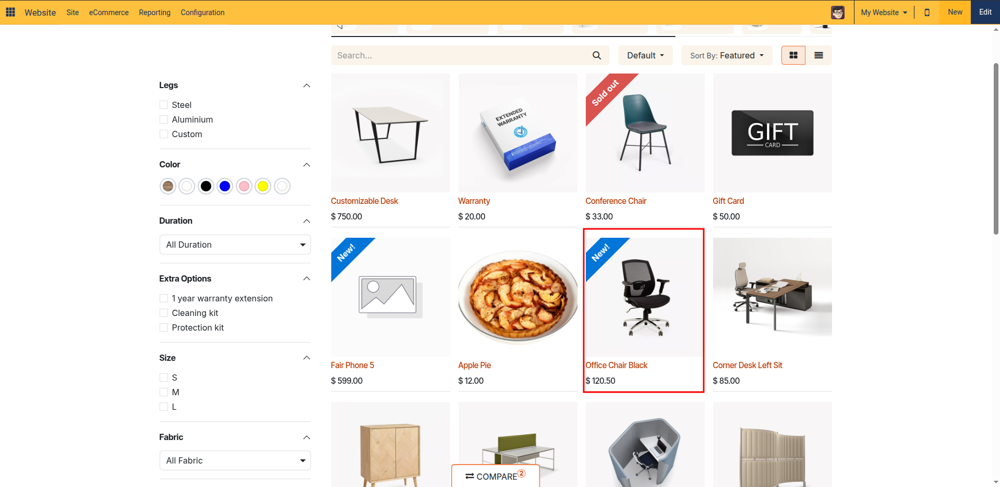

*(Note: In the backend, the `Ribbon` field on the product template form view is restricted to Developer Mode. When Developer Mode is active, the Ribbon field appears under the **Sales** tab > **Ecommerce Shop** section).*

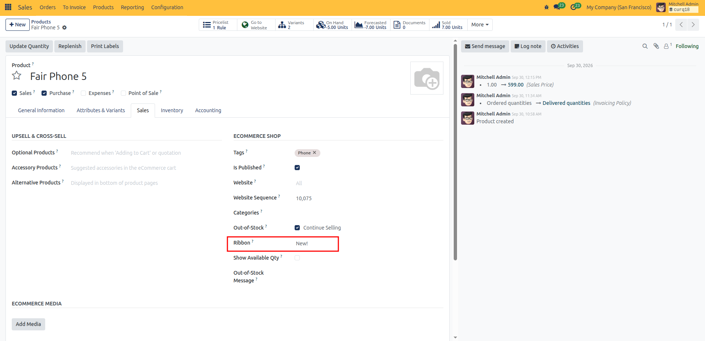

---

## Related Documentation

* [Publish and Manage Products and Courses](./06-publish-and-manage-products-and-courses.md)
* [Configure Discounts, Loyalty Programs, and Gift Cards](./09-configure-discounts-loyalty-and-gift-cards.md)
* [Website Page, Product, and Reporting Field Definitions](../settings-and-fields/05-website-page-product-and-reporting-field-definitions.md)
* [eCommerce Shop and Checkout Settings](../settings-and-fields/02-ecommerce-shop-and-checkout-settings.md)

