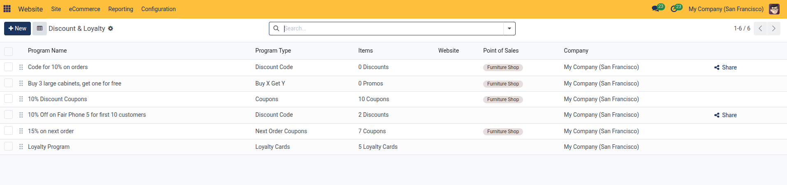
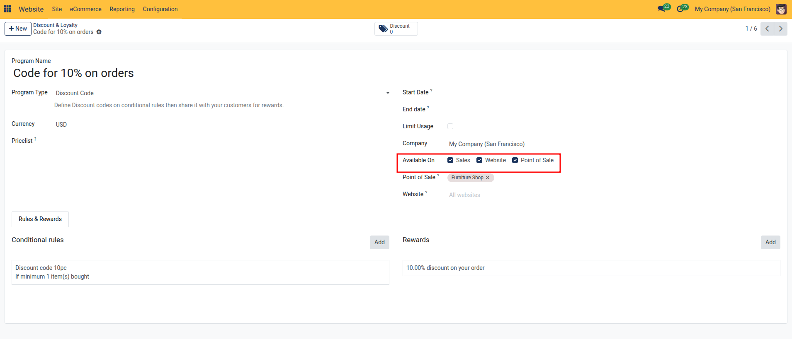
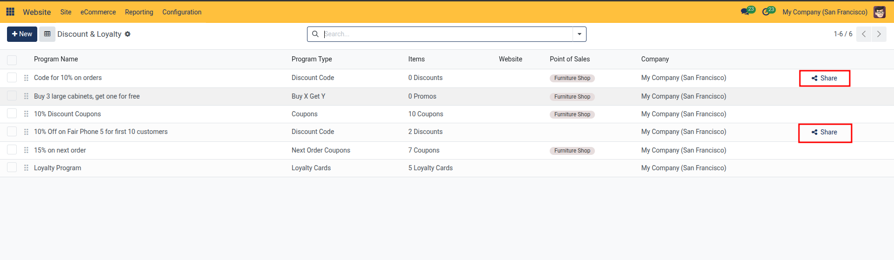
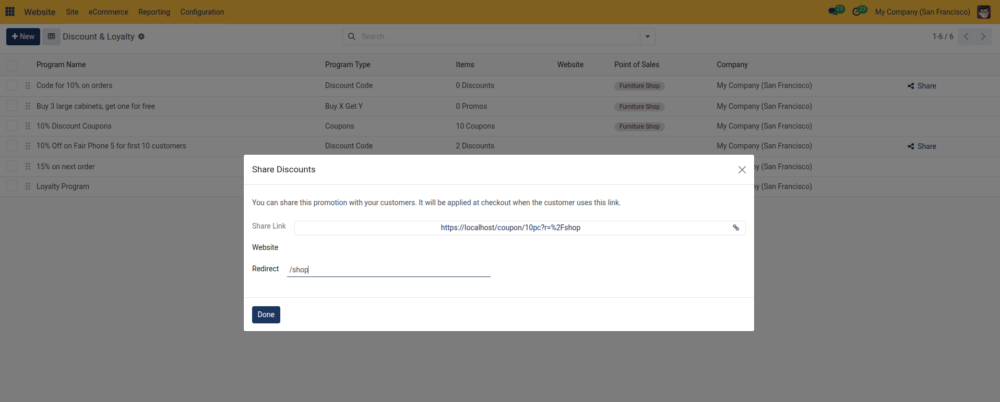
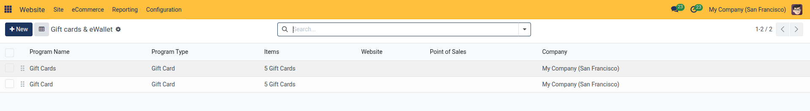
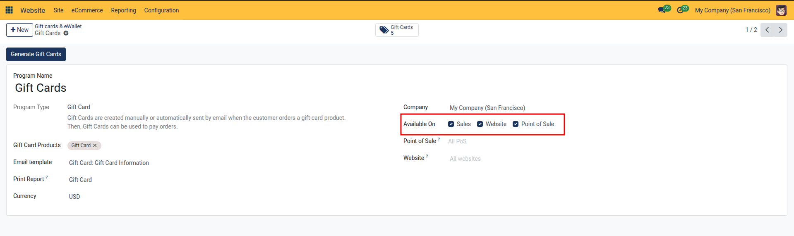

# Configure Discounts, Loyalty Programs, and Gift Cards

This guide covers setting up customer loyalty rewards, promotional discount coupons, e-gift cards, and shareable discount links on your online store.

## Task 1: Enabling or Disabling Programs for the Website

General promotional campaigns, loyalty programs, and gift card generation are managed in Sales; for complete setup instructions, see [Pricing, Pricelists, and Discount Specifications](../../Sales/settings-and-fields/02-pricing-pricelists-and-discount-specifications.md) and [eCommerce Shop and Checkout Settings](../settings-and-fields/02-ecommerce-shop-and-checkout-settings.md).

> For detailed reward structures, point calculation formulas, and gift card field definitions, see [eCommerce Shop and Checkout Settings](../settings-and-fields/02-ecommerce-shop-and-checkout-settings.md) and [Pricing, Pricelists, and Discount Specifications](../../Sales/settings-and-fields/02-pricing-pricelists-and-discount-specifications.md).

All promotional, coupon, and gift card programs share the same master records between Sales and eCommerce. To control whether a program is active on your website:

1. In the top administrative bar, navigate to the target menu under **eCommerce** > **Loyalty**:
   * Click **Discount & Loyalty** for promotional codes, coupons, loyalty point schemes, or Buy X Get Y programs.
   * Click **Gift cards & eWallet** for digital gift cards and prepaid electronic wallets.

2. Click on the target program *(e.g., `Code for 10% on orders` or `Gift Card`)* to open its form view.
3. Locate the **Available On** section on the right side of the form:
   * **To Enable for Website**:
     1. Check the **Website** checkbox. This immediately activates the promotion or gift card program for online shoppers during `/shop` checkout.
     2. *(Optional Website Restriction)*: In the **Website** dropdown that appears directly below the checkbox, leave it blank (*All websites*) to allow redemption across all websites, or select a specific website domain in multi-website databases.
   * **To Disable for Website**:
     1. Uncheck the **Website** checkbox.
     2. The program is immediately deactivated for the website. Shoppers will no longer be able to apply promo codes, earn points, or redeem gift cards/eWallets during checkout.

4. Click the manual save icon or navigate away to save changes.

## Task 2: Program Types and Website Capabilities

* **Discount & Loyalty**:
  * **Share Promo Code Link**: In the **Discount & Loyalty** list view, click the **Share** button *(share icon)* on any Discount Code row to copy a direct URL that automatically applies the promo code to the customer's online shopping cart. *(The Share button appears only in the list view for Discount Code programs and is not present on the form view)*.

Clicking **Share** opens the **Share Discounts** dialog, providing the direct promotional link and target redirect route *(such as `/shop`)*:

* **Gift cards & eWallet**:

  * **Selling Gift Cards Online**: In the program form, ensure the item specified in the **Gift Card Products** field is published (**eCommerce** > **Products** > **Products** > **Sales** tab > check **Is Published**). When purchased online, CURQ automatically generates and emails the gift card code using the configured **Email template**.
  * **Online Checkout Redemption**: Ensure **Available On > Website** is checked so shoppers can enter their gift card code or pay using their eWallet balance directly in the website checkout interface.

---

## Related Documentation

* [Set Up an eCommerce Storefront and Checkout](../getting-started/02-set-up-an-ecommerce-storefront-and-checkout.md)
* [Configure Product Attributes, Ribbons, and Categories](./08-configure-product-attributes-ribbons-and-categories.md)
* [Website Page, Product, and Reporting Field Definitions](../settings-and-fields/05-website-page-product-and-reporting-field-definitions.md)
* [eCommerce Shop and Checkout Settings](../settings-and-fields/02-ecommerce-shop-and-checkout-settings.md)

