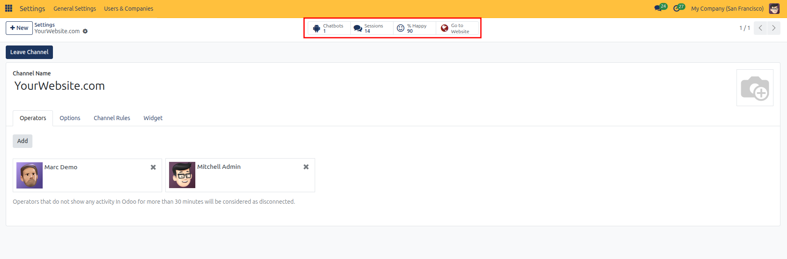
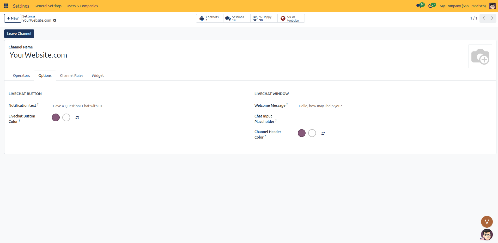
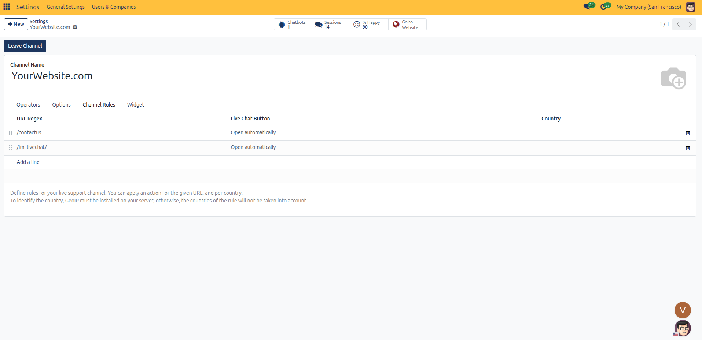
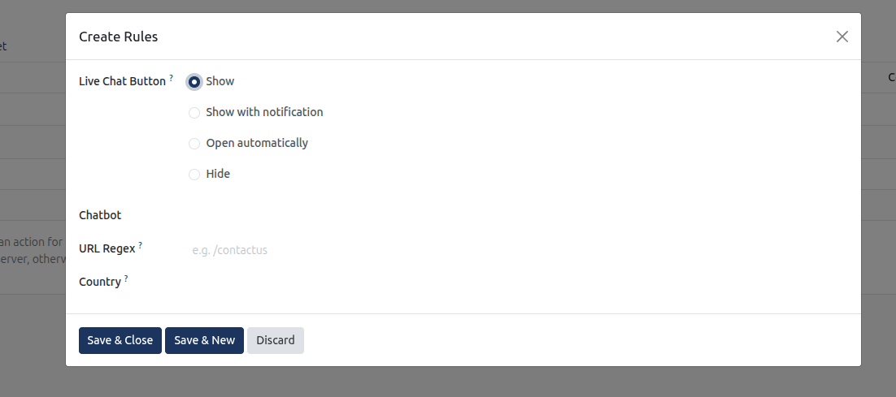
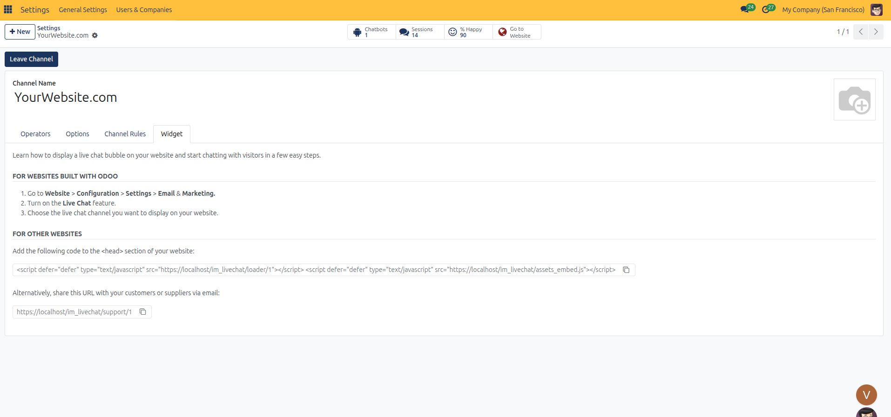
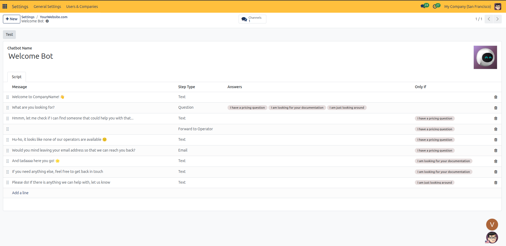
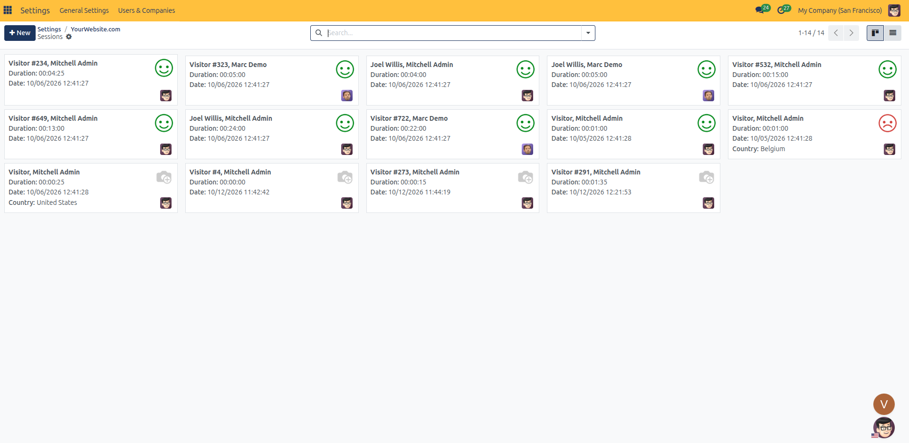
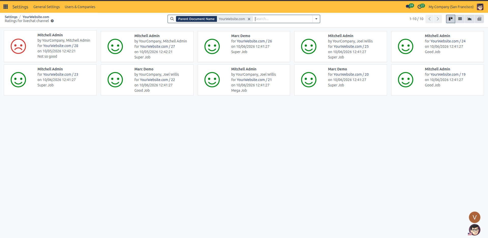

# Configure Live Chat and Visitor Chatbots

This guide details how to configure the website live chat widget, assign operators, build automated chatbot decision trees, manage display rules, and monitor visitor satisfaction in CURQ 18.

> **Prerequisites**
> * Active user account with **Website / Administrator** rights.
> * Active enterprise user profiles configured in the corporate directory.
>
> **Warning (Configuration Advisory):** Modifying live chat and chatbots requires administrative privileges. Because misconfiguration can lead to operational disruptions or workflow errors, configuration by a user administrator with the assistance of an authorized CURQ advisor or consultant is advised.

---

## 1. Live Chat Widget Setup and Configuration

### 1.1 Enable the Live Chat Widget on Your Website
Checking **Allows your visitors to chat with you** injects the CURQ Live Chat widget onto the storefront:

> For complete field definitions, channel attributes, and operator timeout rules, see [**Website Page, Product, and Reporting Field Definitions**](../settings-and-fields/05-website-page-product-and-reporting-field-definitions.md).

* **Channel Selection**: In the **Channel** field, select the operational channel *(such as `YourWebsite.com`)* assigned to this website.
* **Operator Routing**: Incoming chats route directly to assigned staff members active in the Live Chat application.
* **Display Rules**: The selected channel governs widget visibility rules, button color palettes, automated welcome messages, and target website URLs.

Clicking the arrow icon next to the **Channel** dropdown opens the centralized Live Chat channel manager:

#### 1.1.1 Channel Header and Analytical Smart Buttons
* **Smart Buttons**:
  * **Chatbots**: Displays linked conversational flow bots *(e.g., `Chatbots 1`)*.
  * **Sessions**: Tracks total visitor conversation sessions *(e.g., `Sessions 14`)*.
  * **% Happy**: Aggregates visitor satisfaction percentage *(e.g., `% Happy 90`)*.
  * **Go to Website**: Opens the front-end website to preview the live chat widget in real time.
* **Leave Channel Button**: Allows the logged-in administrator to unassign themselves from the active operator roster.

#### 1.1.2 Configure Assigned Channel Operators
* **Operators List**: Displays active operators responding to visitor inquiries *(e.g., `Marc Demo`, `Mitchell Admin`)*. Click **Add** to assign internal users, or click the **x** icon on any operator card to unassign them.
* **Automatic Disconnection Note**: A system notice at the bottom informs users that operators showing no activity in CURQ for more than 30 minutes are automatically treated as disconnected to prevent routing incoming chats to inactive users.

### 1.2 Configure Widget Aesthetics and Greeting Options
Configure customer-facing aesthetics and greeting copy for the floating widget:

> For widget styling properties, color palettes, and greeting parameters, see [**Website Page, Product, and Reporting Field Definitions**](../settings-and-fields/05-website-page-product-and-reporting-field-definitions.md).

* **Livechat Button**:
  * **Notification text**: Enter prompt text appearing next to the floating bubble *(default `Have a Question? Chat with us.`)*.
  * **Livechat Button Color**: Use the color picker to set the background tone and icon hue of the collapsed button.
* **Livechat Window**:
  * **Welcome Message**: Automated greeting displayed to the visitor upon opening the chat *(default `Hello, how may I help you?`)*.
  * **Chat Input Placeholder**: Optional guide text inside the composition box prompting user input.
  * **Channel Header Color**: Sets the theme color for the title banner on the expanded chat window.

### 1.3 Define Display Rules and Geographic Targeting
Define URL path triggers, automated popup actions, and geographic restrictions governing when the chat window displays:

> For regex trigger syntax, display actions, and GeoIP country rules, see [**Website Page, Product, and Reporting Field Definitions**](../settings-and-fields/05-website-page-product-and-reporting-field-definitions.md).

Clicking **Add a line** or selecting an existing rule row opens the **Create Rules** modal:

Configure rule parameters across the dialog:
* **Live Chat Button**: Select the operational display behavior on matching pages:
  * **Show**: Displays the standard collapsed floating chat button in the corner of the browser.
  * **Show with notification**: Displays the chat button accompanied by a notification text prompt.
  * **Open automatically**: Automatically expands the conversational window upon page load to prompt immediate visitor interaction.
  * **Hide**: Completely hides the live chat button on matching pages.
* **Chatbot**: Optionally assign a designated automated bot *(such as `Welcome Bot`)* to engage the visitor on this route before transferring to human operators.
* **URL Regex**: Enter the target URL path expression *(for example, `/contactus`)*.
* **Country**: Select a specific country to restrict rule execution geographically *(requires server GeoIP lookup)*.

## 2. Integrate the Live Chat Widget Across Domains
Review integration methods for native and third-party web properties:

* **Websites Built with CURQ**: Managed directly via **Website** > **Configuration** > **Settings** under **Email & Marketing**.
* **External Websites**: Copy the provided `<script>` embed code to deploy the live chat bubble on external non-CURQ domains.
* **Direct Shareable URL**: Provides a permanent web chat URL *(e.g., `https://localhost/im_livechat/support/1`)* for inclusion in email signatures or direct support correspondence.

---

## 3. Build Automated Chatbot Scripts and Monitor Quality

### 3.1 Conversational Chatbot Builder
Clicking the **Chatbots** smart button on the channel form opens the linked automated conversational bot:

> For chatbot step types, conditional branching rules, and satisfaction metrics, see [**Website Page, Product, and Reporting Field Definitions**](../settings-and-fields/05-website-page-product-and-reporting-field-definitions.md).

* **Test Button**: Launches an interactive preview window to validate conversational branches.
* **Script Structure**:
  * **Message**: Bot prompts sent to the visitor *(e.g., `Welcome to CompanyName!`, `What are you looking for?`)*.
  * **Step Type**: Functional behavior of the node, including **Text**, **Question**, **Email**, and **Forward to Operator**.
  * **Answers**: Interactive clickable choice pills presented to the visitor *(e.g., `I have a pricing question`, `I am looking for your documentation`, `I am just looking around`)*.
  * **Only If**: Branch condition evaluating previous visitor selections to trigger relevant sub-paths.

### 3.2 Monitoring Visitor Chat Sessions
Clicking the **Sessions** smart button displays the archive of visitor conversations:

* Each session card records the visitor identifier, assigned operator, total talk duration, timestamp, customer country, and satisfaction rating.

### 3.3 Customer Satisfaction Ratings
Clicking the **% Happy** smart button opens the feedback quality dashboard:

* Tracks operator ratings with positive, neutral, or negative feedback cards alongside customer feedback notes *(e.g., `Super Job`, `Good Job`, `Not so good`)*.

---

> **Tip (Advised Settings):** Configure automated welcome messages, fallback email prompts, and clear operating hours on public chat channels.

---

## Related Documentation

* [Track Visitors and Analyze Web Reporting](./13-track-visitors-and-analyze-web-reporting.md)
* [Configure Privacy, Cookies, and Compliance Policies](./12-configure-privacy-cookies-and-compliance.md)
* [Website Page, Product, and Reporting Field Definitions](../settings-and-fields/05-website-page-product-and-reporting-field-definitions.md)
* [Website Configuration and Domain Settings](../settings-and-fields/01-website-configuration-and-domain-settings.md)
