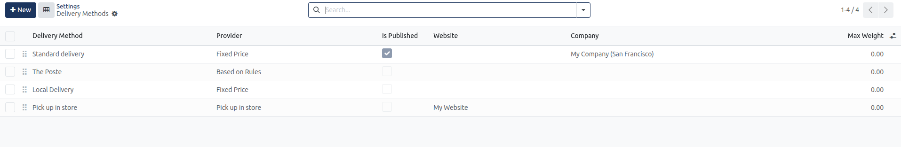
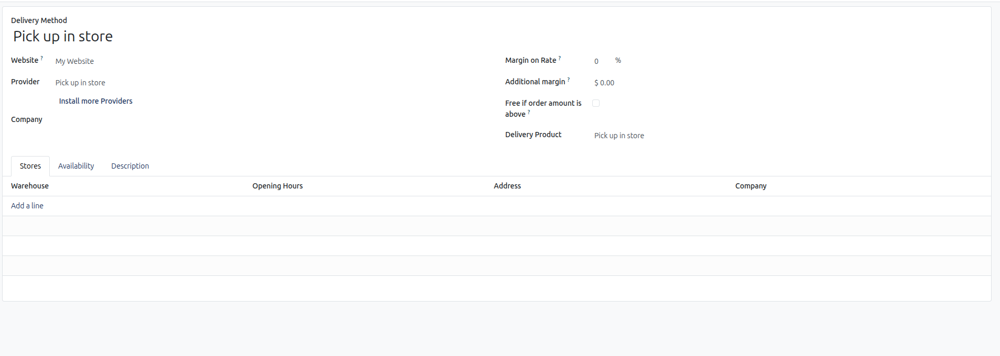
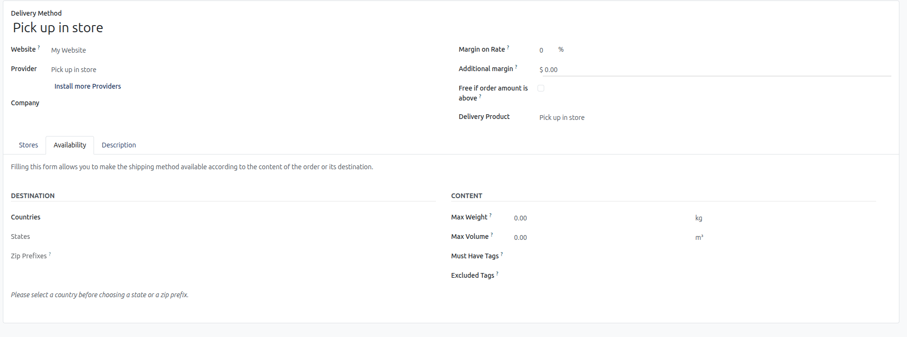

# Configure Delivery Methods and Shipping Zones

This guide covers setting up fixed and rule-based shipping methods, defining delivery zones, and enabling free shipping thresholds and in-store pickup in CURQ 18.

> **Prerequisites**
> * **Administration**: User must have **Settings** rights to access and modify system configurations.
> * **Website**: User must have **Editor and Designer** access rights to manage eCommerce settings.
> * **eCommerce Application**: The **eCommerce** app must be installed in the database to display the Delivery settings block.

---

## 1. Configure Delivery Addresses and Shipping Methods

### 1.1 Enable Delivery Addresses and Shipping Fee Calculation

Configure customer address handling and dynamic shipping cost computation:

> For field explanations, allowed values, and delivery setting definitions, see [**Delivery, Shipping, and Store Pickup Settings**](../settings-and-fields/03-delivery-shipping-and-store-pickup-settings.md).

1. In the backend, open the **Website** application.
2. Click **Configuration** > **Settings**.
3. In the header bar under **Settings of Website**, select your target website *(for example, `My Website`)*.
4. Scroll down to the **Delivery** configuration block.
5. Check **Shipping Address** to allow customers to specify an independent delivery destination when different from their billing address.
6. Check **Shipping Costs** to calculate automated shipping fees on customer shopping carts.

---

### 1.2 Configure Delivery Methods and Free Shipping Thresholds

Define shipping providers, flat-rate options, tiered rules, and free delivery thresholds:

> For carrier column definitions, provider calculation modes, and weight limits, see [**Delivery Methods Specification**](../settings-and-fields/03-delivery-shipping-and-store-pickup-settings.md).

1. Under the **Shipping Costs** setting, click the **Delivery Methods** link button *(or navigate to `Website` > `Configuration` > `eCommerce` > `Delivery Methods`)*.

   

2. Click **New** to create a delivery carrier, or click an existing carrier *(such as `Standard delivery`)* to edit its parameters.
3. Configure the provider options:
   * **Delivery Method**: Enter the customer-facing name displayed at checkout.
   * **Provider**: Select **Fixed Price** for flat-rate shipping, **Based on Rules** for tiered pricing by weight/volume/price, or **Sendcloud** for automated parcel rate integration.
   * **Free Shipping**: Check **Free if order amount is above** and enter the qualifying threshold *(e.g., `$ 100.00`)* to offer promotional free delivery.
   * **Website**: Restrict carrier availability to a specific website domain or leave blank for all sites.
   * **Max Weight**: Set optional weight ceilings for freight carriers.
4. Click the **Publish** button to toggle the method to published so online shoppers can select it during checkout.

---

## 2. Set Up Click & Collect In-Store Pickup

Allow local customers to collect their orders at physical retail stores and pay on-site:

> For warehouse address fields, opening hours, geographic destination rules, and package dimension limits, see [**Click & Collect and Store Pickup Parameters**](../settings-and-fields/03-delivery-shipping-and-store-pickup-settings.md).

1. In **Website** > **Configuration** > **Settings** > **Delivery**, check the **Click & Collect** setting.
2. Navigate to **Website** > **Configuration** > **eCommerce** > **Delivery Methods** and open the **Pick up in store** method.

   

3. Under the **Stores** tab:
   * Click **Add a line** to add fulfillment warehouses.
   * Specify the physical fulfillment **Warehouse**, customer **Opening Hours**, location **Address**, and operating **Company**.

   

4. Under the **Availability** tab:
   * Set geographic restrictions by selecting allowed **Countries**, **States**, or entering **Zip Prefixes**.
   * Define parcel constraints with **Max Weight** and **Max Volume**.
   * Enforce product constraints with **Must Have Tags** or **Excluded Tags** *(e.g., exclude oversized merchandise from store collection)*.
5. Save the record and ensure the delivery method is published.

---

## 3. Save Settings and Test Checkout Fulfillment

Validate delivery method calculations in the live shopping cart:

1. Return to **Website** > **Configuration** > **Settings** and click **Save** in the top-left corner.
2. Open your website storefront (`/shop`) in live preview or private browsing.
3. Add a product to the cart and proceed to checkout.
4. In the checkout pipeline, enter a shipping address to confirm:
   * Independent delivery addresses save correctly.
   * Configured delivery methods calculate fees dynamically.
   * Free shipping thresholds trigger when cart values exceed the limit.
   * Click & Collect options display valid pickup stores.

---

## Related Documentation

* [Delivery, Shipping, and Store Pickup Settings](../settings-and-fields/03-delivery-shipping-and-store-pickup-settings.md)
* [Set Up an eCommerce Storefront and Checkout](../getting-started/02-set-up-an-ecommerce-storefront-and-checkout.md)
* [Manage Online Orders and Abandoned Carts](./07-manage-online-orders-and-abandoned-carts.md)
* [eCommerce Shop and Checkout Settings](../settings-and-fields/02-ecommerce-shop-and-checkout-settings.md)
