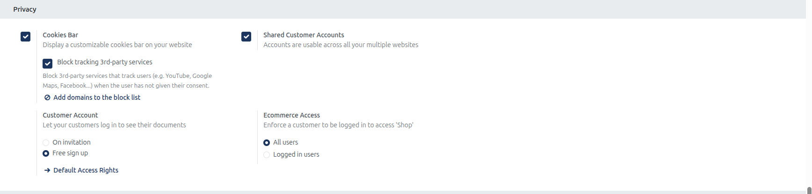
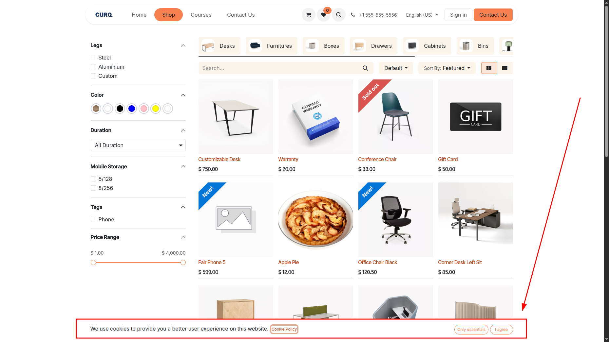
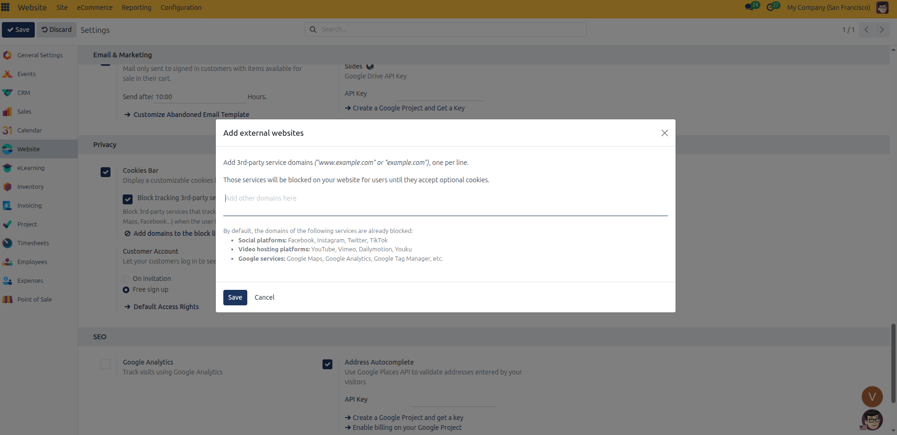

# Configure Privacy, Cookies, and Compliance Policies

This guide details configuring GDPR cookie consent banners, privacy policies, terms of service agreements, blocked tracking domains, and customer portal registration policies in CURQ 18.

---

## Prerequisites

* **Administration**: User must have **Settings** rights to access and modify system configurations.
* **Website**: User must have **Editor and Designer** access rights to manage website settings.

---

## Task 1: Enable and Customize the Cookie Consent Banner

Display a legal cookie consent banner informing visitors of site cookies:

> For field explanations, allowed values, and privacy setting specifications, see [Privacy, Cookie Compliance, and Account Settings](../settings-and-fields/04-privacy-cookie-compliance-and-account-settings.md).

1. In the backend, open the **Website** application.
2. Click **Configuration** > **Settings**.
3. In the header bar under **Settings of Website**, select your target website *(for example, `My Website`)*.
4. Scroll down to the **Privacy** configuration block.

   

5. Check **Cookies Bar** to activate the floating banner on the storefront.
6. When active, visitors arriving on any public web page see the consent bar anchored to the bottom of the viewport:

   

   * **Only essentials**: Limits cookies to required session data.
   * **I agree**: Grants full consent for analytics and third-party media.
   * **Cookie Policy Link**: Automatically links to `/cookie-policy`.

---

## Task 2: Block Third-Party Tracking and Add Blocked Domains

Prevent external platforms and embeds from loading until user consent is recorded:

> For default blocked platform lists, domain formatting syntax, and script behavior, see [Third-Party Tracking and Blocked Domains](../settings-and-fields/04-privacy-cookie-compliance-and-account-settings.md).

1. In **Website** > **Configuration** > **Settings** > **Privacy**, check **Block tracking 3rd-party services**.
   * CURQ automatically suppresses embeds from YouTube, Vimeo, Facebook, Twitter, and Google services until the visitor clicks **I agree**.
2. Click the **Add domains to the block list** button to launch the domain editor:

   

3. In the text area, enter any custom external service domains *(such as `www.example.com`)*, one per line.
4. Click **Save** to enforce domain blocks immediately.

---

## Task 3: Configure Customer Account Registration and Multi-Website Shared Logins

Regulate how customers onboard and authenticate across your web properties:

> For self-registration policies, default access rights, and cross-website credential rules, see [Customer Account Authentication Policies](../settings-and-fields/04-privacy-cookie-compliance-and-account-settings.md).

1. Under **Shared Customer Accounts**, check **Accounts are usable across all your multiple websites** if you operate multiple brand storefronts and want customers to authenticate globally with one set of credentials.
2. Under **Customer Account**, choose your onboarding policy:
   * **On invitation** *(B2B mode)*: Restricts registration. New portal users can only access their documents after staff dispatches an email invitation via **Contacts** > **Action** > **Portal Access Management**.
   * **Free sign up** *(B2C mode)*: Displays a **Sign up** link on the login page for public self-registration.
3. If Free sign up is enabled, click **Default Access Rights** to verify the permission groups assigned to newly registered customer accounts.

---

## Task 4: Restrict eCommerce Catalog Access to Logged-In Customers

Protect wholesale pricing or member catalogs behind account authentication:

> For public vs authenticated catalog visibility rules and redirect behaviors, see [eCommerce Access Restriction Policies](../settings-and-fields/04-privacy-cookie-compliance-and-account-settings.md).

1. Under the **Ecommerce Access** setting, choose storefront visibility:
   * **All users**: Entire storefront (`/shop`) and prices are open to anonymous guests.
   * **Logged in users**: Locks catalog browsing, product prices, and shopping carts behind portal login. Anonymous guests are automatically redirected to the login form.
2. Click **Save** in the top-left corner of the settings view to apply changes.

---

## Related Documentation

* [Privacy, Cookie Compliance, and Account Settings](../settings-and-fields/04-privacy-cookie-compliance-and-account-settings.md)
* [Website Configuration and Domain Settings](../settings-and-fields/01-website-configuration-and-domain-settings.md)
* [Manage Webpages and Redirections](./03-manage-webpages-and-redirections.md)
* [eCommerce Shop and Checkout Settings](../settings-and-fields/02-ecommerce-shop-and-checkout-settings.md)
